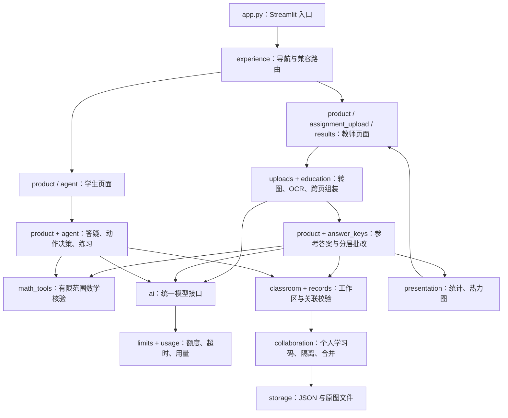

# 00｜现有项目全面审计

> 版本说明：本文件保留升级前的审计快照。当前已实施变化与验证范围见 docs/03_phase01_acceptance.md 至 docs/05_platform_upgrade.md；不要把历史缺陷复现直接当作当前版本仍有同一问题。

审计日期：2026-11-21（北京时间）。审计对象：当前目录 `D:\Agent\MindTrace循理AI-产品开发版` 的实际源码。

目标：围绕第二届全国人工智能应用创新大赛争取最高奖项所需的创新性、应用价值、可靠性、体验、演示与可验证成果，确定优先改进顺序。本次没有查阅赛事最新官方评分文件，因此文中的“比赛价值”是依据用户目标作出的工程判断，不是对官方评分或获奖概率的预测。

## 审计结论与证据边界

**项目已有可延续的产品基础：教师批量材料管理、分层批改、原始证据追溯、学生错题联动、受控教学 Agent 均有真实实现。最紧迫的问题是识别错误向下游传播、串行调用与默认额度不适配班级规模、结果版本的一致性，以及缺乏随项目交付的测试与真实评测证据。没有必要先更换框架或重写全部系统。**

需要区分三种结论：

- **源码确认**：能沿入口找到实现与约束，不等于真实模型效果已验证。
- **离线复现**：本次运行实际业务函数，以固定模型回复替代外部请求，复现某种行为。
- **待实测**：真实手写准确率、真实班级耗时、费用、教学效果、模型兼容性与完整浏览器体验，本次未测，不能给出准确率或收益数字。

本次读取了入口、全部核心模块与页面的关键逻辑，以及组件、配置模板与启动说明；未读取、输出真实密钥。未调用付费 API，未修改业务功能。当前目录没有 Git 元数据、真实历史课堂数据及原测试目录；README 的“整理范围”明确说明这些内容未从原项目复制过来。因此“当前副本没找到测试/评测”不等于原项目从来没有测试或评测。

本次新增本报告与辅助离线检查脚本 `docs/00_audit_offline_checks.py`。脚本中的 `REPRO` 用例用于证明问题仍存在，测试显示 OK 不代表这些问题已修复。

## 1. 当前系统架构图



### 技术栈与启动

| 项目 | 实际情况 | 证据 |
| --- | --- | --- |
| 主语言 | Python；热力图、饼图为 HTML/CSS/JavaScript 组件 | `requirements.txt`；`ui/components/` |
| 页面框架 | Streamlit；业务操作在页面脚本中同步执行 | `app.py`；`ui/product.py:198 teacher` |
| 模型接口 | OpenAI Python SDK 的 Chat Completions，支持自定义 HTTPS base URL | `core/ai.py:69 completion` |
| 数学核验 | SymPy，受限表达式解析器 | `core/analyzer.py:24 _parse`；`core/math_tools.py:30 evidence` |
| 存储 | JSON 文件与 SHA-256 命名的图像/原始文件；没有 SQL 数据库 | `core/storage.py`；`core/classroom.py:89 save` |
| 数据校验 | 自写字典/字段/引用校验，无直接使用 Pydantic 建模 | `core/records.py`；`core/education.py:88 validate_analysis` |
| PDF | 调用外部 Poppler 的 pdfinfo、pdftoppm | `core/uploads.py:27 _pdf_pages`；`packages.txt` |
| 标准启动 | 创建 .venv、安装 requirements，再运行 start.bat；等效命令 python -m streamlit run app.py | `README.md`；`start.bat` |

`start.bat` 设置 development、非共享模式，监听 127.0.0.1:8501。当前目录没有它要求的 `.venv\Scripts\python.exe`，直接双击会提示先建环境，不是即开即用交付包。

生产模式未连接课堂时使用 Streamlit 会话内存；开发模式默认使用 `.local_data` 文件；连接协作课堂后转为服务端课堂文件。**“shared”变量不表示全班共用同一个内存工作区。** 证据：`app.py` 的 `SHARED_MODE`；`ui/workbench.py:41 Runtime.__init__`；`core/settings.py:23 development_mode`。

## 2. 关键文件与职责

| 文件 | 核心职责、入口函数 |
| --- | --- |
| `app.py` | 应用启动、配置页面与样式、侧栏、旧版求导演示及其存储包装 |
| `ui/experience.py:32 navigation / :316 render` | 教师/学生导航；主产品转发；旧工作台兼容路由 |
| `ui/product.py:198 teacher / :582 student / :804 notebook` | 主要产品界面；同时承接批改、身份选择、答疑、错题操作，文件较大 |
| `ui/assignment_upload.py:11 teacher_upload / :53 review_upload` | PDF/照片上传队列、识别进度、身份修正与人工校对 |
| `ui/results.py:13 results` | 题目统计、热力图、异常/正误过滤与案例定位 |
| `ui/workbench.py:41 Runtime` | 统一模型调用、工作区刷新/保存、原图保存与读取 |
| `core/uploads.py:213 process_pages / :370 assemble_materials` | PDF/图片页处理、失败续跑、分区、题干/答案跨页拼接与身份归属 |
| `core/education.py:204 extract_image` | 高中数学 OCR 结构化；同文件还含旧诊断、教学状态机、练习与任务包 |
| `core/product.py:131 quick_check / :300 deep_analyze / :549 run_batch` | 短批改、疑难核验、批次执行、版本失效与续跑 |
| `core/answer_keys.py:9 catalog / :45 compare / :87 generate` | 共用参考答案分组、本地比较、AI 草稿生成 |
| `core/ai.py:69 completion` | 接口参数、模型选择、SDK 请求、输出解析、错误分类、重试与用量登记 |
| `core/limits.py / core/usage.py` | 进程内请求限额、自动等待；Token、耗时、费用估计 |
| `core/math_tools.py / core/analyzer.py` | 有限求导与方程解集核验；禁止任意表达式执行 |
| `core/agent.py:181 run`；`ui/agent.py:11 render` | 受控教学 Agent：模型选动作、策略校验、工具观察、停止与恢复 |
| `core/presentation.py` | 展示口径、题目聚合、教师确认/改判、题型与成绩 |
| `core/product.py:788 sync_notebook / :888 solve_question / :910 study_turn` | 错题自动同步、直接讲解、普通多轮互动 |
| `core/classroom.py / core/records.py` | 工作区版本、唯一 ID、引用校验、教师复核与任务 |
| `core/collaboration.py:99 student_view / :195 save` | 学生视图隔离、访问码、三方合并、写入范围检查 |
| `core/storage.py` | 原子替换 JSON、进程锁、旧版 records |
| `ui/teacher.py / ui/student.py` | 旧版教师任务与学生练习、画像界面，主要保留在兼容路由 |
| `ui/components/question_heatmap/index.html` | 按题目错误人数着色的可点击题块；不是学生×题目矩阵 |
| `ui/components/cause_pie/index.html` | 学生错因饼图 |
| `data/highschool_examples.json / data/demo.csv` | 构造示例材料，不是独立标注评测集 |

### 组织与耦合判断

1. 已有 `core/` 与 `ui/` 分层，应保留。
2. 新旧三套入口并存：app 旧求导演示、experience 工作台、product 主界面；同一功能存在 `education.analyze_submission` 与 `product.deep_analyze` 等不同实现。兼容工具平时隐藏，不代表所有页面重复向用户开放。证据：`ui/experience.py:12–16` 的 PAGES/COMPAT/LEGACY 与 `:316 render`。
3. `core/product.py` 约 934 行、`ui/product.py` 约 944 行、`core/education.py` 横跨 OCR/诊断/教学/练习/导入；更改一项业务容易触及多处。
4. 存在双向模块依赖：education 导入 classroom，records 在校验时延迟导入 education；answer_keys 在函数内导入 product/presentation；这有意避免导入环，但增加理解和单元测试成本。证据：`core/records.py:135` 附近、`core/answer_keys.py:9 / :87`。
5. 业务大量直接修改嵌套字典，并非每项变更都经过 `classroom.commit`。应把“计算结果、状态转换、持久化”边界明确化，不能只靠继续增加条件分支维护一致性。

## 3. 完整数据流与模型调用链

### 3.1 教师主路径

1. `app.py → ui.experience.render → ui.product.render → teacher`。
2. `upload_assignment → teacher_upload`：全班入口要求每名学生一份 PDF；照片入口是一名学生多张照片，**没有直接接收全班散乱照片并自动分人的主流程**。
3. `upload_documents`：验证类型、大小，文件内容哈希；主入口最多 100 份 PDF 或 24 张照片，单文件限制取 Streamlit 配置，当前为 20 MB，总量 512 MB。
4. `_pdf_pages`：每 PDF 最多 24 页；pdfinfo 超时 12 秒，pdftoppm 超时 45 秒；转 JPEG、长边 2000 像素、质量 90。主教师队列不等同于旧 `expand_files` 的全班 160 页上限。
5. `process_pages → education.extract_image → Runtime.call → ai.completion`：每页 OCR；异常时修复格式或上下分区。
6. `assemble_materials`：按文件名/教师指定学号归属；依据明确题号和小问拼接跨页题干与作答；无法唯一匹配会阻止保存。
7. `review_upload` 的 data_editor 和“我已核对”确认后保存；`upload_assignment.save` 保存原 PDF、页图，`create_batch` 生成批次与作答。
8. 可选 `reference_panel`：教师填写答案/依据，或逐个公共题目生成 AI 草稿；人工确认后绑定版本。**这里是表格录入/生成，没有独立的参考答案图片、PDF、Word 自动识别上传入口。**
9. `run_batch → _run_batch`：先所有短批改，再需要时深度核验；本地参考答案可比较时不请求模型。
10. `sync_notebook`：把判错且非留白的作答同步到该学生错题；存储后由 `presentation / results` 生成统计。
11. 学生使用个人学习码加载本人的数据，选择题目、讲解、追问或修改错因；教师在“学生反馈”页签查看。

关键证据：`ui/product.py:35 / :105 / :217`；`ui/assignment_upload.py:135 / :168`；`core/uploads.py:213 / :370`；`core/product.py:565 / :788`。

### 3.2 实际模型与接口

- 接口统一为 `OpenAI(...).chat.completions.create`，`stream=False`，JSON 场景使用 `response_format={"type":"json_object"}`。
- 默认地址和示例地址是 `https://api.deepseek.com`；文本和视觉默认名称均为 `deepseek-flash`。分别可由 `DEEPSEEK_MODEL / DEEPSEEK_VISION_MODEL` 覆盖。
- 传入临时开发者 Key 时，代码固定官方地址与该默认模型，不读取自定义模型选择。
- `deepseek-v4-pro` 只出现在 reasoning_effort 参数兼容分支，**不能据此说项目正在使用它**。
- 当前副本没有实际密钥配置文件；本次未发请求。以上是代码的请求名称，不是对服务商现时可用性、视觉能力、账号权限或真实返回模型的确认。须在后续有授权的最小集成验收中确认。
- 没有独立专业数学 OCR 服务、第二个判卷模型、模型投票或 Agent 框架。OCR 和批改共享同一接口层，不代表一定使用不同模型。

证据：`core/ai.py:19 config / :69 completion`；`.env.example`。本报告不列凭据值。

### 3.3 各阶段的请求次数

下表为**无网络重试、无格式重试、无缓存命中时的逻辑请求数**；实际 HTTP 数还受外层自动等待、SDK 包装重试和格式/长度回退影响。

| 阶段 | 常规调用数 | 复用、增加请求的条件 |
| --- | --- | --- |
| PDF 转图、题目组装、身份匹配 | 0 | 本地完成 |
| 每个未缓存页面 OCR | 1 | 截断后分区、格式错误重试，可能多次；不是固定每页一次 |
| 已知公共题目录 | 0 次单独请求 | 作为 OCR 上下文附带；教师路径最多取近期 6 条、目录字符预算 2400 |
| AI 参考答案草稿 | 每个缺失公共题组 1 | 已有草稿或确认答案跳过；截断/格式回退可再请求 |
| 教师短批改 | 每份学生每题 0 或 1 | 留白、本地参考比较、客观题完全相同作答复用为 0；否则逐题请求 |
| 教师深度核验 | 短批改为 uncertain 的每份作答通常 1 | 正确/明确错误不统一深诊断；仍可能重试 |
| 教师批改错因/完整解答 | 主路径不统一生成 | 短批改 UNKNOWN；teacher_only 深核验不生成完整参考解或推测错因 |
| 学生“分析我的错误” | 短批改 0/1，必要时深分析 0/1 | 与教师 teacher_only 缓存不同，可能重新分析 |
| 直接提示/分步/完整解答 | 每题每模式通常 1 | 指纹/模式/自报错因命中则复用；强制补讲会再请求 |
| 普通追问 | 每次 1 | 附最近 6 条互动 |
| 深度 Agent 一轮 | 最多 3 次决策请求，最多 2 次本地数学工具 | 正常输出动作后即可停止；不是每次固定跑满 |
| 同意后生成验证题、提交验证题 | 各通常 1 | 本地参考核验不过不发布；批改仍调用模型并核对工具 |

证据：`core/product.py:84 / :122 / :131 / :300 / :471 / :565 / :888 / :910`；`core/agent.py:15 / :181 / :253 / :280`；`core/education.py:404 / :442`。

### 3.4 图片、缓存、超时、并发与记录

- 图片先校验真实格式、尺寸、像素、文件大小；EXIF 纠正方向并清理元数据；Base64 data URL 发送，detail=original。未自动遮挡像素中的姓名/学号。
- 主教师入口目前传入 max_bytes=20 MB，`provider_image` 走“大于 8 MB 限额”分支，将所有输入缩到长边 2400 并转 JPEG 质量 92；是否缩放由参数上限决定，不由该图片实际大小决定。旧 8 MB 入口 JPEG 质量 95，PNG 通常保留为 PNG。清理后载荷又受默认 8 MB 校验。
- 已有页草稿、分区成功部分保存在上传队列的会话状态；相同纯试题页只有像素哈希、上下文等缓存键相同才复用。**不是对所有相似拍照题面做语义缓存，也不是全局持久 OCR 缓存。**
- 短批改按作答指纹、参考答案版本复用；客观题复用要求题干、答案、步骤、题型、topic、工具字段等完全匹配，正确与错误均可复用，uncertain 不复用。
- 无教师业务并发调度。默认 concurrent=2 仅是全局准入上限，不能把串行循环变成两路并发。
- 单请求超时默认 90 秒，允许 5–180；受控网络重试默认 0，最多 2；SDK 自身重试关闭。400/401/402/429/5xx 做了分类。
- 外层 `auto_resume` 对短时限流等自动等待，默认整个包装器累计等待预算 120 秒，服务商限流最多额外重试 2 次。等待在页面线程内执行。
- `usage.record` 保存用途、请求模型/返回模型、状态、耗时、输入/输出 Token、重试序号；有配置单价才估算费用，不考虑缓存折扣。超时无服务端 usage 时不能据此确定没有计费。
- 运行元数据先进入进程内最多 2000 条事件队列，由 Runtime.persist 合入工作区。没有独立长期指标库。
- usage 没有 batch_id/submission_id/Agent run_id，难以直接回答“某学生某题究竟花了几次请求”；在限流等待前校验失败的请求也不一定有 usage 记录。

证据：`core/ocr.py:16 / :34`；`core/uploads.py:242 / :278 / :308`；`core/limits.py:20 / :53 / :121`；`core/usage.py:9 / :13`；`ui/workbench.py:82 persist`。

## 4. 现有功能完成度

不使用无评测支撑的“完成百分比”。

| 功能 | 结论 | 实际边界 |
| --- | --- | --- |
| 图片与 PDF 上传 | 已实现 | PDF 批量；照片按单名学生组织；未发现 Word 解析入口 |
| 手写识别 | 有视觉转写链路 | 需人工校对，没有已交付准确率报告 |
| 班级批改 | 已实现基础流程 | 串行、额度受限，无法据源码认定几十人真实负载已达标 |
| 参考答案 | 已实现共用、确认、修订 | 表格填写或 AI 草稿；没有独立答案文档识别入口 |
| 正确率、错误人数、题块热力图、条形图 | 已实现 | 不是学生×题目矩阵；颜色按相对错误人数，不按固定错误率 |
| 平均分、评分 | 部分 | 只在教师完整录入并确认分数时展示平均分；模型短批改明确不给分；不支持自动部分得分 |
| 未交、漏识别区分 | 部分 | 留白、无法识别有状态；批次 roster 与班级名单未贯通，不能完整识别全班未交 |
| 历史保存与导出 | 已实现但受模式限制 | 普通生产访客为会话内存；课堂依赖持久磁盘；JSON 备份不含原图字节 |
| 学生直接答疑、多轮追问 | 已实现 | 单题上下文，有轮数和长度边界 |
| 学生 Agent | 已实现受控决策/工具循环 | JSON 动作协议，不是 SDK 原生 tools/function calling |
| 错题自动关联、分类、编辑与软删除 | 已实现 | 10 类+未知；默认教师快速判错通常无法自动确定错因 |
| 学生正式订正提交与原错题闭环 | 不完整 | 可做自报修改、讲解和 Agent 新题练习；缺少主界面统一“提交本题订正→再批改→验证解决”的事件流程 |
| 跨题长期学习画像 | 初步历史记录/汇总 | 当前 Agent 未消费跨题表现；旧版画像按任务汇总，不是经过校准的学习模型 |
| 到期复习、间隔调度 | 未发现实现 | 无 due_at、复习计划、遗忘参数、到期队列和延迟测验 |
| 教师查看学生反馈 | 已实现 | 主案例有学生反馈页签；旧任务反馈另有兼容页面 |
| 学习效果证明 | 未能核实 | 当前副本无独立前后测、延迟测验、对照结果 |

证据分布：主界面 `ui/product.py`、`ui/results.py`；成绩 `core/presentation.py:112 / :133`；画像 `ui/student.py:201 profiles`；练习状态 `core/education.py:484 learning_state`；复习调度为当前 core/ui 中相关实现检索及流程追踪未发现，不排除原目录另有未迁入工作。

## 5. 教师端性能瓶颈

### 5.1 首要瓶颈：逐页、逐题同步串行

`core/uploads.py:222–239 process_pages` 按文件、页顺序执行 OCR；`core/product.py:603–629 _run_batch` 先 quick 再 deep 双层循环，每次等请求完成才处理下一份。没有工作队列、后台 worker、异步并行批判。

所以，即便单题很快，学生数×题数增长后仍慢。40 人×20 题=800 份作答只用于说明规模；真实请求数由已确认参考、本地比较、答案重复比例等决定，不能直接说必花 800 次。

### 5.2 默认额度会使班级任务提前暂停

`core/limits.py:53 Limits` 默认每会话每分钟 6、每日 50；全局每分钟 30、每日 300、并发 2。OCR、参考答案、批改、答疑都走同一限额。

只要同会话当日所需成功准入请求超过 50 次，默认值就无法完成；不是调快模型能解决的问题。按分钟限额还会产生等待。**先做任务预算、适配班级规模的配额，再考虑增加并发；不能直接取消费用保护。**

### 5.3 同一份试卷题面仍常被重复识别/推理

只对完全相同的纯题面 PDF 页做复用；不同学生照片有不同笔迹、倾斜、背景、图像哈希，通常不命中。后续若未确认共用参考答案，仍把相同题目逐份交给模型推理。题目文本轻微 OCR 差异还会使题库分组、参考答案分组和作答结果缓存进一步分裂。

证据：`core/uploads.py:242 / :308`；`core/answer_keys.py:22 catalog`；`core/product.py:589 objective_key`。

已有 `generate_references` 会跳过已确认/已有草稿的公共题组，不能笼统说它“每个学生都重新生成标准答案”。优化重点应是“一次校对公共题面并建立稳定题目 ID”，让现有参考答案复用真正覆盖更多作答。

### 5.4 每题保存整个工作区，数据越大越慢

`ui/product.py:225 update` 每个新阶段结果调用 Runtime.persist。保存过程可包含：
1. 收集所有本会话 usage；
2. 深复制 before/after/current；
3. 工作区整体验证、关联遍历；
4. 三方合并；
5. 完整 JSON 重写。

证据：`ui/workbench.py:82`；`core/collaboration.py:195`；`core/classroom.py:41 / :89`；`core/storage.py:24`。这保护了进度，但不是低成本增量检查点。它是源码推断的增长瓶颈，本次未做真实课堂数据磁盘耗时基准。

### 5.5 页面长任务与崩溃恢复

- 请求 stream=False，按钮回调内执行；等待、OCR、批改期间页面线程持续占用，没有独立任务 ID 的后台任务系统。进度文字不等于任务脱离浏览器生命周期。
- 已成功批改通常按题保存，续跑会复用；离线已验证，不应归结为“失败后一律从头重来”。
- OCR 页草稿主要留在 `st.session_state` 上传队列，`rt.persist()` 并不把该队列变为工作区持久检查点；重启/丢会话后识别中的成功页可能丢失，需要重做。
- 已完成但仍 `needs_review` 的 teacher_only 深核验不作为有效缓存命中；继续批改可能再次请求同一疑难题。应把“需要人工复核”和“接口未完成需重试”分开。证据：`core/product.py:304 / :534`。
- 教师主路径已减少不必要解释：短批改一句依据，深核验不生成完整解答。主要节省空间在公共题面、可靠参考和疑难分流，不是简单再删提示词。

## 6. 手写识别问题分析

### 已有保护

- 不清楚内容使用“[无法辨认]”，不捏造模型置信度；结构化区分空白、缺页、续页与不可读。
- 截断后自动上下重叠区域识别；已成功分区保留。
- 跨页答案无法唯一匹配时停止导入，不按题号盲配。
- 人工编辑题干、过程、答案后确认；保留源页与原始文件引用。

证据：`core/education.py:176 / :186 / :204`；`core/uploads.py:284 / :370`；`ui/assignment_upload.py:168`。

### 关键短板

1. **没有独立的视觉质量与版面定位层。** 未发现清晰度阈值、透视纠正、行/题区域检测、题目 bbox 或手写/印刷分离；当前自动裁切是输出截断后的上下分区，不是针对某处难认字的精确重识别。
2. **图形证据没有贯通到判卷。** OCR 发图，后续 quick/deep/solve 主要发 question/steps/answer 等文本。几何图、函数图、表格若未完整转成文字，判卷模型不能主动回看图片找条件。证据：`core/product.py:189 / :318 / :898`。
3. **图像重编码与降采样可能损害细小数学符号。** PDF 长边 2000；主教师图像再清理转 JPEG。细分数线、上下标、小数点可能受影响；这属于需样本验证的风险，不代表已测出具体损失。
4. **警告不等于下游阻断。** extract_image 返回 warnings/uncertainties，但 normalize_submission 的核心作答未完整保留这些字段；主要判读保护依赖明确状态与“[无法辨认]”字符串。模型若自信地转写错了一个负号，格式校验和引用原文检查都无法发现。证据：`core/education.py:36 / :238 / :255`。
5. **数学工具路由未充分接入 OCR。** 主 OCR 结构不含 task_type/tool_expression，normalize 默认为 general；可核验的求导题也未必激活导数工具。本次已复现“求导 x**2 / 2*x”默认 not_applicable，显式指定 derivative 后 checked。证据：`core/education.py:52 / :176`；`core/math_tools.py:33`。
6. **题目身份仍受 OCR 文本影响。** 空格可归一，标点、公式写法变化没有统一数学题目 ID；“求 x 的值”与“求x的值。”会分为两题，已离线复现。另一方面，相同题干但实际题号不同也可能被合并/同学生重复冲突。证据：`core/product.py:30 / :33 / :390`。
7. **没有可以报告的真实识别率。** 必须把转写错误、分题/配题错误、批改错误分开测。只测最终对错会掩盖上游问题。

最值得优先验证的方案：一次上传并人工确认公共试卷与答案；学生卷优先提取作答并关联固定题目；仅对不清/冲突区域补识别，同时保留原图证据。专业 OCR、多模态模型替换应通过同一批标注样本比较后决定，不能预设换服务一定有效。

## 7. 学生端 Agent 能力评估

### 7.1 确实存在受控 Agent

`core/agent.py:181 run` 让模型在 ask_student、explain_step、verify_math、offer_practice、request_teacher、finish 中选下一步；`_decision` 校验可见证据 ID、步骤、偏好和核验声明；`_tool` 真正调用本地数学工具，再将 observation 返回模型继续决策。

不是只有“你是 Agent”的提示词。也不是 OpenAI SDK 原生 tools/function calling：请求仍是 JSON 内容，由程序分派工具。这个实现足以作为可解释、有限动作的 Agent 基础，换框架不会自动提升教学质量。

已离线验证：两次模型固定回复完成“请求工具→实际本地工具→追问”；相同上下文重复启动复用已有运行；其他学生 ID 被拒绝。证据：辅助脚本 test_14、test_15。

### 7.2 状态、历史与保护

- 单学生、单原题的 study_sessions，内含 turns、agent_runs、trace。
- 每轮最多 3 次决策、2 次工具；40 次运行/互动边界；重复提问相似度检查。
- 支持暂停、恢复、取消、直接讲解偏好、命令去重、同题进程锁。
- 自愿练习需先同意；新题参考解必须在本地工具范围内通过后才发布。
- 独立作答、提示使用、答案展示、局部工具是否支持有分开的记录，不把“我懂了”当掌握证据。

证据：`core/agent.py:13–36 / :43 / :135 / :181 / :253`；`core/education.py:442 / :484`。

### 7.3 与长期学习系统的距离

- Agent 上下文主要为本题原答、当前教师意见、本题诊断、本题最近 4 条互动、本题错因备注、此前本题新练习结果。**没有读取学生全部题目的长期表现并形成下一次教学策略。** 证据：`core/agent.py:85 / :120 _payload`。
- 旧版 profiles 有任务、独立作答、工具支持通过数与学习状态，是历史展示，不是经过验证的知识掌握估计。
- 主 Agent 新题结果嵌套在 agent_runs.practice.attempts；旧版画像与任务反馈读取工作区顶层 attempts，两套证据未统一。
- 工具主要覆盖显式多项式求导、四次以内实数多项式方程；大量高中几何、三角、概率题的练习不能通过当前 Agent 的严格参考门槛，可能被阻止发布，而普通直接讲解仍可进行。
- 失败调用也先增加 model_calls，恢复沿用预算；连续失败可能耗尽本轮决策额度，虽然保护费用，但需解释与测试恢复体验。证据：`core/agent.py:192 / :211–220`。
- 没有间隔复习调度、延迟再测、跨题累计证据的过期/撤销规则。

评估：**具备可审计的单题 Agent 雏形；尚不足以宣称“成熟的长期个性化学习 Agent”。** 比赛上更值得展示它如何根据具体证据选动作、何时停止和交给老师，以及学生下一题是否独立答对。

## 8. 双端数据结构与完整联动

### 8.1 主要实体

| 实体 | 关联与作用 |
| --- | --- |
| workspace | id、schema_version、revision、storage_version；容纳全部记录 |
| batch | 作业名、submission_ids、questions、materials、answer_keys；可有教师录入成绩 |
| material/page | 学生、源文件哈希、页码、原图哈希、原始识别条目/作答；证据来源 |
| submission | UUID、student_id、题干/步骤/答案、question_id、fingerprint、源页、批改历史 |
| answer_key version | confirmed/draft/history；修改后通过 reference_revision 使旧批改失效 |
| quick_check / analysis | 每次判断与原文依据、工具证据、状态及版本 |
| review | 教师确认/修改；绑定 analysis_id 或作答 fingerprint |
| notebook entry | 学生+question_id 去重；submission_id、source_ids、错因、原答与个人修订 |
| study_session / agent_run | 单题互动、决策轨迹、练习邀请和嵌套练习结果 |
| task / learning / attempt | 旧教学任务、教学过程与顶层练习证据 |
| book_event / event / usage | 错题历史、命令事件、模型用量 |

源定义：`core/classroom.py:35 new_workspace`；`core/education.py:36 normalize_submission`；`core/product.py:371 / :788`；`core/agent.py:70 / :200`。

### 8.2 已接通的链条

教师卷识别并确认 → 文件名/教师指定 student_id → batch/submission → quick/deep 判错 → sync_notebook 按同一 student_id 写入 → 个人学习码 student_view 过滤 → notebook_rows 显示 → 学生修订错因与备注/继续答疑/新题验证 → collab.save 合并 → 教师 selected_case 的“学生反馈”显示。

教师查看学生错因和自主反馈已有主界面入口；不能说双端完全割裂。证据：`ui/product.py:377–406`。

### 8.3 身份隔离的真实边界

- **个人学习码课堂**：随机令牌仅存哈希，student_view 服务端过滤作答、错题、任务、互动；写入时 _student_changes 检查学生归属与不可改原始作答；跨学生原图会隐藏。已有隔离设计，离线测试通过。
- **按学号演示课堂**：知道课堂标识和有效学号即可作为该学生进入；无需证明本人身份。已离线复现。界面明确用于虚构数据，这不构成正式身份认证。
- **未连接课堂的演示工作区**：可切教师/学生；本地按名单选择学号，不应承载不同真实学生的隐私隔离。
- 普通课堂的个人学习码是持有即授权；重发可替换旧码，但未发现完整账号、过期时间、访问审计与恢复流程。

证据：`core/collaboration.py:35 / :62 / :89 / :99 / :149`；`ui/product.py:473 / :491`；`ui/collaboration.py:37`。

### 8.4 数据一致性与追溯风险

| 问题 | 证据及状态 | 影响 |
| --- | --- | --- |
| 旧判错变 uncertain，旧错题仍 active | `core/product.py:804–809`；离线 test_05 复现 | 后续若用户已确认旧错因，错因统计仍可能把失效判断当有效证据 |
| 参考答案换版，完整讲解没有同等版本约束 | `solve_question:892` 缓存键仅作答指纹/模式/错因；`correction_for:781` 优先旧 full solution；test_07 复现读取旧解 | 新批改可能重新同步旧参考解；需要联动失效 |
| 题目文本差异导致重复/碎片 | `question_key/item_key`、`answer_keys.catalog`；test_08 | 同一道题跨学生/批次可能拆开，复用与统计被破坏 |
| 源文件与 JSON 不在同一事务 | `ui/product.py:59–62` 先保存证据再创建批次；`Runtime.keep_image` 保存失败只警告 | 孤立文件，或有引用但磁盘无图；界面当前会话仍能看不代表重启后能看 |
| 多页原答主要有一个 image_ref | `assemble_materials:458` 取首源页；学生视图移除 source_pages，batches 不包含 materials | 教师可追整份源材料，学生端跨页复核能力较弱 |
| 未交统计名单不贯通 | 班级名单是 workspace.student_roster；heatmap_rows:99 读取 batch.roster；create_batch 未填该字段 | 有名单也未必能正确呈现本次作业缺交人 |
| AI 判错默认即自动收录 | `sync_notebook:804` 不要求 confirmed | 误批可能直接进入学生错题，应明确候选/教师确认的状态 |
| 留白不自动入错题本 | `sync_notebook:791`；test_04 | 有意避免空白被强归因，但“不会做”的题不能只靠自动错题收录覆盖 |
| UUID 防编号冲突，但逻辑重复仍存在 | `classroom.uid` 与 `records._records` 检查 ID；题目身份另依赖文本 | 无证据说明 UUID 冲突；主要风险是相同题目被认成两题或反之 |

正向设计：错题有 source_ids、个人修改不改教师原答、原转写修订保留旧版本、旧任务标 needs_recheck；都应保留。证据：`core/product.py:647 regrade_transcription / :849 edit_entry`。

## 9. 测试、稳定性与主要技术风险

### 9.1 本次实际验证

| 项目 | 结果与限制 |
| --- | --- |
| 原业务 Python 语法解析 | 34 个 Python 文件全部通过 AST 解析；不等于模块实际运行通过 |
| 现有自动化测试 | 当前副本未找到 test_*.py、tests/、pytest 配置；requirements 声明 pytest，但本次可用环境未安装 |
| 新增离线检查 | 18 项全部通过，运行摘要 Ran 18 tests in 1.105s；含 5 项明确 REPRO 问题行为用例 |
| 纯本地功能 | 相同客观题复用、已成功续跑、本地答案比较、教师改判、数据隔离、保存冲突、三方合并、数学工具、PDF 转图均有覆盖 |
| Agent | 固定模型回复驱动真实动作分派/工具调用与去重；无真实模型教学质量评估 |
| 首屏 AppTest | 尝试后未在本次执行窗口内完成，已中断；不计为通过，无完整浏览器验收结论 |
| 真实网络、模型兼容、识别准确率、实际费用 | 未测；外部客户端构造在离线脚本中被禁止 |

运行环境说明：当前项目自身没有 .venv。托管 Python 3.12 缺少 Streamlit/SymPy/OpenAI/dotenv/pytest；只借用机器上已存在的 `D:\Agent\zhicuo-ai\.venv\Scripts\python.exe`（Python 3.14.6）执行**当前目录代码**。该环境有 Streamlit/SymPy/Pillow，缺 OpenAI/dotenv/pytest。辅助脚本仅给缺失 SDK/配置读取依赖提供导入占位，禁止构造 API 客户端；未用占位替换核心数学、存储、批改、Agent 业务函数。

首次内联检查中，两项存储/课堂用例未完成有效验证；调整测试夹具（保留修改前快照、使用项目内临时目录）后重跑通过，最终 18 项可复现脚本已全部通过。不能把这些离线结果描述为“生产环境与真实接口均通过验收”。

复现命令（从项目根目录）：

```powershell
python docs/00_audit_offline_checks.py
```

需要已安装项目依赖的 Python；脚本不会自动安装包、读取真实 .env 或调用付费接口。一次运行会在项目根目录建立并自动清理 audit-temp- 临时目录。

辅助脚本 test_05/07/08/09/11 分别复现：错题状态滞留、旧完整讲解未关联新参考版本、OCR 标点造成分题、求导工具路由未自动启用、演示学号足以作为身份。它们断言的是现存行为，后续修复时应将断言改为期望行为并纳入正式回归集。

### 9.2 错误、配置、日志与备份

已有：
- 模型输出长度结束、非 stop、空结果、非法 JSON 分开处理，HTTP 错误信息不直接暴露凭据。
- 多层字段、原文子串、步骤编号、首错位置、引用归属校验；工具冲突降为待定。
- 原子临时文件替换、RLock、storage_version 防陈旧写入；课堂三方合并拒绝冲突。
- 进程内批次/单题租约，防同进程多标签重复付费处理。
- 环境变量优先，Secrets 其次，development 才读取 .env；生产默认不读 .env；敏感文件有 .gitignore。
- 设置中有工作区 JSON 导出；旧任务/反馈包有重复导入保护与不可信反馈标识。

不足：
- 缺项目可携带的依赖锁定、自动化测试、CI、实际启动验收和模型接口契约测试。
- 没有结构化应用异常日志、请求关联 ID 与集中指标；usage 不是完整错误诊断日志。
- 进程锁、进程配额、租约不能保护多进程/多实例；JSON 原子替换不等于数据库级并发事务。
- JSON 导出不包含原图与原 PDF；没有完整备份包、定时备份、恢复演练与可用性校验。
- 原图按哈希存储，没有自动配额清理/孤立文件回收策略；全工作区容量上限也影响长期运行。
- 总作答上限 2000、单批 1600。按每次 40 人×20 题计算，每次 800 条，第三轮整批就可能无法继续放入同工作区。只是容量算例，不是真实课堂测量。
- 依赖仅设宽版本区间，不同日期安装可能得到不同 SDK/Streamlit 行为；PDF 还依赖系统 PATH。

证据：`core/ai.py:69`；`core/storage.py:24`；`core/execution.py:11`；`core/classroom.py:15 / :89`；`ui/experience.py:364`；`requirements.txt`。

### 9.3 主要风险排序

| 等级 | 风险 | 理由 |
| --- | --- | --- |
| 高 | 错识别、漏图形条件后继续批改 | 下游格式和原文引用校验不能证明 OCR 内容真实 |
| 高 | 串行调用叠加 50 次/日默认额度 | 班级批次可能暂停，现场演示与实际应用受影响 |
| 高 | 参考答案、讲解、错题状态版本不一致 | 可能展示已失效参考或继续累计旧错因 |
| 高（使用真实数据时） | 演示学号登录被当正式认证 | 可选择他人身份；应与个人学习码模式明确区分 |
| 中高 | 会话 OCR 进度、原图备份与持久化 | 重启后材料/识别进度不完整 |
| 中高 | 无可随项目复现的原测试与评测 | 难以证明改进可靠且具有比赛价值 |
| 中 | JSON 全量保存与单实例锁 | 随数据增长变慢，不能直接横向扩容 |
| 中 | 新旧学习证据分散、缺复习调度 | 难以形成跨题长期反馈与延迟验证 |
| 中 | 题目 ID、名单、统计口径不统一 | 易导致题数与错误人数误读、缺交漏计 |

## 10. 最值得保留的设计

1. **证据优先而非强行猜错因**：原文引用、逐步对齐、工具冲突、未知类别；是区别于普通“上传→回答”的可靠性基础。
2. **快速批改/疑难核验分层**：明确错题不统一深分析，把课堂统计与个人讲解分开，方向正确。
3. **人工确认的公共参考答案与版本历史**：可减少重复推理，也为正确率提供可审查依据。
4. **原文件/页图/转写/教师复核可追溯**：应补全恢复能力，而不是丢掉这条证据链。
5. **错题自动归属与个人修订保护**：教师数据与学生个人备注分开；同题保留多来源。
6. **真实受控 Agent**：动作白名单、证据引用、预算、停止、复核升级、自愿验证，具有可展示的技术价值。
7. **独立完成与提示下完成分开记录**：比无依据的掌握百分比更适合做可信教学实验。
8. **三方合并、陈旧写保护、断点复用与用量记录**：已有防损坏设计，可以渐进升级。

证据分别见 `education.validate_analysis`、`product.needs_deep/run_batch`、`save_references`、`uploads.assemble_materials`、`sync_notebook/edit_entry`、`agent.run`、`education.grade_attempt`、`collaboration.save`。

## 11. 最需要重构的部分

建议按问题边界重构，不先整体迁移框架：

1. **统一作业/题目/作答/批改/学习证据的数据契约**：公共题目 ID 独立于 OCR 文本；reference_revision、transcription_revision、模型/提示词版本贯通批改、讲解、错题与学习证据。
2. **提取模型网关与任务执行器**：业务返回结果，执行器管理队列、并发、取消、失败类别、检查点和每题成本；页面只提交任务、展示结果。
3. **拆分 product 与 education**：分别形成识别导入、公共题库/参考、判卷、错题、辅导、学习事件等可测试服务；逐步收敛旧入口。
4. **统一 attempt 与 Agent practice**：不要让“学生会不会”散落在顶层 attempts 与嵌套练习里；所有验证记录用统一、可追溯事件。
5. **存储增量化**：先评估单实例 SQLite 等低成本方案是否够用，再根据真实并发需求选 PostgreSQL 等；不为比赛复杂度先引入分布式系统。
6. **把复习、订正、掌握状态建立在真实作答事件上**：不能用学生改一个错因标签代替订正通过；不能用一道题讲解完成代替长期学习效果。

这些是下一阶段建议，本次没有实施业务重构。

## 12. 按预期收益、成本、风险和比赛价值排序的优化清单

“成本”是相对工程量；“风险”是改动带来的回归风险；“比赛价值”按可靠性、可展示区别与可验证成果判断。未给没有实测依据的加速倍数或准确率提升。

| 顺序 | 优化事项 | 预期收益 | 成本 | 改动风险 | 比赛价值 | 验收证据 |
| --- | --- | --- | --- | --- | --- | --- |
| P0-1 | 恢复独立运行环境、正式回归集、模型请求契约检查 | 让后续改动可复现，避免演示启动/接口失败 | 低至中 | 低 | 高 | 全新环境可启动；核心回归通过；有明确真实接口兼容报告 |
| P0-2 | 修复错题/参考解版本一致性 | 防止学生看旧讲解、旧错误持续计入 | 中 | 中 | 极高 | 换答案/改转写/改判/待定用例，所有下游同步失效且保留历史 |
| P0-3 | 公共试卷与答案只校对一次，建立稳定题目 ID | 减少重复题面识别和重复解题，提升统计一致性 | 中 | 中 | 极高 | 同卷不同拍摄/标点不分裂；不同题不误合并；前后请求量对比 |
| P0-4 | 建立带标注的真实匿名评测集与基线 | 判断应该换 OCR、模型还是流程；形成可信实验成果 | 中 | 低 | 极高 | OCR/配题/判卷分开报告，独立标注复核，失败案例可追溯 |
| P1-1 | 班级请求预算、配额策略、受控并发、持久任务进度 | 改善批改速度与中断恢复 | 中至高 | 中高 | 极高 | 固定班级规模总耗时、P50/P95、失败率、请求数/费用、断点恢复对比 |
| P1-2 | 困难区域补识别与图形证据回看 | 改善手写/几何题的可判性 | 中至高 | 中 | 高 | 同一困难样本集上有效可判率、误判率与成本的比较 |
| P1-3 | 正式订正入口与统一学习事件 | 打通“发现问题→订正→独立再做”的闭环 | 中 | 中 | 极高 | 原题订正、新题迁移与提示依赖分开记录，老师能核查 |
| P1-4 | 复习到期队列与延迟验证 | 让错题本从收藏升级为实际复习 | 中 | 中 | 高 | 每题有复习计划/实际记录；有延迟再测结果；不虚构学习收益 |
| P1-5 | 跨题证据摘要供 Agent 使用 | 按具体重复困难调整追问与练习 | 中至高 | 中高 | 高 | 无长期摘要/有摘要的同条件实验；决策能回指历史证据 |
| P1-6 | 统一班级名单与作业应交名单，修正热力图语义 | 防缺交漏计与颜色误导 | 低至中 | 中 | 中高 | 人工手算小样本对账；固定错误率阈值或明确相对人数口径 |
| P1-7 | 增量存储、完整证据备份与恢复 | 稳定历史记录与多人协作 | 中 | 中高 | 高 | 恢复后 JSON/原图/原 PDF 都可用；并发不丢记录 |
| P1-8 | 真实学生使用个人学习码，演示数据与真实数据隔离 | 保证双端身份与数据可信 | 低至中 | 中 | 高 | 他人学号不能登录；本人读取/写入越权测试通过 |
| P2-1 | 收敛兼容页面、统一状态解释与操作命名 | 降低学习和维护成本 | 中 | 中 | 中 | 教师完成一次上传到反馈无需开发者入口，旧数据迁移有检查 |
| P2-2 | 自动汇总可审查的实验与演示报告 | 将技术改进转成比赛材料 | 中 | 低 | 高 | 数据能回溯到运行记录，演示异常分支和真实边界清楚 |

### 下一阶段最合理的范围

先做 **P0-1～P0-4**：让项目可复现、修掉已证实的一致性问题、统一公共题目来源、建立评测基线。之后用实测数据决定并发、识别方案和长期学习机制的具体实现。

不建议现在先堆更多页面、增加多个 Agent 角色或迁入大型框架。最有竞争力的展示应能证明：**同一批匿名真实作业中，系统能更可靠地指出哪里错、给出原始依据、减少教师处理时间，并用学生后续独立作答验证问题是否解决。**

本阶段审计结束，业务代码保持原样，等待下一阶段指令。

