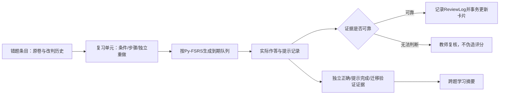
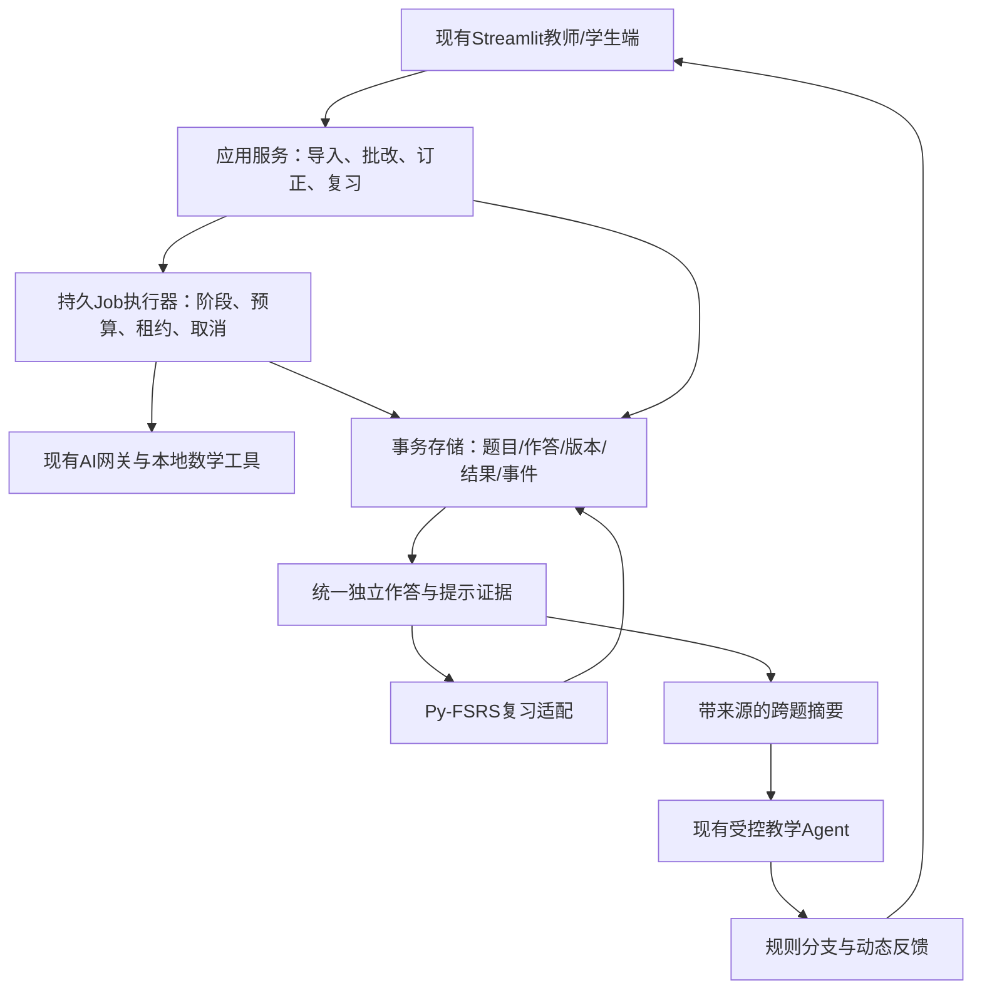

# 01｜开源教育项目源码研究与技术复用分析

研究日期：2026-11-21（北京时间）。研究对象：MindTrace 循理 AI 当前开发副本，以及下列六个公开仓库的固定提交。先阅读了 [现有项目审计](00_current_project_audit.md)，再核对当前 `core/`、`ui/` 中的对应调用链。本阶段仅提交研究文档，未修改业务代码或安装产品依赖，未请求付费模型接口。

## 1. 结论与证据等级

**建议保留现有 Streamlit 产品、证据校验与分层批改；直接引入 Py-FSRS 作为复习计算库；适配 DeepTutor 的证据化记忆、教学反馈契约和复习事务；参考 Oppia 构建可测试的教学状态分支。批改执行器应结合本项目约束重新实现，不能直接搬入任一参考仓库。**

以下发现直接影响技术选择：

1. DeepTutor 当前提交已经是较大的模块化学习平台，实际入口为统一 Agent 循环、工具注册、能力扩展和会话执行器。不能照抄早期项目介绍中的模块名，或把兼容 `AgentCoordinator` 当成当前执行引擎。
2. DeepTutor 的 [services/practice/scheduler.py][DT-sm2] 明确是 **SM-2 风格的冷启动策略，不是 FSRS**；另外 [learning/scheduler.py][DT-reviewpolicy] 的 `SpacedRepetitionScheduler` 使用按知识类型配置的基线间隔、稳定性和遗忘风险策略，也不能称为官方Py-FSRS。其知识掌握分数是加权正确率启发式，不是经过校准的掌握概率。
3. GradeFlow 当前源码是 **Next.js + Prisma/PostgreSQL + Gemini**；未找到 LangGraph 依赖或图执行代码。主路径为浏览器分批调用、每批三份顺序批改、数据库状态和外部 cron 补处理。仓库简介不能作为实现证据。
4. Auto-Homework-Grader 有五线程批改、指数退避和 SSE，但任务主要在进程内，SSE 重连不是进程重启后的断点恢复。
5. 两个教师批改仓库在本次提交中均未找到明确复用许可证。**可研究其思路，但当前不推荐复制、翻译移植或分发其实现。** 需取得明确授权后才能重新评估源码移植。
6. Anki 的调度主体在 Rust，Python 接口依赖 Anki 后端，不是可以单文件抽取的 Python FSRS 库。其 AGPL 义务也不同于 MIT 的 Py-FSRS。

证据标记：**S**＝读取实际源码；**P**＝在独立研究目录执行小范围离线探针；**D**＝本文为 MindTrace 提出的设计，尚未实现。未运行六个项目的完整服务、完整测试集、优化训练或真实模型教学评测；不提供未经测量的提速倍数、准确率或学习效果。

### 1.1 固定版本与下载范围

研究目录：`D:/Agent/_education_source_research/`，位于应用目录之外。所有引用指向下表 SHA，不指向浮动的 main。

| 项目 | 固定 commit | 提交时间（保留上游时区） | 下载与核查范围 |
| --- | --- | --- | --- |
| HKUDS/DeepTutor | `341af371bf8143b2da3569084edf8e6cb46d7404` | 2026-11-20 17:35:12 +08:00 | 浅克隆，完整工作树；重点读取循环、工具、记忆、学习、练习、会话、前端协议 |
| ankitects/anki | `be56085c32a9d02b506fa880cfa63c756c1779fc` | 2026-11-20 14:19:46 +03:00 | 浅克隆；首次检出中断，随后以 git archive 成功导出 LICENSE、Cargo.toml、Rust scheduler/revlog/card、Python scheduler、proto/anki；未声称完整工作树可构建 |
| open-spaced-repetition/py-fsrs | `e40a5a74799a12c9b15e01559a9b2c9f6be7a648` | 2026-11-13 02:34:22 Z | 浅克隆完整源码；pyproject 版本 `6.3.3`；实际执行调度探针 |
| yzy-thu/Auto-Homework-Grader | `be8ed16a7e8a7f1ced18afcf83f2e10e0b222463` | 2026-03-15 23:15:51 +08:00 | 浅克隆完整源码；Flask后台、文件处理、Gemini、Vue进度 |
| vishvamsinh28/GradeFlow | `60fa5d7bceac4b8fe99eca51baab159df650f80c` | 2026-08-30 17:40:05 +05:30 | 浅克隆完整源码；实际GitHub项目路径大小写可重定向到gradeflow |
| oppia/oppia | `a289689dc65d6755e545414cb883749e6814d21d` | 2026-11-20 01:53:28 +08:00 | 稀疏检出 core/domain、core/storage、交互扩展、前端领域模型及播放器服务；未下载所有部署资产 |

下载首次受网络代理限制；授权下载后完成。Anki 初次检出及一次二进制归档写入失败，后改用 `git archive --output` 成功；本文仅引用最终已落盘文件。研究目录的 `versions.json`、`verify_reuse.py`、`verification_results.json` 提供本地复核依据，不属于应用运行文件。

### 1.2 当前项目真正需要填补的边界

| 当前代码 | 已有能力，应保留 | 缺口与研究用途 |
| --- | --- | --- |
| `core/agent.py:181 run`、`:135 _decision` | 有预算的动作循环、证据ID、数学工具、取消、去重、教师升级 | 扩展跨题证据，而不是先换Agent框架 |
| `core/product.py:549 run_batch / :565 _run_batch` | quick/deep分层、成功结果复用、参考版本、逐阶段保存 | 页面同步串行，缺独立持久任务、租约和后台调度 |
| `core/limits.py:20 auto_resume / :79 request` | 进程内限额、短时等待、并发准入 | 准入上限不会自动产生并发；配额不适配大批次 |
| `core/uploads.py:213 process_pages / :370 assemble_materials` | 页队列、分区续识别、跨页组装、学号归属 | OCR中间进度主要在会话内；公共题目ID依赖文本 |
| `core/product.py:788 sync_notebook / :888 solve_question` | 错题归属、多来源、个人修订、讲解缓存 | 改判/参考换版后的下游失效需要修复；未有到期复习 |
| `core/agent.py:85 _sources / :120 _payload` | 本题证据与最近互动 | 缺统一跨题attempt事件及可追溯长期摘要 |
| `core/storage.py:24 save_runs`、`core/collaboration.py:195 save` | 原子JSON、旧写保护、三方合并、学生范围校验 | 缺数据库事务、增量写、完整证据备份和多进程协调 |

这些判断由当前源码重新核对，不把审计建议当成已经实现的功能。下文提及的新表、新服务名与接口均标为 D。

## 2. DeepTutor：从真实执行链识别复用边界

### 2.1 实际调用与状态组织

核心路线可概括为：应用层请求 → 统一 turn 执行 → capability/pipeline → 有预算的 AgentLoop → 工具注册与分派 → StreamBus 事件 → 会话/学习记录持久化。

| 研究能力 | 实际源码、关键对象与依赖 | 事实与边界 |
| --- | --- | --- |
| Agent执行循环 | [agents/loop/agent_loop.py][DT-loop] 的 `AgentLoop.run`；[python_scheduler.py][DT-sched] 的 `run_loop`；[loop_state.py][DT-state] 的 `AgentLoopState / LLMCallResult / LoopOutcome` | 区分探索与收尾预算，处理截断、空回复、工具暂停与结束检查。Python参考调度与 `packages/chat-engine/src/core/run-loop.ts` 对齐；移植不是拷一个while循环即可 |
| 工具协议与调用 | [core/tool_protocol.py][DT-tool] 的 `ToolDefinition / ToolParameter / BaseTool`；[runtime/registry/tool_registry.py][DT-registry] 的 `ToolRegistry.execute / build_openai_schemas`；[runtime/agentic/tool_dispatch.py][DT-dispatch] | schema与实际执行分开；普通工具可gather，改变绑定范围的工具先串行，暂停工具后执行。注册表不自动等于权限系统 |
| 任务计划与状态 | [services/task_board.py][DT-board] 的 `TaskBoardStore`；[session/turns/lifecycle.py][DT-life] 的 `TurnLifecycle`；[api/contracts/turn_protocol.py][DT-wire] | 看板存SQLite、具revision与会话关联；turn有queued/running/waiting_input/completed/failed/cancelled。看板卡片不是批改执行器的作业DAG |
| 多能力协调 | [agents/loop/pipeline.py][DT-pipeline] 的 `AgenticLoopPipeline`；[capabilities/subagent/tools.py][DT-subagent] 的 `ConsultSubagentTool`；[agents/question/coordinator.py][DT-coordinator] | 子Agent可咨询本机外部CLI或partner，涉及额外权限和预算。旧AgentCoordinator仅代理QuestionPipeline，不能当新版规划器复用 |
| 长期记忆及来源 | [services/memory/paths.py][DT-mpaths]、[document.py][DT-doc]、[store.py][DT-mstore]、[consolidator/references.py][DT-refs] | L1逐日JSONL原始trace；L2按学习界面摘要；L3 recent/profile/scope/preferences。Entry有id与refs；更新引用限于允许来源。引用存在不等于摘要语义正确 |
| 记忆检索 | [services/memory/recall.py][DT-recall] 的 `recent / recent_queries`；snapshot适配器 | 区分“最近存在/更新的资源”和“学生实际问过什么”，不能以打开资源代替学习证据；依赖workspace/user路径范围 |
| 学生画像与知识状态 | [learning/models.py][DT-models] 的 `LearnerProfile / TeachingObservation / QuizAttempt`；[mastery.py][DT-mastery] 的 `compute_mastery`；[service.py][DT-learning] 的 `record_quiz_attempt / calculate_mastery` | 最近最多五次加权正确率，1次正确上限0.5、2次上限0.8。是启发式；profile中的偏好、自报困难与正式assessment必须区分 |
| 引导教学与反馈 | [learning/teaching.py][DT-teaching] 的 `parse_teaching_updates / apply_teaching_updates`；[service.py][DT-learning] 的 pending/interaction 注册与回答流程 | 要求学生原话为证据，限定当前目标ID，分偏好与暂定观察，记录session/turn；动态反馈不直接授予掌握状态 |
| 练习生成与答案判断 | [agents/question/pipeline.py][DT-question] 的 `QuestionPipeline.run`；[learning/semantic_assessment.py][DT-semantic] 的 `validate_question / exact_verdict`；[services/practice/answers.py][DT-answers] 的 `check_answer` | 有题型与来源契约、选择题精确匹配、开放回答不确定分支；LLM语义判断仍不是数学形式证明。旧 `learning/grading.py` 存在不适合数学的模糊判分 |
| 学习进度和评估事件 | [learning/assessment.py][DT-assessment] 的 `AssessmentRecord / record_assessment`；[services/practice/storage.py][DT-practice] 的 `PracticeStore.review` | assessment统一来源；复习写入事务同时更新状态与追加事件，request_id去重、version防陈旧提交。部分返回字段仍将good/easy称为mastered，不能直接沿用这个教学含义 |
| 会话持久化 | [services/session/sqlite_store.py][DT-session] 的 `SQLiteSessionStore / TurnRecord`；[learning/storage.py][DT-lstore] 的 `LearningTransaction` | SQLite会话与学习事务；另有PocketBase适配。具体迁移体系很大，不适合整体复制 |
| 前后端交互 | [api/contracts/turn_protocol.py][DT-wire]、[runtime/stream_bus.py][DT-stream] 的 `StreamBus`；[web/lib/turn-reconcile.ts][DT-reconcile] | turn_id、after_seq重订阅、明确终态、工具事件与内容分离；前端临时消息ID与持久ID定向合并，避免全量刷新。内存总线本身不是持久消息队列 |

### 2.2 候选模块卡片

以下每项给出来源、原理、现有落点、方式、收益、难度、风险和验收；难度是相对工程量，不是排期承诺。

#### DT-01｜Agent工具协议与有界循环

- **来源/源码**：DeepTutor；[AgentLoop][DT-loop]、[run_loop][DT-sched]、[ToolDefinition][DT-tool]、[ToolRegistry][DT-registry]、[工具分派][DT-dispatch]。
- **原理**：模型提出工具调用，宿主解析执行，回传观察，预算/暂停/终止由程序决定；普通并行工具与改变上下文的工具区别调度。
- **现有位置**：`core/agent.py:135 _decision / :181 run`，`core/math_tools.py:evidence`，`core/ai.py:completion`。
- **推荐方式**：**适配架构，循环本体保留**。下一阶段先抽取工具结果契约；只有供应商已验证原生tools兼容时再增加适配层。不要移植全套运行时。
- **预期收益/难度**：新工具可测试、可观测；中。不会仅因改协议就提高数学准确率。
- **主要风险**：异步工具访问Streamlit会话、扩大文件/代码权限、多层重试和额外工具调用费用；注册表不能绕过 `_decision` 的学生与证据范围校验。
- **验收方法**：伪造证据ID、超额工具、重复调用、取消后晚到结果均被拒绝；原JSON动作与新工具适配产生同一业务事件；调用次数可对账。

#### DT-02｜带来源的三层学习记忆

- **来源/源码**：DeepTutor；[memory/document.py 的 Entry、Document、parse、serialize][DT-doc]；[MemoryStore][DT-mstore]；[refs_in_chunk_l2/l3、validate_fact_refs][DT-refs]；[recall][DT-recall]。
- **原理**：原始事件→分域摘要→跨域摘要；摘要条目持续保留来源引用，支持更新/撤回与回看。
- **现有位置**：`core/agent.py:_sources / _payload`，`core/product.py:sync_notebook`，`core/education.py:learning_state`，`core/records.py`。
- **推荐方式**：纯 `document.py` **可直接复用**（保留Apache声明）；存储和合并器**适配移植**，先仅建立原始学习事件与最近证据摘要，不立即上三层自动总结。
- **预期收益/难度**：让跨题建议能回指具体独立作答，减少整段聊天塞入上下文；中高。
- **主要风险**：引用实体存在但内容被错误概括、OCR错误污染长期画像、学生互串、删除后摘要残留；原文中的提示注入不能升格成系统规则。
- **验收方法**：摘要每条可打开原attempt；撤销误批或改参考版本后，依赖摘要失效；学生A不能召回B记录；已确认事实与自报困难显示不同来源。

#### DT-03｜教学偏好和反馈更新契约

- **来源/源码**：DeepTutor；[TeachingUpdate、parse_teaching_updates、apply_teaching_updates][DT-teaching]；[LearnerProfile / TeachingObservation][DT-models]。
- **原理**：仅用学生当前原话更新显式偏好；教学观察绑定目标和session/turn，暂定观察不能变成掌握结论；结构校验限制变更规模。
- **现有位置**：`core/agent.py:_payload / _decision`，`core/product.py:study_turn / edit_entry`。
- **推荐方式**：**适配移植**小型模型与验证器；将book/path目标范围替换为课堂、学生、knowledge_point与question版本范围。
- **预期收益/难度**：Agent可以记住“希望先给提示”及某次策略反馈；中。
- **主要风险**：把“听懂了”当作独立完成；学生备注影响教师判卷；profile缺少撤回和保留期限。
- **验收方法**：非原话引用被拒；不存在的知识目标被拒；偏好可撤销；偏好变化不直接修改错因统计、教师判定或复习成功记录。

#### DT-04｜统一学习评估事件与复习事务

- **来源/源码**：DeepTutor；[AssessmentRecord / record_assessment][DT-assessment]；[PracticeStore.review][DT-practice]；[LearningTransaction][DT-lstore]。
- **原理**：固定题目来源标识，所有评估追加事件；事务中检查request_id、版本与客观答案，再同时写状态和事件。
- **现有位置**：`core/agent.py:280 check_practice`，`core/education.py:grade_attempt`，`core/product.py:sync_notebook`，`core/classroom.py:commit / save`。
- **推荐方式**：**适配移植数据契约，重新实现本地存储适配**。统一原题订正、变式题和复习事件；不复制DeepTutor整个数据库迁移体系。
- **预期收益/难度**：解决顶层attempts与嵌套practice结果分散，为FSRS和跨题证据提供可靠输入；中高。
- **主要风险**：重复事件、结果落盘但计划未更新、参考换版仍把旧结果作为有效掌握证据；good/easy字段不能称为“已掌握”。
- **验收方法**：同request_id同内容只计一次，不同内容拒绝；并发版本冲突拒绝；状态/事件同成同败；撤销判定后能重放重算。

#### DT-05｜知识掌握启发式

- **来源/源码**：DeepTutor；[compute_mastery][DT-mastery] 与 [LearningService.calculate_mastery][DT-learning]。
- **原理**：最近五次正确度加权，少量证据封顶；不是BKT、IRT，也未提供高中数学上的校准证据。
- **现有位置**：`core/education.py:learning_state`，`ui/student.py:profiles`，`core/agent.py:_sources`。
- **推荐方式**：**仅借鉴证据不足封顶的设计，暂不移植分数**；保留独立完成/提示完成/未验证等可解释状态。
- **预期收益/难度**：避免一次答对即宣称掌握；低；无收益百分比承诺。
- **主要风险**：有提示与无提示记录混合、题目难度差异、自报答案、同题背答案，都会使加权率失真。
- **验收方法**：同题复述不算新迁移证据；有提示不计独立通过；无延迟测验不能展示“长期掌握概率”。

#### DT-06｜练习生成、精确答案与语义核验

- **来源/源码**：DeepTutor；[QuestionPipeline.run][DT-question]；[semantic_assessment.validate_question / exact_verdict][DT-semantic]；[practice.answers.check_answer][DT-answers]；对照 [learning/grading.py][DT-oldgrade]。
- **原理**：题型/选项/参考契约先校验；客观题确定匹配，语义判断另行处理；未知答案应保持未判定。
- **现有位置**：`core/answer_keys.py:compare / generate`，`core/education.py:generate_exercise / grade_attempt`，`core/agent.py:accept_practice`。
- **推荐方式**：多选项集合和三值结果**适配移植**；保留现有受限SymPy与证据校验。**放弃旧grade_answer的字符串相似度与关键词阈值判分**。
- **预期收益/难度**：多选顺序不影响结果，缺选不误判；中。
- **主要风险**：选项重排时字母语义变化、生成题无解/多解、模型自审与生成共错、正文含答案；不能把模型验证写成形式证明。
- **验收方法**：AC/CA一致，A对AC不通过；未知选项/缺参考返回待定；替代数学解法通过，负号/定义域错误不通过；生成后未核实的题只进草稿。

#### DT-07｜独立任务状态与前端增量事件

- **来源/源码**：DeepTutor；[TurnLifecycle][DT-life]、[TurnStatus / SubscribeTurnCommand][DT-wire]、[StreamBus][DT-stream]、[SQLiteSessionStore][DT-session]、[turn-reconcile.ts][DT-reconcile]。
- **原理**：执行ID与页面连接分离；带序号事件重订阅；终态与消息持久ID明确；流式呈现不要求重复整个会话。
- **现有位置**：`ui/product.py:teacher`，`ui/assignment_upload.py:review_upload`，`ui/workbench.py:Runtime.persist`，`core/execution.py:batch_lease`。
- **推荐方式**：**借鉴协议，Python任务服务重新实现**；保留Streamlit，用轮询/fragment展示持久任务快照，不迁入React和整个WebSocket平台。
- **预期收益/难度**：页面断开后继续任务，减少“用户点继续”的负担；高。
- **主要风险**：StreamBus为内存总线，直接复制仍不能重启恢复；完成事件先于提交、租约失效后仍回写、事件无限增长。
- **验收方法**：断页重连、进程重启、重复订阅、延迟事件、取消均有确定状态；已完成作答不再调用模型；failed与needs_review分离。

#### DT-08｜网络熔断小模块

- **来源/源码**：DeepTutor；[utils/network/circuit_breaker.py 的 CircuitBreaker][DT-breaker]。
- **原理**：按provider记录连续失败，open后拒绝，超时进入half-open，再按成功/失败转移。
- **现有位置**：`core/ai.py:completion`、`core/limits.py:auto_resume`。
- **推荐方式**：**适配移植**；当前实现half-open可放行多个请求，应补单探测租约；不直接叠加到现有限流外层形成第三套重试。
- **预期收益/难度**：供应商持续故障时减少无效请求；低中。
- **主要风险**：401配置错误被当临时故障，或所有学生因单一坏请求被全局熔断；进程内状态不跨实例。
- **验收方法**：故障阈值、恢复时钟、单探测并发；认证/余额/429/5xx分类；暂停不记为学生答案错误。

#### DT-09｜多Agent、看板与外部CLI

- **来源/源码**：DeepTutor；[AgenticLoopPipeline][DT-pipeline]、[ConsultSubagentTool][DT-subagent]、[TaskBoardStore][DT-board]、[旧AgentCoordinator][DT-coordinator]。
- **原理**：能力扩展、外部专家委派、任务看板与会话关联是三件不同的事；并非天然形成多个教学角色相互验证。
- **现有位置**：`core/agent.py:run`，`core/product.py:needs_deep`。
- **推荐方式**：**当前放弃整体引入**，仅借鉴“能力按需启用、同一预算和证据回传”。
- **预期收益/难度**：避免高复杂度低收益框架迁移；整体移植高难度。
- **主要风险**：外部CLI可访问文件与命令、多个角色重复推理、模型一致性错觉、维护成本；看板不能代替持久任务调度。
- **验收方法**：未来只有在固定题集上相对单Agent确有质量提升、额外成本可接受且权限可控，才重新立项。

### 2.3 直接复用与不可移植的明确划线

可抽取的最小源码候选是memory纯文档解析器；教学反馈验证器、精确选项检查和事务机制需要适配当前实体。Agent循环、全套SQLite/PocketBase会话、用户路径体系、React客户端、模块插件、外部CLI子Agent仅借鉴架构。大规模RAG、研究写作、桌面集成、视频生成等不是本轮高中作业闭环的必要依赖，暂不纳入。

DeepTutor存在真实的来源约束与事件体系，值得学习；但“有长期记忆”不代表“有可信知识状态”，“有答案检查”不代表“数学证明正确”。两个结论必须分别评测。

### 2.4 模块依赖与抽取成本

| 候选 | 实际依赖边界 | 抽取时应带走或替换的内容 |
| --- | --- | --- |
| DT-01 / DT-07循环与任务 | asyncio、统一LLM服务、UnifiedContext、StreamBus、session protocol；部分执行可跨Python/TypeScript | 只取协议和预算策略；保留本项目模型网关，替换provider状态、trace、路径和存储适配 |
| DT-02文档纯函数 | 标准库dataclasses、re | `document.py`可单独抽取；MemoryStore另依赖paths、trace、ID与异步锁，不能当作同样独立 |
| DT-03 / DT-04教学与事件 | Pydantic v2、Learning models、SQLite学习/会话存储、事件发布 | 小验证器带类型模型；替换book/path/session范围、事务和当前学生ID映射，不通过复制整个service解决导入错误 |
| DT-06答案与语义判断 | 精确选项检查为标准库json/re；语义判断需要LLM配置、lesson_evidence、来源和视觉上下文 | 客观检查可独立测试；语义评估保留当前有限数学核验，不能只复制Prompt |
| DT-08熔断 | 标准库threading、time、logging | 小范围适配，增加单探测控制与错误分类 |
| DT-09外部子Agent | 外部CLI/ACP、各后端凭据、能力配置和流式桥 | 当前不引入；不让教学场景继承开发代理的文件与命令权限 |

## 3. Anki 与 Py-FSRS：采用真实调度库

### 3.1 从Anki确认调度与实体的区别

实际源码：[rslib/src/card/mod.rs][A-card] 的 `Card / CardType / CardQueue / FsrsMemoryState`、[revlog/mod.rs][A-log] 的 `RevlogEntry / RevlogReviewKind`、[scheduler/fsrs/params.rs][A-params] 的 `compute_params`、[memory_state.rs][A-memory]、[Python scheduler/v3.py][A-python]。

- note承载内容，card是具体练习或提示方式的调度对象；一个内容来源可以衍生不同card。不要把同一道大题的所有能力揉成唯一记忆状态。
- card有state/queue/due/interval/stability/difficulty等；revlog是实际复习事件，包括评分、时间、时长与前后间隔。**调度快照不能代替原始日志。**
- Python的Scheduler通过后端执行 `get_queued_cards / build_answer / answer_card`，不是独立数学调度器；Rust依赖 `fsrs`，本提交Cargo配置为 `6.6.2`，与Python包版本不能混同。
- Anki的due在不同queue可能是时间戳、天偏移或新卡顺序，不应原样当作MindTrace统一UTC字段。
- 参数训练取经过整理的revlog；手动改期、同日重复、过滤练习等有专门语义。不能拿每次点开错题本作为一次复习训练样本。

**AN-01候选：Anki卡片/日志分离设计。** 来源与原理见上述源码；对应 `core/product.py:notebook_rows / sync_notebook` 和 `core/education.py:grade_attempt`；推荐**只借鉴实体与日志原则，不复制AGPL实现**。收益是支持一题多复习目标与可重放记录，难度中。风险是内容、复习单元和掌握证据混淆。验收：同一道错题可以有“条件回忆”“关键步骤”“独立重做”等不同复习卡，历史不能因当前快照变化而丢失。

### 3.2 Py-FSRS真实接口与计算

来源：[fsrs/scheduler.py][F-scheduler]、[card.py][F-card]、[review_log.py][F-log]、[rating.py][F-rating]、[state.py][F-state]，依赖见 [pyproject.toml][F-project]。

```python
# D：建议的未来适配示例；不是本次对业务代码的变更。
from datetime import datetime, timezone
from fsrs import Card, Scheduler, Rating

scheduler = Scheduler(desired_retention=0.9, enable_fuzzing=False)
now = datetime.now(timezone.utc)
card = Card(card_id=12345, due=now)  # ID由持久层分配并建立UUID映射
updated_card, review_log = scheduler.review_card(
    card, Rating.Good, review_datetime=now, review_duration=30000
)
next_due = updated_card.due
state_payload = updated_card.to_dict()
restored_card = Card.from_dict(state_payload)
```

`review_card`返回**新卡片和ReviewLog**，内部copy输入，不要只调用而丢弃返回值。Rating为Again/Hard/Good/Easy，数值1至4；State为Learning/Review/Relearning，没有独立New枚举。新卡初始为Learning、step=0。

默认有1分钟、10分钟学习步，10分钟重学步；不代表每次评分都以“天”为单位。默认参数21项，`desired_retention=0.9`、最大间隔36500天、默认fuzz开启。正式复现应保存完整Scheduler配置及包版本；测试禁用fuzz，实际启用时接受区间而非固定秒数。

计算上由历史状态估计stability/difficulty，结合当前间隔得到retrievability，再按评分更新状态；Review阶段下一间隔由目标保持率求得。**retrievability是特定复习单元的模型回忆估计，不是高中数学综合能力或一道证明题正确概率。**

包运行时主要依赖typing-extensions，Python>=3.10。只有Optimizer需要torch/numpy/pandas/tqdm；应安装 `fsrs`，不为正常调度安装 `fsrs[optimizer]`。

**FS-01候选：真实FSRS调度器。** 来源见 [Scheduler.review_card / get_card_retrievability][F-scheduler]；当前项目无调度实现，拟在 `core/product.py:notebook_rows` 与错题本页面旁新增薄适配服务（D）。推荐**直接使用固定版本Py-FSRS**，不手写近似算法。收益是可复现的到期时间与日志，难度低中。主要风险：UTC错误、卡ID碰撞、重复提交推进两次、配置升级无法重放。验收：四档评分、跨时区展示、学习/重学转移、序列化、幂等写、固定日志重放同结果；不把调度成功当作教学效果已证实。

### 3.3 参数优化条件：不能只喊“个性化”

[Optimizer][F-optimizer] 的真实入口为 `Optimizer(review_logs).compute_optimal_parameters()`；另有 `compute_optimal_retention(parameters)`，两者条件不能混淆。

| 问题 | 源码事实与实施判断 |
| --- | --- |
| 用什么训练 | 按card_id组织、按时间排序的ReviewLog序列；以Again为未回忆，其他评分为回忆成功 |
| 哪些事件有训练信息 | `compute_optimal_parameters` 对非同日的复习计算学习信息；同一节课连续点击并不提供足够遗忘曲线证据 |
| 有无统一“满N条即可个性化” | 本版本参数优化入口没有简单、统一的最小日志数门槛；不能套用其他FSRS实现或Anki旧版本阈值 |
| 最优保持率要求 | `compute_optimal_retention` 明确至少512条ReviewLog，且review_duration均非None；这是**保持率优化**的检查，不是参数拟合的通用阈值 |
| 当前应不应该训练 | 不应。先使用默认参数，收集真实跨日、独立作答、评分定义一致的记录；有留出时间段、评分覆盖和足够样本后再评估 |
| 如何证明比默认好 | 时间顺序留出评估，比较概率校准/log loss、复习负担和延迟独立正确率；训练损失下降本身不算上线依据 |

**FS-02候选：Optimizer。** 来源 [fsrs/optimizer.py][F-optimizer]；对应未来统一attempt/ReviewLog持久层，当前不存在足够数据；推荐**延后直接调用官方Optimizer，当前放弃训练**。收益是可能改善个体调度，难度高于基础接入。风险是torch体积、冷启动过拟合、把看答案后的“会了”当成功、未成年学习记录外泄。验收：数据最小化、有效跨日样本审查、时间留出优于默认且可回滚；不在页面线程训练。

### 3.4 错题→复习卡→学习证据的建议映射（D）



建议表：`review_units(unit_uuid, student_id, question_id, objective_id, source_revision, fsrs_card_id, scheduler_version)`；`review_events(event_id, request_id, unit_uuid, attempt_id, rating, rating_source, helped, answer_revealed, review_datetime, duration_ms, reference_revision)`。字段均为D，不是当前已存在的实体。

错题本仍保存整题与证据；FSRS卡保存“要复习什么”的状态。可一题多卡，但不自动将每一步拆成几十张卡，避免机械背诵与任务负担。

普通记忆卡常依赖主观四档评分；数学练习还必须记录**正确性、独立性、提示级别、答案是否已揭示、原题还是迁移题、耗时、题面和参考版本**。评分建议：确实无法完成可Again；独立正确再由学生选择难度；有提示完成不能自动Good/Easy；待定不创建伪成功日志。是否为帮助后的练习另建调度策略，应通过试点确定，不由模型随意折算。

不把原始错因标签、AI判错或点击“查看解析”直接送入FSRS。原题改判后保留过去日志，撤销其有效学习证据并重建受影响计划；不能静默删除历史。

## 4. 教师批改项目：比较真实执行机制

### 4.1 能力对照

| 能力 | Auto-Homework-Grader | GradeFlow | 对MindTrace的判断 |
| --- | --- | --- | --- |
| 拆分粒度 | [routes/grading.py][H-jobs] `_grade_worker`，每学生一个ZIP或文件→grade_one | [grading.js][G-grading] `gradeOne`，每test_submission一份作业 | 当前按题quick/deep有成本优势，保留；外层可按页OCR和按题阶段建job |
| 调度与并发 | 后台daemon线程+ThreadPoolExecutor(max_workers=5)，一次提交所有future | `GRADE_BATCH=3`，`gradeBatch`中的for-await顺序执行；浏览器持续POST，cron兜底 | 五线程并不适合直接套当前限额；三份一批不是三路并发 |
| API限流 | [gemini_grader.py][H-model] 429等字符串匹配后重试；没有统一RPM/日成本准入 | [rate-limit.js][G-limit] 数据库固定窗用于入口；不等于Gemini模型RPM/Token预算 | 保留现有UsageLimiter，补持久化与可配置班级预算 |
| 重试 | 默认5次总尝试，退避2/4/8/16秒；最后一次失败后不再sleep，非所有注释中列出的32秒都会发生 | `gradeBatch`捕获后markSheetFailed；当前可见主链没有内部模型指数退避/自动持久重试队列 | 注释中“queue retry”不能覆盖实际实现；应按错误类别重试并记attempt_count |
| 进度 | 内存queue/history+SSE result/progress/complete，前端EventSource | 数据库submission状态、grade接口返回remaining | 用持久任务状态做事实来源，进度以完成阶段数计算 |
| 断点续批 | 重连能回放内存历史；重启丢_jobs；没有持久每项checkpoint | queued/过期grading可被claim；已graded跳过；failed由老师重试 | GradeFlow方向更接近恢复，但领取不是严格原子排他 |
| 结果持久化 | 作业临时目录；完整或停止后写CSV，运行中results主要在内存 | PostgreSQL成绩、状态；对象存储保留文件 | MindTrace需要增量事务及证据备份，不能退回最终CSV唯一存储 |
| 教师复核 | 未发现完整确认/改判历史服务；展示分数反馈 | [sheets/[id]/route.js][G-review] accept/override，标记overridden/needs_review | 当前MindTrace复核历史与引用更细，应保留 |
| 学生关联 | 文件名规则解析；非标准文件名让Gemini分析 | [schema.prisma][G-schema] classroom_students/tests/test_submissions，唯一(test_id,student_id) | 保留严格学号/名单；AI匹配只能建议，不自动确定学生身份 |
| 前后端 | Flask+Vue+SSE | Next.js/React，数据库+cron | 不为调度优化而迁移现有UI框架 |

### 4.2 能直接复制的Python代码并不多

#### HG-01｜线程池与进度分离

- **来源/源码**：Auto-Homework-Grader；[routes/grading.py `_grade_worker / grade_one / start_grading / grade_stream`][H-jobs]；[utils/sse.py][H-sse]；[useGrading.js][H-front]。
- **原理**：长任务放后台，子任务用future回收，完成一项即发布结果与进度。
- **现有位置**：`core/product.py:_run_batch`、`core/uploads.py:process_pages`、`ui/product.py:teacher`。
- **推荐方式**：**借鉴并重新实现**。若以后获得许可，可适配Python的future组织方式；当前不复制仓库代码。worker只返回不可变结果，由协调器落盘，不能在线程里读写Streamlit状态。
- **预期收益/难度**：网络等待可重叠、页面不承担执行；中高；收益受RPM、请求数和磁盘保存制约。
- **主要风险**：一口气提交全部任务、线程共享SDK与工作区字典、停止后仍在计费；ThreadPool上下文退出会等待已运行future，cancel不能中断正在进行的HTTP。
- **验收方法**：控制1/2/4路并发对比；最大活动请求不超配额；局部失败不停止其他题；取消不再派新请求；统计成功与实际费用一致。

#### HG-02｜退避重试与身份解析

- **来源/源码**：Auto-Homework-Grader；[grade_student / _is_retryable][H-model]， [parse_submission_filename / default_parse_works][H-zip]。
- **原理**：暂时性失败退避；常见学号_姓名文件名本地解析，低匹配率才求助模型。
- **现有位置**：`core/ai.py:completion`、`core/limits.py:auto_resume`、`core/uploads.py:identify_materials / parse_roster`。
- **推荐方式**：**保留现有实现，按错误码重新实现统一重试策略**。不直接搬字符串关键词判断，也不让模型决定真实学号归属。
- **预期收益/难度**：避免永久错误反复计费，减少人名信息发送；低中。
- **主要风险**：关键词rate可能误匹配其他错误，缺Retry-After与抖动；多层重试指数相乘；文件名被用作路径时存在越界风险。
- **验收方法**：401/402不重试，429尊重等待，5xx受预算重试；同一次HTTP计数一次；保留学号前导零，重号/未知号进入人工匹配。

#### GF-01｜持久状态与过期任务回收

- **来源/源码**：GradeFlow；[gradeOne / markSheetFailed / settleTest / claimPendingSheets / claimGlobalPending][G-grading]；[grade路由][G-route]、[drain路由][G-drain]。
- **原理**：作业状态保存在数据库，已完成跳过；queued与超过10分钟的grading由后续调用回收；外部cron处理老师离开后的尾项。
- **现有位置**：`core/execution.py:batch_lease`，`core/product.py:batch_execution / run_batch`，`ui/workbench.py:Runtime.persist`。
- **推荐方式**：**借鉴后重新实现Python持久执行器**；当前许可未明确，且JavaScript/Prisma无法直接接到字典存储。
- **预期收益/难度**：浏览器断开和进程中断后恢复，成功题不重判；高。
- **主要风险**：findMany后updateMany不是排他领取；queued仍可被重复领取，两个worker可能同时进gradeOne。10分钟超时只是启发式，不是租约证明；已发请求但未写结果的窗口仍可能重复计费。
- **验收方法**：两worker同时claim只返回一次；每个job有lease_owner/lease_until/attempt_id/fencing token；过期worker结果拒绝提交；终态提交与下游版本一致。不能承诺外部API exactly-once，需记录不确定调用窗口。

#### GF-02｜作业实体、应交名单与教师复核

- **来源/源码**：GradeFlow；[schema.prisma][G-schema]、[ownedTest / ownedSubmission][G-domain]、[sheets PATCH][G-review]。
- **原理**：课堂、学生、作业、应交/出勤、提交分表；教师操作先核所有权；复核accept与override区别。
- **现有位置**：`core/classroom.py:new_workspace / review`，`core/collaboration.py:student_view / save`，`core/presentation.py:batch_summary / override_grade`。
- **推荐方式**：**借鉴约束，按Python实体重新实现**；保持MindTrace多版本review历史，不降级成仅overridden布尔值。
- **预期收益/难度**：名单贯通、避免重复提交、明确待复核状态；中。
- **主要风险**：share_token为持有者凭证，链接泄漏可暴露成绩；按姓名匹配错误；当前GradeFlow结构不足以证明具备不可变审计日志；替换文件后的旧分数必须失效。
- **验收方法**：一作业一学生的提交唯一性与补交版本策略明确；未交单独统计；改判留操作者/版本/原因；学生只能读本人已发布结果。

#### GF-03｜跨进程入口限流

- **来源/源码**：GradeFlow；[rateLimit / clientKey][G-limit]。
- **原理**：数据库按key+window_start原子upsert计数，避免serverless进程重启把计数清零。
- **现有位置**：`core/limits.py:UsageLimiter.request`，`core/usage.py:record`。
- **推荐方式**：**只借鉴原子共享计数模式**；在持久任务层重新实现请求/Token/预算三种配额，不能将其登录入口计数直接当模型限额。
- **预期收益/难度**：进程重启不清空预算，多执行器共享上限；中。
- **主要风险**：固定窗口边界可能双倍突发；信任任意转发IP易绕过；仅限制请求数无法控制图像Token与费用。
- **验收方法**：两个进程累计不越限，窗口边界受控，故障按策略拒绝，预算消耗与usage核对；不按学生IP直接等价学生身份。

### 4.3 不应复制的缺陷

Auto-Homework-Grader `_emit` 同时写history和queue，订阅时先回放history再消费未清理queue，存在重复消费/事件序号不一致的可能；多个订阅还会竞争一个queue。**这不是可直接移植的可靠广播。** 应使用单调event_id与每订阅游标，持久化后再发布。

Auto-Homework-Grader 的 `_jobs` 无长期存储/清理策略，CSV在收尾写；源码允许请求传student_folder，路径范围、认证与任务归属未形成完整安全边界。ZIP解包仅做字符串清理与深度限制，不能视作完整Zip Slip、Windows盘符/UNC、解压炸弹保护。

GradeFlow有数据库事务，但查询与更新分离、无领取条件的比较交换，不能因为出现 `$transaction` 就称为并发安全。批改catch保留了对旧queue的注释，必须以调用链为准。其教师复核没有本项目已有的analysis_id/fingerprint级历史保障，不应覆盖现有复核机制。

另查GradeFlow [学生分享接口][G-share]：它按test/submission的 `status="graded"` 读取，没有以 `needs_review=false` 或独立教师发布记录作为条件。因此不能依据简介宣称“所有学生反馈都经教师批准才发布”。MindTrace后续应把“模型完成”“教师确认”“向学生发布”设为不同状态。其 `grader.js:normalize` 会按模型分项总分缩放到试卷总分，这能约束总量，却不能证明分项评分正确，不能取代明确评分细则。

## 5. Oppia：规则教学状态与LLM相结合

### 5.1 真实教学模型

[core/domain/state_domain.py][O-state] 中：

- `State`含展示内容、参数变更、interaction及checkpoint标志；`InteractionInstance`含answer_groups、default_outcome、hints、solution。
- `RuleSpec`定义规则类型及参数；`AnswerGroup`中的规则按OR匹配，同组共用Outcome，可标记具体skill misconception。
- `Outcome`含dest、feedback、labelled_as_correct、param_changes，以及卡住后的dest/refresher/prerequisite skill。
- [AnswerClassificationService][O-classify] 按answer group顺序找第一条匹配规则，否则default outcome；可训练交互中还有trainingData完全匹配后备，不是任意自然语言的LLM语义分类。
- [NumericInputRulesService][O-rules] 的Equals、IsWithinTolerance等是确定规则。字符串模糊匹配服务即使在教育产品中存在，也不能直接移植来判断数学等价。

学习记录不是只有聊天记录：[learner_progress_services.py][O-progress] 的 `mark_exploration_as_incomplete` 保存user、exploration、state_name、exploration_version；完成活动另存。 [user/gae_models.py][O-user] 的 `IncompleteActivitiesModel / ExpUserLastPlaythroughModel / ExplorationUserDataModel`保存进度与checkpoint；[event_services.py][O-events] 的 `StateHitEventHandler / StateCompleteEventHandler`记录过程事件。**完成课程活动不等于掌握一个数学概念。**

#### OP-01｜可解释反馈分支和教学状态机

- **来源/源码**：Oppia；[State / RuleSpec / AnswerGroup / Outcome][O-state]、[getMatchingClassificationResult][O-classify]、[NumericInputRulesService][O-rules]。
- **原理**：有序规则→明确反馈→目标状态，未覆盖回答进入默认分支；提示与完整解答作为不同教学资源。
- **现有位置**：`core/agent.py:_decision / run`，`core/education.py:tutor_turn`，`core/product.py:study_turn`。
- **推荐方式**：**借鉴模型，在Python中适配实现**。不要复制整个7000余行领域层及Angular依赖；挑确定规则、状态/结果契约与上游边界用例。
- **预期收益/难度**：常见错误反馈稳定、分支可回归测试，LLM只补动态语言；中。
- **主要风险**：规则过窄拒绝替代解法，首匹配顺序遮蔽其他错误，答案提前泄露，重试回环不终止。
- **验收方法**：相同证据稳定到同状态；规则冲突有优先级；未知解法不直接判错；连续无进展可换策略或交老师；direct偏好得到尊重。

#### OP-02｜活动版本、checkpoint和学习事件

- **来源/源码**：Oppia；[learner_progress_services][O-progress]、[user模型][O-user]、[事件处理][O-events]、[player-position.service.ts][O-position]、[stats-reporting.service.ts][O-stats]。
- **原理**：进度绑定活动及版本，已访问、已完成、最后位置分开；过程事件独立于内容定义。
- **现有位置**：`core/classroom.py`，`core/records.py`，`core/product.py:regrade_transcription`，`core/agent.py:session / run`。
- **推荐方式**：**适配契约，存储重新实现**。保留当前submission指纹与reference_revision，补教学活动revision/checkpoint和对应证据。
- **预期收益/难度**：恢复时知道学生做到了哪一步，并识别题面换版；中高。
- **主要风险**：旧活动checkpoint误用于新题，匿名会话混并，记录大量未成年细节，GCP datastore模型无法直接移植。
- **验收方法**：中途离开后回到同一有效状态；内容换版时提示重新验证；完成讲解不写独立通过；删除/导出能覆盖所有关联事件。

### 5.2 规则与LLM动态教学的具体组合（D）

建议策略由程序先决定允许的动作，LLM选择范围内的提问/解释，确定答案或有足够证据的错误才进入规则分支；无法确定时保留待判，不把自由文本强塞入已有错因。

例：原题为“求 `f(x)=ln(x)+a*x` 的单调区间”，学生写 `f'(x)=1/x+a`。规则先确认定义域x>0及求导局部证据；如a符号/零点讨论不全，进入“补充分情形”状态；学生使用另一种有效分析时交语义核验；不是由于第一步与参考格式不同就判错。

| 状态（建议） | 可触发条件 | 允许输出 | 进入下一状态的证据 |
| --- | --- | --- | --- |
| 待澄清 | 题干/图形/OCR条件缺失 | 只追问缺什么 | 新补充的原始材料，不能由模型猜补 |
| 定位困难 | 有作答但错因尚不明确 | 一次有区分力的问题 | 学生具体回答与原答引用 |
| 引导/解释 | 已有可靠困难位置 | 提示、关键条件或另一解法 | 新回答；仅“懂了”不算独立完成 |
| 原题订正 | 学生提交修改后的解题过程 | 再批改并记录版本 | 原题新attempt；支持替代解法 |
| 独立迁移 | 自愿做新题，未看答案 | 验证过程和反馈 | 独立attempt，保留提示/答案揭示状态 |
| 待复习 | 有可信复习单元与评分 | 到期队列 | 跨日新attempt，由Py-FSRS安排后续 |
| 教师复核 | 证据冲突/超出验证能力 | 明确争议点和原卷入口 | 教师决定及其版本 |

规则层不把“与参考不同”当错误，LLM层不越过规则写正式分数、宣称掌握或改教师判定。完整证明正确性仍需专业评测及必要人工复核。

## 6. 质量、许可证、维护与安全审查

### 6.1 许可证门槛

| 项目 | 本次核实依据 | 复用约束与决定 |
| --- | --- | --- |
| DeepTutor | [LICENSE][DT-license]、pyproject Apache-2.0；部分vendor另有LICENSE | 拷贝代码保留许可、版权声明与修改说明；若对应内容附NOTICE需保留。主仓库许可不自动覆盖品牌、第三方素材/插件或模型服务条款。可选小模块适配 |
| Anki | [LICENSE][A-license]；目标Rust/Python文件头明确AGPL v3 or later | 不复制核心实现进入当前产品；若以后选择修改并提供网络使用，需审查AGPL相应源码提供义务及组合方式。不能因商业可用就忽略开源义务 |
| Py-FSRS | [LICENSE][F-license] 为MIT | 作为依赖保留版权/许可文本；不把现成FSRS算法宣称自主发明。直接复用优先 |
| Auto-Homework-Grader | 固定commit完整文件树、README/源码，未找到LICENSE/COPYING/NOTICE或明确许可声明 | 授权不明确，**源码复制/移植暂停**；仅研究行为并按本项目需求独立实现；先联系权利人补许可再谈适配 |
| GradeFlow | 固定commit完整文件树与package.json；private:true不等于许可；未找到明确LICENSE | 同上。公开可见、技术栈相同或翻译成Python，都不自动获得复用权 |
| Oppia | [LICENSE][O-license]、目标文件Apache-2.0头 | 小型规则/状态设计可适配；保留声明，按文件核查第三方依赖与教学内容许可，不整体复制课程素材 |

以上为实施门槛，不作个案法律保证。无许可证不意味着任意复用，依据 [GitHub官方许可说明](https://docs.github.com/en/repositories/managing-your-repositorys-settings-and-features/customizing-your-repository/licensing-a-repository)；Apache分发要求参见 [Apache-2.0原文](https://www.apache.org/licenses/LICENSE-2.0)，MIT声明要求参见 [MIT原文](https://opensource.org/license/mit)。AGPL网络交互条款应按 [AGPL-3.0第13节](https://www.gnu.org/licenses/agpl-3.0.html#section13)与Anki文件许可进一步审查；本次GNU网页抓取超时，未将其当作成功下载的研究材料。

### 6.2 维护、测试和依赖：不拿热度代替可靠性

维护判断仅依据固定提交日期、可见测试/CI和依赖清单。全部为浅克隆，未分析长期提交频率、bus factor、issue响应、发布签名或全部安全通告；不声称无漏洞。

| 项目 | 当前可见维护证据 | 测试与依赖证据 | 可移植性 / 风险 |
| --- | --- | --- | --- |
| DeepTutor | 提交距研究日1天；本提交含桌面签名安全更新 | `tests/`、`learning/tests/`、web/tests与行为测试；pyproject含大量可选模块 | Python小模块可提取；完整平台含Node/TS、RAG、MCP、外部CLI、多存储后端，明显超出本项目必要复杂度。未跑全套测试 |
| Anki | 提交距研究日1天；成熟调度状态和Rust测试代码可见 | Cargo workspace、内联测试、rslib/tests、Python后端桥与proto | Rust/Python/TS/Qt和生成构建体系；整体复用困难且AGPL需审查。未构建；仅完成选定源码导出 |
| Py-FSRS | 最近提交2026-11-13，修复fuzz边界 | `tests/test_basic.py / test_optimizer.py`；`.github/workflows/test.yml`覆盖Python3.10–3.14；基础依赖少，optimizer可选 | 最轻且与Python匹配；本次探针通过，未跑上游pytest全集或torch优化器 |
| Auto-Homework-Grader | 最近提交2026-03-15，移除配置中硬编码Key默认值 | Python依赖未锁版本；Vue/Vite；完整树未发现正式测试套件/CI | Python线程池易理解但任务内存化；有历史敏感配置变更提示，应做秘密扫描，不假定历史已清理。无需读取或传播旧Key |
| GradeFlow | 最近提交2026-08-30，文件替换行为更新 | package-lock、ESLint存在，package scripts无test；完整树未发现正式自动测试/CI | Node>=20、Next16、React19、Prisma7、PostgreSQL、Supabase；不适合整体迁入Python。事务领取/模型重试需另验证 |
| Oppia | 提交距研究日1天；状态模型和大量相邻测试可见 | Python `*_test.py`、Angular `*.spec.ts`；requirements锁版本并带hash | 领域层深耦合GCP NDB、服务、翻译和schema迁移；适合抽取规则模型，整体部署依赖过重。未执行上游测试 |

### 6.3 安全与学生数据保护的落地检查

| 风险 | 上游观察 | 当前项目的采用条件 |
| --- | --- | --- |
| 提示注入与工具越权 | DeepTutor扩展工具/CLI可扩大执行范围；注册schema并不限制工具权限 | 保留现有白名单、学生范围、证据ID校验；不为学生开放shell/任意Python/任意路径 |
| 画像泄漏与错误记忆 | 多层摘要可能长期保留错误；路径隔离依赖宿主身份范围 | 每条记忆绑定student_id与课堂，摘要检索先授权；支持删除、撤回、引用失效传播 |
| 云模型数据出境/第三方处理 | 两个批改器会上传整份作业/答案；文件名也可能发送模型 | 上传前最小化姓名/学号，明确服务提供者与用途；研究样本匿名；像素内身份信息需专门处理 |
| 文件安全 | ZIP深度限制不等于解压配额；PDF/图片需防资源消耗 | 真实格式检查、像素/页数/总字节/解压总量/路径归属/超时；不采用任意student_folder请求参数 |
| 链接式身份 | GradeFlow share_token、当前课堂个人码均属于持有者凭证 | 可撤销、限范围、不要把分享码放日志；演示学号模式不能用于真实学生身份认证 |
| 状态并发 | GradeFlow查询再更新；当前进程锁/JSON无法跨实例 | 带租约与版本比较交换的事务；教师改判和晚到AI结果互斥保护；备份包括原图/PDF |
| 依赖与供应链 | 部分项目依赖浮动、可选组件多 | 只引入必要模块；记录固定版本/hash、许可清单，后续做依赖扫描；本次没有完成全量CVE审计 |

## 7. 实际执行的验证与尚未验证的范围

离线脚本：`D:/Agent/_education_source_research/verify_reuse.py`。使用机器现有Python环境，仅载入研究目录源码与纯函数，不运行应用、不调用API，不安装任一完整平台。

本机复核命令：`D:/Agent/zhicuo-ai/.venv/Scripts/python.exe -B D:/Agent/_education_source_research/verify_reuse.py`。脚本会更新研究目录内的结果和清单；不修改应用。此环境不作为未来产品依赖锁定的替代品。

| 探针 | 结果 | 能证明什么 |
| --- | --- | --- |
| Py-FSRS新卡四档评分 | 通过；固定UTC起点、禁fuzz：Again 60秒，Hard 330秒，Good 600秒，Easy 8天 | 真实接口可用；只是此配置新卡结果，不是通用固定复习表 |
| Card/ReviewLog字典往返 | 通过 | 能持久化并恢复模型状态/日志 |
| 非UTC/无时区输入 | 无时区输入按预期拒绝 | 需要统一UTC；本次不宣称所有时区边界都测完 |
| 四事件顺序重放 | 最终Card与逐次更新一致 | 固定版本/参数/禁fuzz可重放；未覆盖优化换参后的所有迁移 |
| DeepTutor memory parse/serialize | 来源chat:turn-1保留，序列化幂等 | 纯文档工具可独立提取；不能证明摘要语义正确 |
| DeepTutor掌握启发式 | 1次正确0.5、2次正确0.8 | 分数有封顶，未证明统计校准 |
| 旧grade_answer数学反例 | 将 `x=-123456789` 与 `x=123456789` 判为相同 | 复现字符串相似阈值不适用于数学，放弃该模块 |
| practice.check_answer多选 | AC与CA通过、A不通过；essay返回None | 可借鉴集合与三值判断；未覆盖所有选项文本和恶意输入 |

未验证：真实手写/OCR、完整证明、几何图形、真实模型工具兼容、上游全部测试、真实并发下吞吐、付费调用金额、学生学习提升、所有许可证例外及依赖漏洞。因此“可复用”指源码与接口适配结论，**不等于已完成集成或生产验收**。

## 8. 实施建议：先让证据和任务稳定，再做长期个性化

### 8.1 推荐的最小目标架构（D）



先评估单实例SQLite事务能否满足真实并发，不因GradeFlow采用PostgreSQL就直接迁库。执行器后台任务需要稳定宿主及持久磁盘；若继续使用Streamlit托管，必须验证重启、空闲休眠与worker生命周期，不能只加一个daemon线程就宣称永不暂停。

### 8.2 任务粒度、幂等与成本边界（D）

1. OCR任务键＝材料哈希＋页/区域＋解析版本＋公共试卷版本；成功页持久化后再组装。
2. 判卷任务键＝submission_id＋transcription_revision＋reference_revision＋policy/prompt/model配置版本＋stage；与当前指纹/参考版本对齐。
3. 暂时网络失败、配额等待、材料需复核分别用retry_wait、quota_wait、needs_review；人工待定不进入无限自动重试。
4. `job_id / batch_id / submission_id / attempt_id / provider_request_id`贯通usage和结果；准入预算与实耗分开记录。
5. worker先租约领取，调用后校验版本与fencing token再提交；取消不再分派新工作，已发请求可能继续执行并计费，界面需明确。
6. 部分失败不阻塞可本地判断的题；当前quick/deep分层、共用参考、客观题复用继续保留。

### 8.3 下一阶段的可审查工作包（不是本阶段改动）

| 顺序 | 内容 | 研究来源 | 必须提交的验收证据 |
| --- | --- | --- | --- |
| P0 | 正式回归与参考/转写版本一致性，统一题目身份 | 当前审计；Oppia活动版本；DeepTutor事件 | 改参考/改判/改OCR后讲解、错题、计划全部失效或重算；历史可查 |
| P1 | 统一attempt事件与原题订正入口 | DT-04、OP-02 | 原题订正/新题迁移/看答案/有提示分别记录；双端可核对 |
| P1 | 持久任务、配额预算、1→2路受控并发 | DT-07、HG-01、GF-01/03思想 | 固定批次耗时/请求量/费用；重启恢复；竞争领取；教师晚到改判测试 |
| P2 | 官方Py-FSRS薄适配与到期复习 | FS-01、AN-01、DT-04 | UTC、日志重放、幂等、陈旧提交、有效题目版本、到期队列 |
| P2 | 证据摘要与教学偏好 | DT-02/03、OP-01 | 每条建议可定位证据；跨学生隔离；撤回误批后清理；教学状态可复现 |
| P3 | 参数优化、复杂多Agent | FS-02、DT-09 | 有足够真实跨日数据、时间留出评测、明确收益/成本；达不到则不实施 |

## 9. 最终“保留 / 直接复用 / 适配移植 / 重新实现 / 放弃”决策表

“适配移植”只对许可证明确的模块成立；未授权的两个教师项目仅借鉴抽象思路，不能借“重新实现”之名逐行翻译代码。商业功能与教学内容许可另行审核。

| 对象 / 候选ID | 最终决定 | 明确范围与理由 |
| --- | --- | --- |
| 当前core/ui分层、Streamlit入口 | **保留** | 不因研究而更换全部框架 |
| 当前quick/deep、共用参考版本、客观题复用 | **保留** | 已有正确成本方向；修复题目身份与版本传播 |
| 当前Agent预算、证据ID、工具白名单、教师升级 | **保留** | 作为DT-01/OP-01适配的权限基础 |
| 当前学生隔离、教师复核历史、三方合并原则 | **保留** | 不以只有布尔override的外部实现替换完整追溯 |
| Py-FSRS Scheduler/Card/ReviewLog（FS-01） | **直接复用** | 首选固定版本依赖；外围写薄适配与事务 |
| DeepTutor纯memory文档解析（DT-02子模块） | **直接复用** | 标准库纯函数，保留Apache许可及版权；探针已通过 |
| DeepTutor记忆引用/撤回、教学反馈（DT-02/03） | **适配移植** | 换成学生/课堂范围与当前证据实体，不全盘复制多用户路径体系 |
| DeepTutor统一assessment及复习事务（DT-04） | **适配移植** | 契约与事务原则可移植；数据库表按当前产品设计 |
| DeepTutor多选集合与三值判断（DT-06） | **适配移植** | 补齐选项语义版本；不替代现有数学工具 |
| DeepTutor小熔断器（DT-08） | **适配移植** | 增加单half-open探测，避免多层重试 |
| Oppia状态/分支/版本契约（OP-01/02） | **适配移植** | Python小型状态模型；不引入Angular/GCP整套平台 |
| Anki卡片与复习日志分离（AN-01） | **重新实现** | 只借鉴实体原则，不复制AGPL实现 |
| 持久批改执行器（HG-01、GF-01、DT-07） | **重新实现** | 结合本项目版本、限额、租约与宿主约束；不复制授权不明源码 |
| 持久预算/统一错误重试（HG-02、GF-03） | **重新实现** | 保留当前安全准入并升级，避免关键词误判与重试叠乘 |
| 名单/应交/提交与复核约束（GF-02） | **重新实现** | 连接现有班级名单与batch，保持指纹级复核历史 |
| DeepTutor旧模糊grade_answer（DT-06反例） | **放弃** | 已复现数学不等价仍判对 |
| 将DeepTutor SM-2策略当FSRS | **放弃** | 明确改用官方Py-FSRS，不伪造算法名称 |
| DeepTutor掌握加权率作为能力概率（DT-05） | **放弃** | 仅借鉴证据不足保护，不输出伪精确掌握率 |
| Anki Rust/Python调度代码直接搬入 | **放弃** | 工程耦合与AGPL复用门槛；Py-FSRS已满足计算需求 |
| Auto-Homework-Grader/GradeFlow源码复制 | **放弃（当前）** | 未核实许可；后续有明确授权才能重新评估 |
| 直接复制内存SSE、无租约数据库claim | **放弃** | 无法满足可靠广播、重启恢复与防重复计费 |
| 全套DeepTutor、Oppia、GradeFlow前端迁入 | **放弃** | 依赖/迁移成本不对应当前产品最紧迫问题 |
| 多Agent专家群、CLI权限、FSRS个体训练（DT-09/FS-02） | **放弃（当前阶段）** | 数据和收益证据不足；不影响保留未来接口 |

最终可落实的技术组合是：**现有受控批改与Agent + 持久任务和统一学习事件 + Py-FSRS + 有证据来源的记忆 + 轻量规则教学状态**。每项都必须接受原题版本、学生隔离、教师复核和成本预算的约束。本报告只完成源码研究与选型，不将建议写成已上线能力。

## 10. 固定提交源码索引

以下链接均由本地已存在的固定提交文件生成，可用于逐项复核。
<!-- generated-pinned-source-index -->

| 索引 | 来源与真实源码（固定SHA） | 本地起始符号行 |
| --- | --- | --- |
| DT-loop | [DeepTutor · `deeptutor/agents/loop/agent_loop.py`][DT-loop] | 118 |
| DT-sched | [DeepTutor · `deeptutor/agents/loop/python_scheduler.py`][DT-sched] | 15 |
| DT-state | [DeepTutor · `deeptutor/agents/loop/loop_state.py`][DT-state] | 15 |
| DT-tool | [DeepTutor · `deeptutor/core/tool_protocol.py`][DT-tool] | 17 |
| DT-registry | [DeepTutor · `deeptutor/runtime/registry/tool_registry.py`][DT-registry] | 29 |
| DT-dispatch | [DeepTutor · `deeptutor/runtime/agentic/tool_dispatch.py`][DT-dispatch] | 81 |
| DT-board | [DeepTutor · `deeptutor/services/task_board.py`][DT-board] | 30 |
| DT-life | [DeepTutor · `deeptutor/services/session/turns/lifecycle.py`][DT-life] | 34 |
| DT-wire | [DeepTutor · `deeptutor/api/contracts/turn_protocol.py`][DT-wire] | 16 |
| DT-pipeline | [DeepTutor · `deeptutor/agents/loop/pipeline.py`][DT-pipeline] | 115 |
| DT-subagent | [DeepTutor · `deeptutor/capabilities/subagent/tools.py`][DT-subagent] | 43 |
| DT-coordinator | [DeepTutor · `deeptutor/agents/question/coordinator.py`][DT-coordinator] | 31 |
| DT-mpaths | [DeepTutor · `deeptutor/services/memory/paths.py`][DT-mpaths] | 39 |
| DT-doc | [DeepTutor · `deeptutor/services/memory/document.py`][DT-doc] | 69 |
| DT-mstore | [DeepTutor · `deeptutor/services/memory/store.py`][DT-mstore] | 35 |
| DT-refs | [DeepTutor · `deeptutor/services/memory/consolidator/references.py`][DT-refs] | 36 |
| DT-recall | [DeepTutor · `deeptutor/services/memory/recall.py`][DT-recall] | 46 |
| DT-models | [DeepTutor · `deeptutor/learning/models.py`][DT-models] | 25 |
| DT-mastery | [DeepTutor · `deeptutor/learning/mastery.py`][DT-mastery] | 24 |
| DT-learning | [DeepTutor · `deeptutor/learning/service.py`][DT-learning] | 59 |
| DT-teaching | [DeepTutor · `deeptutor/learning/teaching.py`][DT-teaching] | 14 |
| DT-question | [DeepTutor · `deeptutor/agents/question/pipeline.py`][DT-question] | 157 |
| DT-semantic | [DeepTutor · `deeptutor/learning/semantic_assessment.py`][DT-semantic] | 27 |
| DT-answers | [DeepTutor · `deeptutor/services/practice/answers.py`][DT-answers] | 9 |
| DT-assessment | [DeepTutor · `deeptutor/learning/assessment.py`][DT-assessment] | 36 |
| DT-practice | [DeepTutor · `deeptutor/services/practice/storage.py`][DT-practice] | 21 |
| DT-session | [DeepTutor · `deeptutor/services/session/sqlite_store.py`][DT-session] | 46 |
| DT-lstore | [DeepTutor · `deeptutor/learning/storage.py`][DT-lstore] | 83 |
| DT-stream | [DeepTutor · `deeptutor/runtime/stream_bus.py`][DT-stream] | 32 |
| DT-reconcile | [DeepTutor · `web/lib/turn-reconcile.ts`][DT-reconcile] | 58 |
| DT-breaker | [DeepTutor · `deeptutor/utils/network/circuit_breaker.py`][DT-breaker] | 13 |
| DT-oldgrade | [DeepTutor · `deeptutor/learning/grading.py`][DT-oldgrade] | 13 |
| DT-license | [DeepTutor · `LICENSE`][DT-license] | 1 |
| DT-reviewpolicy | [DeepTutor · `deeptutor/learning/scheduler.py`][DT-reviewpolicy] | 25 |
| DT-sm2 | [DeepTutor · `deeptutor/services/practice/scheduler.py`][DT-sm2] | 17 |
| A-card | [anki · `rslib/src/card/mod.rs`][A-card] | 44 |
| A-log | [anki · `rslib/src/revlog/mod.rs`][A-log] | 36 |
| A-params | [anki · `rslib/src/scheduler/fsrs/params.rs`][A-params] | 55 |
| A-memory | [anki · `rslib/src/scheduler/fsrs/memory_state.rs`][A-memory] | 32 |
| A-python | [anki · `pylib/anki/scheduler/v3.py`][A-python] | 39 |
| A-license | [anki · `LICENSE`][A-license] | 1 |
| F-scheduler | [py-fsrs · `fsrs/scheduler.py`][F-scheduler] | 128 |
| F-card | [py-fsrs · `fsrs/card.py`][F-card] | 25 |
| F-log | [py-fsrs · `fsrs/review_log.py`][F-log] | 24 |
| F-rating | [py-fsrs · `fsrs/rating.py`][F-rating] | 4 |
| F-state | [py-fsrs · `fsrs/state.py`][F-state] | 4 |
| F-project | [py-fsrs · `pyproject.toml`][F-project] | 1 |
| F-optimizer | [py-fsrs · `fsrs/optimizer.py`][F-optimizer] | 1 |
| F-license | [py-fsrs · `LICENSE`][F-license] | 1 |
| H-jobs | [Auto-Homework-Grader · `backend/routes/grading.py`][H-jobs] | 26 |
| H-model | [Auto-Homework-Grader · `backend/services/gemini_grader.py`][H-model] | 14 |
| H-zip | [Auto-Homework-Grader · `backend/services/zip_extractor.py`][H-zip] | 8 |
| H-sse | [Auto-Homework-Grader · `backend/utils/sse.py`][H-sse] | 4 |
| H-front | [Auto-Homework-Grader · `frontend/src/composables/useGrading.js`][H-front] | 3 |
| G-grading | [GradeFlow · `src/lib/server/grading.js`][G-grading] | 16 |
| G-limit | [GradeFlow · `src/lib/server/rate-limit.js`][G-limit] | 18 |
| G-route | [GradeFlow · `src/app/api/tests/[id]/grade/route.js`][G-route] | 1 |
| G-drain | [GradeFlow · `src/app/api/queue/drain/route.js`][G-drain] | 15 |
| G-review | [GradeFlow · `src/app/api/sheets/[id]/route.js`][G-review] | 1 |
| G-schema | [GradeFlow · `prisma/schema.prisma`][G-schema] | 1 |
| G-domain | [GradeFlow · `src/lib/server/domain.js`][G-domain] | 26 |
| G-share | [GradeFlow · `src/app/api/share/[token]/route.js`][G-share] | 1 |
| O-state | [oppia · `core/domain/state_domain.py`][O-state] | 91 |
| O-classify | [oppia · `core/templates/pages/exploration-player-page/services/answer-classification.service.ts`][O-classify] | 44 |
| O-rules | [oppia · `extensions/interactions/NumericInput/directives/numeric-input-rules.service.ts`][O-rules] | 31 |
| O-progress | [oppia · `core/domain/learner_progress_services.py`][O-progress] | 74 |
| O-user | [oppia · `core/storage/user/gae_models.py`][O-user] | 52 |
| O-events | [oppia · `core/domain/event_services.py`][O-events] | 47 |
| O-position | [oppia · `core/templates/pages/exploration-player-page/services/player-position.service.ts`][O-position] | 33 |
| O-stats | [oppia · `core/templates/pages/exploration-player-page/services/stats-reporting.service.ts`][O-stats] | 36 |
| O-license | [oppia · `LICENSE`][O-license] | 1 |

[DT-loop]: https://github.com/HKUDS/DeepTutor/blob/341af371bf8143b2da3569084edf8e6cb46d7404/deeptutor/agents/loop/agent_loop.py#L118
[DT-sched]: https://github.com/HKUDS/DeepTutor/blob/341af371bf8143b2da3569084edf8e6cb46d7404/deeptutor/agents/loop/python_scheduler.py#L15
[DT-state]: https://github.com/HKUDS/DeepTutor/blob/341af371bf8143b2da3569084edf8e6cb46d7404/deeptutor/agents/loop/loop_state.py#L15
[DT-tool]: https://github.com/HKUDS/DeepTutor/blob/341af371bf8143b2da3569084edf8e6cb46d7404/deeptutor/core/tool_protocol.py#L17
[DT-registry]: https://github.com/HKUDS/DeepTutor/blob/341af371bf8143b2da3569084edf8e6cb46d7404/deeptutor/runtime/registry/tool_registry.py#L29
[DT-dispatch]: https://github.com/HKUDS/DeepTutor/blob/341af371bf8143b2da3569084edf8e6cb46d7404/deeptutor/runtime/agentic/tool_dispatch.py#L81
[DT-board]: https://github.com/HKUDS/DeepTutor/blob/341af371bf8143b2da3569084edf8e6cb46d7404/deeptutor/services/task_board.py#L30
[DT-life]: https://github.com/HKUDS/DeepTutor/blob/341af371bf8143b2da3569084edf8e6cb46d7404/deeptutor/services/session/turns/lifecycle.py#L34
[DT-wire]: https://github.com/HKUDS/DeepTutor/blob/341af371bf8143b2da3569084edf8e6cb46d7404/deeptutor/api/contracts/turn_protocol.py#L16
[DT-pipeline]: https://github.com/HKUDS/DeepTutor/blob/341af371bf8143b2da3569084edf8e6cb46d7404/deeptutor/agents/loop/pipeline.py#L115
[DT-subagent]: https://github.com/HKUDS/DeepTutor/blob/341af371bf8143b2da3569084edf8e6cb46d7404/deeptutor/capabilities/subagent/tools.py#L43
[DT-coordinator]: https://github.com/HKUDS/DeepTutor/blob/341af371bf8143b2da3569084edf8e6cb46d7404/deeptutor/agents/question/coordinator.py#L31
[DT-mpaths]: https://github.com/HKUDS/DeepTutor/blob/341af371bf8143b2da3569084edf8e6cb46d7404/deeptutor/services/memory/paths.py#L39
[DT-doc]: https://github.com/HKUDS/DeepTutor/blob/341af371bf8143b2da3569084edf8e6cb46d7404/deeptutor/services/memory/document.py#L69
[DT-mstore]: https://github.com/HKUDS/DeepTutor/blob/341af371bf8143b2da3569084edf8e6cb46d7404/deeptutor/services/memory/store.py#L35
[DT-refs]: https://github.com/HKUDS/DeepTutor/blob/341af371bf8143b2da3569084edf8e6cb46d7404/deeptutor/services/memory/consolidator/references.py#L36
[DT-recall]: https://github.com/HKUDS/DeepTutor/blob/341af371bf8143b2da3569084edf8e6cb46d7404/deeptutor/services/memory/recall.py#L46
[DT-models]: https://github.com/HKUDS/DeepTutor/blob/341af371bf8143b2da3569084edf8e6cb46d7404/deeptutor/learning/models.py#L25
[DT-mastery]: https://github.com/HKUDS/DeepTutor/blob/341af371bf8143b2da3569084edf8e6cb46d7404/deeptutor/learning/mastery.py#L24
[DT-learning]: https://github.com/HKUDS/DeepTutor/blob/341af371bf8143b2da3569084edf8e6cb46d7404/deeptutor/learning/service.py#L59
[DT-teaching]: https://github.com/HKUDS/DeepTutor/blob/341af371bf8143b2da3569084edf8e6cb46d7404/deeptutor/learning/teaching.py#L14
[DT-question]: https://github.com/HKUDS/DeepTutor/blob/341af371bf8143b2da3569084edf8e6cb46d7404/deeptutor/agents/question/pipeline.py#L157
[DT-semantic]: https://github.com/HKUDS/DeepTutor/blob/341af371bf8143b2da3569084edf8e6cb46d7404/deeptutor/learning/semantic_assessment.py#L27
[DT-answers]: https://github.com/HKUDS/DeepTutor/blob/341af371bf8143b2da3569084edf8e6cb46d7404/deeptutor/services/practice/answers.py#L9
[DT-assessment]: https://github.com/HKUDS/DeepTutor/blob/341af371bf8143b2da3569084edf8e6cb46d7404/deeptutor/learning/assessment.py#L36
[DT-practice]: https://github.com/HKUDS/DeepTutor/blob/341af371bf8143b2da3569084edf8e6cb46d7404/deeptutor/services/practice/storage.py#L21
[DT-session]: https://github.com/HKUDS/DeepTutor/blob/341af371bf8143b2da3569084edf8e6cb46d7404/deeptutor/services/session/sqlite_store.py#L46
[DT-lstore]: https://github.com/HKUDS/DeepTutor/blob/341af371bf8143b2da3569084edf8e6cb46d7404/deeptutor/learning/storage.py#L83
[DT-stream]: https://github.com/HKUDS/DeepTutor/blob/341af371bf8143b2da3569084edf8e6cb46d7404/deeptutor/runtime/stream_bus.py#L32
[DT-reconcile]: https://github.com/HKUDS/DeepTutor/blob/341af371bf8143b2da3569084edf8e6cb46d7404/web/lib/turn-reconcile.ts#L58
[DT-breaker]: https://github.com/HKUDS/DeepTutor/blob/341af371bf8143b2da3569084edf8e6cb46d7404/deeptutor/utils/network/circuit_breaker.py#L13
[DT-oldgrade]: https://github.com/HKUDS/DeepTutor/blob/341af371bf8143b2da3569084edf8e6cb46d7404/deeptutor/learning/grading.py#L13
[DT-license]: https://github.com/HKUDS/DeepTutor/blob/341af371bf8143b2da3569084edf8e6cb46d7404/LICENSE#L1
[DT-reviewpolicy]: https://github.com/HKUDS/DeepTutor/blob/341af371bf8143b2da3569084edf8e6cb46d7404/deeptutor/learning/scheduler.py#L25
[DT-sm2]: https://github.com/HKUDS/DeepTutor/blob/341af371bf8143b2da3569084edf8e6cb46d7404/deeptutor/services/practice/scheduler.py#L17
[A-card]: https://github.com/ankitects/anki/blob/be56085c32a9d02b506fa880cfa63c756c1779fc/rslib/src/card/mod.rs#L44
[A-log]: https://github.com/ankitects/anki/blob/be56085c32a9d02b506fa880cfa63c756c1779fc/rslib/src/revlog/mod.rs#L36
[A-params]: https://github.com/ankitects/anki/blob/be56085c32a9d02b506fa880cfa63c756c1779fc/rslib/src/scheduler/fsrs/params.rs#L55
[A-memory]: https://github.com/ankitects/anki/blob/be56085c32a9d02b506fa880cfa63c756c1779fc/rslib/src/scheduler/fsrs/memory_state.rs#L32
[A-python]: https://github.com/ankitects/anki/blob/be56085c32a9d02b506fa880cfa63c756c1779fc/pylib/anki/scheduler/v3.py#L39
[A-license]: https://github.com/ankitects/anki/blob/be56085c32a9d02b506fa880cfa63c756c1779fc/LICENSE#L1
[F-scheduler]: https://github.com/open-spaced-repetition/py-fsrs/blob/e40a5a74799a12c9b15e01559a9b2c9f6be7a648/fsrs/scheduler.py#L128
[F-card]: https://github.com/open-spaced-repetition/py-fsrs/blob/e40a5a74799a12c9b15e01559a9b2c9f6be7a648/fsrs/card.py#L25
[F-log]: https://github.com/open-spaced-repetition/py-fsrs/blob/e40a5a74799a12c9b15e01559a9b2c9f6be7a648/fsrs/review_log.py#L24
[F-rating]: https://github.com/open-spaced-repetition/py-fsrs/blob/e40a5a74799a12c9b15e01559a9b2c9f6be7a648/fsrs/rating.py#L4
[F-state]: https://github.com/open-spaced-repetition/py-fsrs/blob/e40a5a74799a12c9b15e01559a9b2c9f6be7a648/fsrs/state.py#L4
[F-project]: https://github.com/open-spaced-repetition/py-fsrs/blob/e40a5a74799a12c9b15e01559a9b2c9f6be7a648/pyproject.toml#L1
[F-optimizer]: https://github.com/open-spaced-repetition/py-fsrs/blob/e40a5a74799a12c9b15e01559a9b2c9f6be7a648/fsrs/optimizer.py#L1
[F-license]: https://github.com/open-spaced-repetition/py-fsrs/blob/e40a5a74799a12c9b15e01559a9b2c9f6be7a648/LICENSE#L1
[H-jobs]: https://github.com/yzy-thu/Auto-Homework-Grader/blob/be8ed16a7e8a7f1ced18afcf83f2e10e0b222463/backend/routes/grading.py#L26
[H-model]: https://github.com/yzy-thu/Auto-Homework-Grader/blob/be8ed16a7e8a7f1ced18afcf83f2e10e0b222463/backend/services/gemini_grader.py#L14
[H-zip]: https://github.com/yzy-thu/Auto-Homework-Grader/blob/be8ed16a7e8a7f1ced18afcf83f2e10e0b222463/backend/services/zip_extractor.py#L8
[H-sse]: https://github.com/yzy-thu/Auto-Homework-Grader/blob/be8ed16a7e8a7f1ced18afcf83f2e10e0b222463/backend/utils/sse.py#L4
[H-front]: https://github.com/yzy-thu/Auto-Homework-Grader/blob/be8ed16a7e8a7f1ced18afcf83f2e10e0b222463/frontend/src/composables/useGrading.js#L3
[G-grading]: https://github.com/vishvamsinh28/GradeFlow/blob/60fa5d7bceac4b8fe99eca51baab159df650f80c/src/lib/server/grading.js#L16
[G-limit]: https://github.com/vishvamsinh28/GradeFlow/blob/60fa5d7bceac4b8fe99eca51baab159df650f80c/src/lib/server/rate-limit.js#L18
[G-route]: https://github.com/vishvamsinh28/GradeFlow/blob/60fa5d7bceac4b8fe99eca51baab159df650f80c/src/app/api/tests/%5Bid%5D/grade/route.js#L1
[G-drain]: https://github.com/vishvamsinh28/GradeFlow/blob/60fa5d7bceac4b8fe99eca51baab159df650f80c/src/app/api/queue/drain/route.js#L15
[G-review]: https://github.com/vishvamsinh28/GradeFlow/blob/60fa5d7bceac4b8fe99eca51baab159df650f80c/src/app/api/sheets/%5Bid%5D/route.js#L1
[G-schema]: https://github.com/vishvamsinh28/GradeFlow/blob/60fa5d7bceac4b8fe99eca51baab159df650f80c/prisma/schema.prisma#L1
[G-domain]: https://github.com/vishvamsinh28/GradeFlow/blob/60fa5d7bceac4b8fe99eca51baab159df650f80c/src/lib/server/domain.js#L26
[G-share]: https://github.com/vishvamsinh28/GradeFlow/blob/60fa5d7bceac4b8fe99eca51baab159df650f80c/src/app/api/share/%5Btoken%5D/route.js#L1
[O-state]: https://github.com/oppia/oppia/blob/a289689dc65d6755e545414cb883749e6814d21d/core/domain/state_domain.py#L91
[O-classify]: https://github.com/oppia/oppia/blob/a289689dc65d6755e545414cb883749e6814d21d/core/templates/pages/exploration-player-page/services/answer-classification.service.ts#L44
[O-rules]: https://github.com/oppia/oppia/blob/a289689dc65d6755e545414cb883749e6814d21d/extensions/interactions/NumericInput/directives/numeric-input-rules.service.ts#L31
[O-progress]: https://github.com/oppia/oppia/blob/a289689dc65d6755e545414cb883749e6814d21d/core/domain/learner_progress_services.py#L74
[O-user]: https://github.com/oppia/oppia/blob/a289689dc65d6755e545414cb883749e6814d21d/core/storage/user/gae_models.py#L52
[O-events]: https://github.com/oppia/oppia/blob/a289689dc65d6755e545414cb883749e6814d21d/core/domain/event_services.py#L47
[O-position]: https://github.com/oppia/oppia/blob/a289689dc65d6755e545414cb883749e6814d21d/core/templates/pages/exploration-player-page/services/player-position.service.ts#L33
[O-stats]: https://github.com/oppia/oppia/blob/a289689dc65d6755e545414cb883749e6814d21d/core/templates/pages/exploration-player-page/services/stats-reporting.service.ts#L36
[O-license]: https://github.com/oppia/oppia/blob/a289689dc65d6755e545414cb883749e6814d21d/LICENSE#L1
