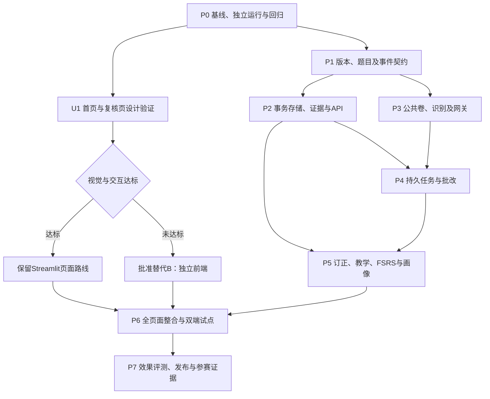

# 02｜分阶段实施任务清单

日期：2026-11-21。状态：**推荐方向已批准，分批实施中**。首批记录见 [03 首批实施验收](03_phase01_acceptance.md)，后续批改优化见 [04 批改可靠性优化](04_batch_reliability.md)。用户要求暂缓专项真实样本验收、直接开展优化；P0-04仍保留为待办，后续不据离线测试宣称真实准确率或成本达标。总体决策、字段契约、指标和回滚规则以 [目标架构](02_target_architecture.md) 为准。下表保留完整阶段门槛，未勾选不代表局部实现尚未发生，不将研究探针、截图或旧报告视为整个阶段验收通过。

## 1. 实施方式与完成标准

当前工程进度：最近批准的四条功能主线（作业题目身份、双端订正、持久后台、证据画像/FSRS）已有可操作实现，详见[05 实施记录](05_platform_upgrade.md)及[06 运行恢复](06_development_and_recovery.md)。不把这等同于下方全部长期阶段或真实效果门槛通过；用户暂缓的真实样本评测、正式部署与规模化验证仍单独保留。

采用“做成一段真实可用流程→检查→修正→进入下一阶段”的方式。界面原型尽早验证，数据/版本先稳住，长期学习功能建立在真实作答事件之上。使用独立开发分支和预览环境，现有线上产品不承担未验收的改造。

每项完成需同时满足：实现符合范围；相关自动检查通过；影响到的实际页面能操作；教师/学生权限不回退；有明确失败状态；数据可恢复；记录配置/模型/代码版本。只完成代码、通过语法解析或展示模拟界面均不算完成。

相对成本：S＝局部适配；M＝跨少量模块、需集成验证；L＝跨数据/执行/双端，需故障与迁移验证。成本不等于固定工期；真实样本、教学反馈和延迟测验有独立的时间成本。不得为了追求表面进度跳过安全与数据门槛。

### 1.1 依赖图

“并行”指工作可独立推进，不表示本阶段已启动任何实现、外包或子Agent。每阶段入口与退出条件如下。

## 2. P0：建立可靠起点

目标：当前版本在可复现环境中真实跑通，后续收益有同条件基线。

| ID / 状态 | 具体任务与产出 | 成本 / 前置 | 验收条件 | 失败/回滚 |
| --- | --- | --- | --- | --- |
| P0-01 [ ] | 核实本地副本与原Git仓库关系、线上绑定分支/入口；创建开发分支与独立预览环境，保存业务文件hash | S；架构批准 | 明确唯一开发目录、可对比基线提交；无密钥/学生数据进入Git；未覆盖现有站点 | 保留原目录和线上，停止推送 |
| P0-02 [ ] | 建立项目自身虚拟环境、锁依赖、Poppler检查、正常/缺Key启动说明 | M；P0-01 | 干净环境安装成功；首页、教师/学生入口可操作；缺Key时功能状态清晰，配置Key不显示给普通用户 | 回到基线依赖；不使用导入占位假装生产启动成功 |
| P0-03 [ ] | 恢复正式回归目录和CI；迁入审计18项检查并区分REPRO与预期行为 | M；P0-02 | 数学工具、参考比较、租约、隔离、三方合并、Agent动作有可复现覆盖；已知缺陷标注清楚 | 不让“bug仍存在”的断言作为修复通过 |
| P0-04 [ ] | 整理匿名真实题样本与标注规范，开发/留出分组；记录旧版识别、配题、批改与操作基线 | M；可访问且授权样本、P0-02 | 样本来源、题型、难度、手写质量、参考和争议复核可查；无近重复泄漏；费用与请求完整记录 | 缺样本时保留fixture回归，但不宣称真实效果 |

**阶段门槛G0**：独立运行成功、基础权限用例通过、当前缺陷清单和测量基线固定。上游研究通过不代替G0。

## 3. U1：先确定界面能达到的水平

目标：用真实代表页验证视觉与操作，避免全做完后才发现布局路线不合适。

| ID / 状态 | 具体任务与产出 | 成本 / 前置 | 验收条件 | 失败/回滚 |
| --- | --- | --- | --- | --- |
| U1-01 [ ] | 整理用户给过且当前可访问的参考图；建立设计tokens与页面状态清单 | S/M；P0-01 | 品牌、色彩层次、字体、间距、按钮、图表、状态统一；参考有来源与可比较标准 | 不凭印象声称已与示例一样 |
| U1-02 [ ] | 实现首页代表页：悬停即预选、整卡进入、层次蓝色、适当高度与平滑回弹 | M；P0-02、U1-01 | 1440/1280/768/390截图与真实操作；无需额外预选点击；键盘可达；无布局跳动；减少动效可用 | 隔离新组件，回到基线首页 |
| U1-03 [ ] | 实现教师复核代表页：原卷/转写/判定同屏、题目与学生导航、异常筛选 | M/L；P0-02、U1-01 | 数学内容可读、长公式/多页原卷可操作；不堆expander；切换保留位置；空/错/加载状态齐全 | 保留原数据，页面功能开关撤回 |
| U1-04 [ ] | 对照架构第12节评审两个真实页面；确定A继续或B前端替代 | S；U1-02/03 | 提供截图、连续操作录屏、关键任务耗时/失败点；用户对方向的反馈已落实 | 若无法达标，说明具体限制并申请B范围变更，不降低验收标准 |

**阶段门槛GU**：两张代表页达到认可方向，采用的组件方案能覆盖主要状态。未通过时不批量复制到其他页面。视觉认可不代替业务正确性。

## 4. P1：修复一致性，统一业务契约

目标：同一题、同一学生、同一版本有明确身份；旧判定不再污染讲解、错题和统计。

| ID / 状态 | 具体任务与产出 | 成本 / 前置 | 验收条件 | 失败/回滚 |
| --- | --- | --- | --- | --- |
| P1-01 [ ] | 修复当前错题active_error滞留、旧讲解缓存不随参考换版失效、求导工具路由遗漏等已复现问题 | M；G0 | 原审计test_05/07/09变为修复期望；incorrect→uncertain→correct、改OCR/改参考/教师改判均覆盖 | 按功能开关撤回；保留所有历史，不删个人笔记 |
| P1-02 [ ] | 定义Question/AssignmentQuestion/Reference/Submission/Attempt/Assessment及版本契约 | M；G0 | 稳定UUID独立于OCR标点；相同题号不同题不合并；多选保留完整选项语义；同题关系可人工纠正 | 旧ID映射保留，疑似同题不自动合并 |
| P1-03 [ ] | 贯通班级名单与作业应交快照；统一正确、错误、留白、未识别、待判定、未交口径 | M；P1-02 | 人工手算小班样例全部对账；过滤范围与分母明确；缺交不算错误 | 保留旧报表可对照，不发布含糊百分比 |
| P1-04 [ ] | 定义统一学习事件、发布与失效传播；拆出业务服务边界但保留旧入口适配 | M/L；P1-02 | 顶层与Agent嵌套attempt可映射；教师review、学生笔记和原答权限分离；晚到AI不覆盖教师决定 | 不在契约未定时大面积移动文件；小步可回退 |

**阶段门槛G1**：版本失效与统计对账用例通过；教师上传到学生查看的旧路径仍正常。

## 5. P2：持久存储、迁移、权限与API

目标：解除页面会话与长期资料绑定，为恢复、并发和复习提供事务基础。

| ID / 状态 | 具体任务与产出 | 成本 / 前置 | 验收条件 | 失败/回滚 |
| --- | --- | --- | --- | --- |
| P2-01 [ ] | 建立Repository、SQLite schema/迁移版本与短事务；查询分页与索引 | L；G1 | 同机API/worker读写、陈旧版本拒绝、foreign_key/范围约束、连续10次班级作业查询测试 | SQL功能开关；迁移前保留JSON只读主源 |
| P2-02 [ ] | 资产staging/ready、页/区域引用、孤立/缺失文件修复、数据库+原文件备份恢复 | M/L；P2-01 | PDF与图片hash对账；磁盘满/中断不留可消费的半资产；恢复后原卷可打开 | 缺图阻断相关任务；不生成替代图假装恢复 |
| P2-03 [ ] | 实现幂等JSON导入、旧ID/题目/学生映射、顶层和Agent练习迁移 | L；P2-01/02 | 重复导入不增长；无效记录隔离并出报告；不把匿名资料自动分给学生；个人笔记与review完整 | 导入失败事务撤回；原文件不改写 |
| P2-04 [ ] | API命令/查询、课堂学习码/教师码会话、权限、吊销、授权资产读取 | L；P1-04、P2-01 | 两学生多浏览器越权0例；伪造student_id/asset_id/课堂ID被拒；真实课堂学号不作为凭证；Key不下发 | 服务不可用时不回退公共共享JSON |
| P2-05 [ ] | 一小课堂影子比对→写冻结→最终迁移→原子切换；保存恢复演练结果 | M；P2-02/03/04 | 原/新计数、统计、来源、权限、原文件一致；切换后新写入不丢 | 按架构11.3执行；有新写入后禁止直接还原旧快照 |

**阶段门槛G2**：持久数据和双端权限通过，迁移/备份实演可恢复。此时仍不自动更新正式线上地址。

## 6. P3：公共卷、识别与模型网关

目标：减少重复题面和答案推理，区分OCR错误与判卷错误，让图形证据能回到判卷链。

| ID / 状态 | 具体任务与产出 | 成本 / 前置 | 验收条件 | 失败/回滚 |
| --- | --- | --- | --- | --- |
| P3-01 [ ] | 提取ProviderAdapter与用途路由，保留现有SDK接入；记录模型、提示词、schema、请求关联ID | M；P1契约 | 离线响应/错误契约通过；经预算确认后做最小真实图像/JSON/工具验证；未验证能力不启用 | 不能无提示切陌生服务商；原适配器保留 |
| P3-02 [ ] | 公共试卷和参考答案图片/PDF入口；每题AI草稿、集中确认、稳定题目关联 | M/L；P1-02、P2-02、P3-01 | 有/无参考两条路均可；答案只生成一次；多选、子问和图形完整；草稿不直接批改 | 教师可修订；缺公共卷仍可走原上传路线 |
| P3-03 [ ] | OCR警告与页/区域元数据贯通；质量检测、局部重识别、图形回看工具 | L；P3-01/02、资产层 | 细小符号、跨页、模糊、几何图分层评测；未知bbox不编造；学生只能看本人区域 | 缺条件阻断自动结论；保留原图与人工校对 |
| P3-04 [ ] | 同一匿名题集比较当前视觉路径与可选专业OCR/视觉模型，给出路由与压缩参数结论 | M/L；P0-04、P3-03；外部服务需可用预算 | 同数据/标注/版本比较质量、覆盖、成本、耗时；保留失败样本 | 无改善则保留旧配置；无授权不付费试跑 |

**阶段门槛G3**：公共题关联可靠、OCR异常可定位，至少一种真实识别路径完成契约与匿名样本验证。只“换了模型名”不算达标。

## 7. P4：可靠批改、持久任务与自动恢复

目标：用户不需反复点继续；任务可恢复，费用和人工待定有明确边界。

| ID / 状态 | 具体任务与产出 | 成本 / 前置 | 验收条件 | 失败/回滚 |
| --- | --- | --- | --- | --- |
| P4-01 [ ] | 按页OCR、逐题本地/quick/deep建立Job；唯一键、租约、fencing token、attempt与outbox | L；G2、P3-01 | 两worker抢同job仅一方有效；过期响应不覆盖；成功结果不重跑；所有用途有归因 | 回到单worker/停派任务，保留已提交结果 |
| P4-02 [ ] | 持久配额与预算预留/结算、错误分类、next_retry_at、受控重试和取消 | L；P4-01 | 429自动恢复、401停止、日预算明确等待；UI不sleep；未知计费窗口可查；已发请求取消边界清晰 | 配置降并发，暂停新调用，不能关闭成本保护 |
| P4-03 [ ] | 保留本地/quick/deep分流；参考评分要点、替代解法、图形回看和冲突升级 | M/L；G3、P4-01 | 多选顺序/缺选、正确替代证明、定义域遗漏、负号错误、无参考等用例；待复核不无限重试 | 缺少可靠评分细则则不启用正式分数 |
| P4-04 [ ] | 并发1→2与队列公平；更新批次进度、等待原因与费用状态 | M；P4-02/03 | 固定40×20题负载对比；含学生交互时无长期饥饿；总耗时/请求/费用完整 | 并发退到1；进度不伪造剩余秒数 |
| P4-05 [ ] | 教师批量确认、异常复核、发布快照；断页/重启/磁盘满故障注入 | M/L；P4-03、P2权限 | 关页面后后台继续；worker重启恢复；未确认争议不以正式错因发布；旧review优先级正确 | 发布开关关闭不影响教师已存数据；历史发布可更正 |

**阶段门槛G4**：上传→批改→教师复核/发布→学生查看在真实双端跑通；故障注入无数据丢失，重试不反复调用人工待定题。

## 8. P5：订正、动态教学、复习与长期证据

目标：错题本成为真正可使用的学习过程，而不只是收藏与聊天记录。

| ID / 状态 | 具体任务与产出 | 成本 / 前置 | 验收条件 | 失败/回滚 |
| --- | --- | --- | --- | --- |
| P5-01 [ ] | 正式原题订正入口、不可变attempt、父子来源、教师反馈及题目换版处理 | M；G2、G4 | 学生能提交文本/图片/PDF订正；原答不被覆盖；老师看到新过程；有提示完成不计独立通过 | 可停新提交，已有attempt只读可看 |
| P5-02 [ ] | 保留Agent动作保护，增加规则状态与授权证据/画像工具；预算/恢复/取消统一 | M/L；P5-01、P3网关 | 动态追问非机械轮次；尊重直接解释；伪造引用、越权、重复核验、失败恢复测试 | 关闭新增工具，保留普通答疑；不发明掌握结论 |
| P5-03 [ ] | 自愿变式，已审题库/确定性核验/教师审核分级；保存提示与答案揭示记录 | M/L；P5-01/02 | 生成错误/缺解不发布；超出工具范围有可解释替代；新题与原题区分；不强制练习 | 无可靠题源则保留原题订正与直接讲解 |
| P5-04 [ ] | 固定版本Py-FSRS适配、review_unit/状态/日志、到期队列、四档评分与幂等 | M；P5-01、G2 | UTC、唯一card_id、序列化/重放、原子更新、陈旧提交与撤销重建；看答案不自动Good/Easy | 停止新调度，保留所有日志与错题；不改成简化“FSRS” |
| P5-05 [ ] | 跨题知识证据投影与近期摘要、偏好、失效传播；教师反馈列表 | M/L；P5-01/03/04 | 每条状态/建议可回原attempt；跨学生隔离；误批撤回后重建；提示/迁移/延迟通过分列 | 关闭摘要，退回原始事件与统计；学生仍可学习 |

**阶段门槛G5**：同一学生完成“老师结果→本题订正→可选迁移→复习→教师反馈”；FSRS和画像建立在真实有效事件上。个人参数优化与多专家Agent群不在本轮范围。

## 9. P6：全页面设计整合与可用性验证

目标：把GU认可的设计推广到真实功能，保持一致、清楚、流畅。

| ID / 状态 | 具体任务与产出 | 成本 / 前置 | 验收条件 | 失败/回滚 |
| --- | --- | --- | --- | --- |
| P6-01 [ ] | 教师工作台：上传/公共参考/进度/复核/发布整合，统计可定位原答 | M/L；GU、G4 | 主操作直接可见；一条完整作业流程无需开发者入口；无下拉堆叠；缺交/错误/异常范围明确 | 页面按功能开关回退，后端记录不撤销 |
| P6-02 [ ] | 学生工作台：统一输入、自动识别、原题上下文、订正/错题/复习连贯 | M/L；GU、G5 | 不新增确认匿名；PDF可上传；普通提问不强制Agent流程；切题不会混上下文 | 普通答疑路径始终可用 |
| P6-03 [ ] | 文案、空/错/加载/离线/冲突状态、动效、响应式、键盘与公式统一 | M；P6-01/02 | 覆盖1440/1280/768/390；焦点可见；减少动效；公式不挤坏布局；保存未完成不假成功 | 降级动画不降级关键功能与可读性 |
| P6-04 [ ] | 新使用者完成教师与学生任务；保留原始操作时间、误操作、求助点 | M；P6-03 | 测试者能说清当前状态与下一步；按失败点修正，而非只凭开发者自评好看 | 未达标迭代，不以PPT模拟页面替代 |

若GU选择B：本阶段由React组件实现以上页面，API/权限/学习规则完全复用；额外维护构建、前端契约与新托管入口。切换前给出具体范围与影响，不在重写期间让原产品不可访问。

**阶段门槛G6**：实际页面截图、连续录屏、响应式与状态覆盖通过；两个角色能独立完成核心任务。界面通过和业务通过都必须成立。

## 10. P7：真实试点、评测与正式更新

| ID / 状态 | 具体任务与产出 | 成本 / 前置 | 验收条件 | 失败/回滚 |
| --- | --- | --- | --- | --- |
| P7-01 [ ] | 固定匿名留出集质量/耗时/费用回归，失败案例分类；与P0基线比较 | M；G4、G5、G6 | OCR、配题、判卷分开报告，precision与覆盖同时列；全阶段费用，不仅快速判卷；不删困难样本 | 不达候选目标则保留限制并继续修复 |
| P7-02 [ ] | 经允许的小班试点：教师时间、学生订正/独立迁移、延迟复习 | M＋实际观察期；P7-01 | 参与/提示依赖、失访、题目可比性记录；7天延迟验证有真实数据才报告 | 未完成观察期不编造学习增益或因果结论 |
| P7-03 [ ] | 部署持久后端、监督worker、HTTPS与Secrets；原Streamlit入口接新后端预览后灰度 | M/L＋托管成本；G2、G4、G6 | 重启恢复、备份实演、旧码迁移、两浏览器同步、权限/资源/预算通过；确认实际绑定仓库和版本 | 后端降级/暂停新写入；原入口保留；按schema兼容规则回滚 |
| P7-04 [ ] | 更新参赛演示所需的真实流程与证据：双端联动、异常恢复、成本/质量对比、学习记录 | M；P7-01/02/03 | 使用真实系统屏幕；公开样例匿名且说明范围；开源贡献与自主改进区分；不承诺获奖 | 演示材料版本与应用版本绑定，过时素材重录 |

**最终门槛G7**：正式入口可访问；功能、界面、数据、权限、恢复、成本均有证据；遗留限制明确。不得只完成FSRS或换模型就宣称整个升级完成。

## 11. 阶段验收交付模板

每阶段交付简明记录，至少包含：

1. **用户现在能完成什么**：实际路径与可运行入口。
2. **改变了哪些边界**：代码/配置/模型/依赖/数据schema版本，是否影响旧课堂。
3. **证据**：相关自动检查、真实页面截图或录屏；外部模型测试注明配置、题集、耗时、Token/费用。
4. **失败与限制**：已知问题、未测试范围、不能支持的数学工具类型；不把未测写成通过。
5. **恢复办法**：具体功能开关、数据备份和兼容版本，不仅写“可以回滚”。

常规实现细节由实施方处理，不要求用户逐行判断代码。只有前端路线/范围显著变化、外部费用或正式部署边界需要新的选择时，再提供具体可审查方案。

## 12. 本轮明确不实施的内容

本次只完成 `02_target_architecture.md` 与本清单。任务批准后优先推进P0、P1与U1，不直接执行全量迁库、替换模型或更新公网。

当前不纳入：复杂账号中心、全校管理平台、分布式微服务、多专家Agent群、任意代码执行、个人FSRS参数训练、无证据能力排名、自动正式步骤分。必要评分细则、明确身份与预算可以渐进补齐；普通学生不用申请API Key。

UI不是“以后再考虑”的附录任务，U1前置且G6为必过门槛。比赛呈现依赖真实产品和实测证据，不能反过来让产品为了演示而使用伪造诊断或预设学习收益。
