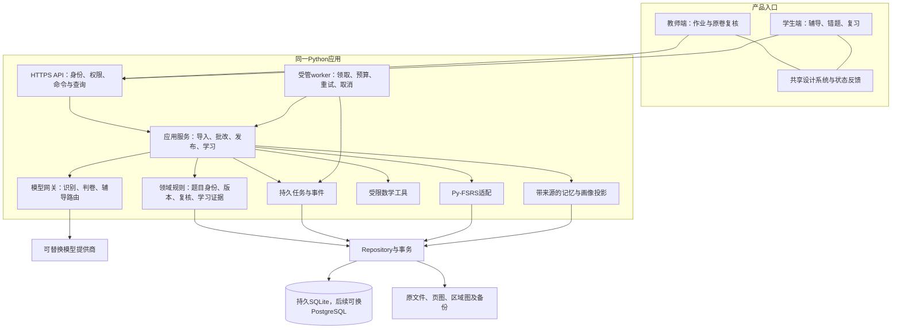
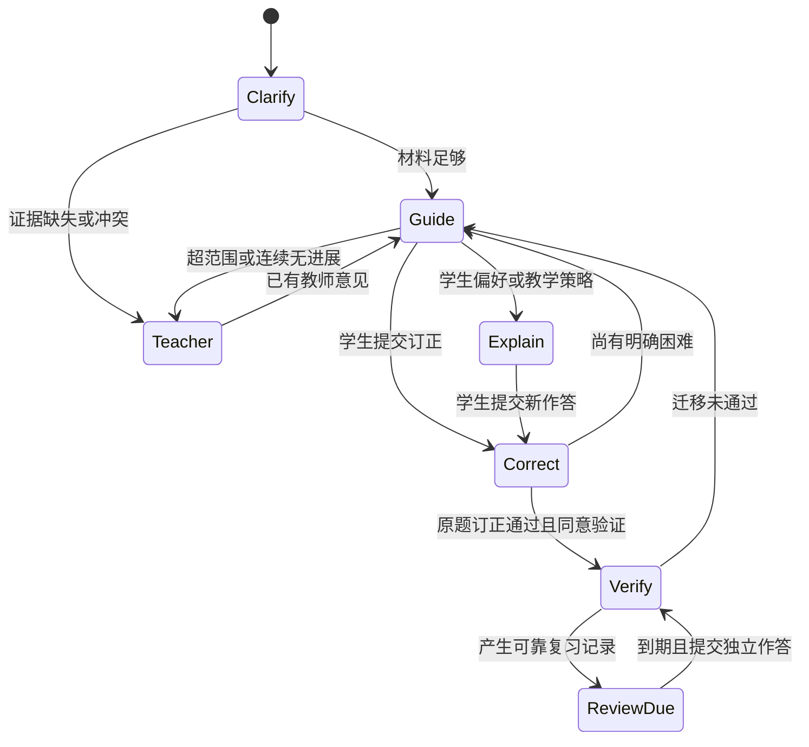
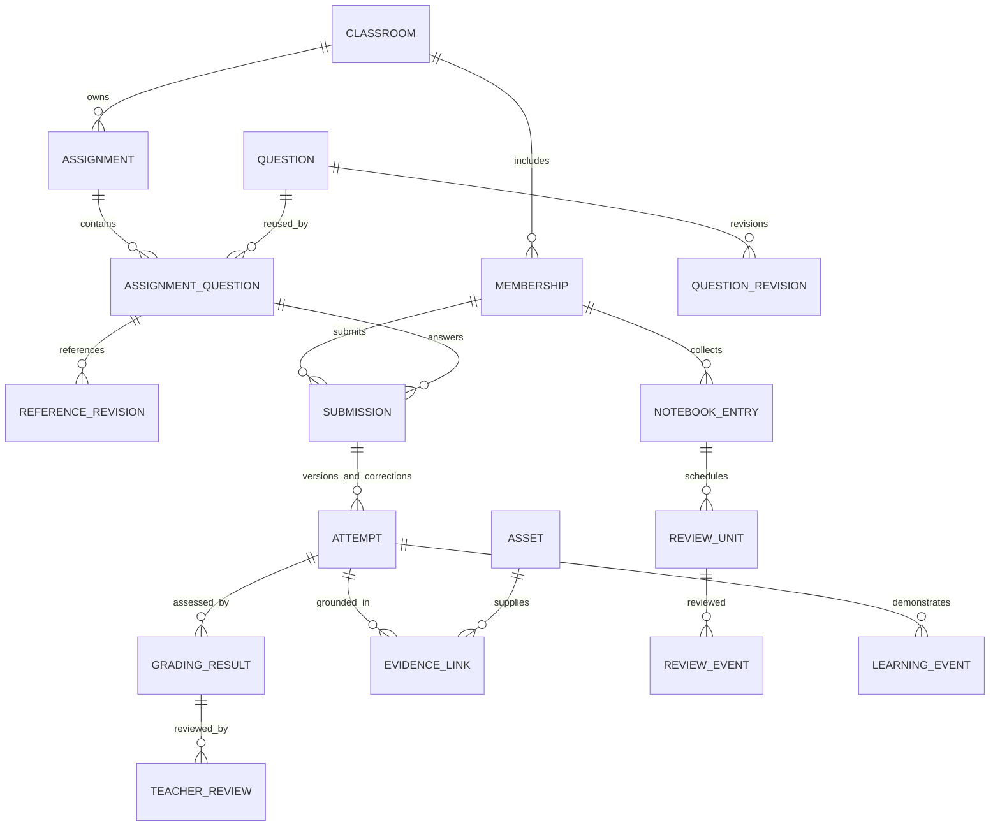
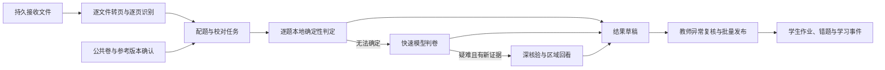

# 02｜MindTrace 循理 AI 目标架构与实施决策

日期：2026-11-21。状态：**推荐方向已批准，分批实施中**。本文保留目标架构设计；实际完成范围以 [03 首批记录](03_phase01_acceptance.md)、[04 批改优化](04_batch_reliability.md) 为准，不将目标能力视为已经落地。配套清单：[02_implementation_plan.md](02_implementation_plan.md)。

设计依据：完整阅读 [00 当前项目审计](00_current_project_audit.md)、[01 开源源码研究](01_open_source_research.md)，并核对当前入口、Runtime、批改、Agent、课堂协作、数据结构、上传和样式。以下“目标”“建议目录”“新接口”“新表”“验收目标”均未实现；已有功能单独说明。赛事贡献是工程判断，不是对官方评分或获奖结果的保证。

## 1. 推荐方案与替代方案

### 1.1 推荐：保留产品入口，构建有持久后端的Python模块化应用

**现有Streamlit界面渐进升级 + Python应用服务 + 持久任务worker + SQLite事务存储 + 原始文件存储 + 官方Py-FSRS。**

教师和学生使用同一后端、同一套业务规则。页面负责输入和展示；模型、任务、权限、结果版本及学习证据由服务端负责。暂不采用微服务集群、Redis/Celery、向量数据库或多专家Agent群。

推荐的线上形态：现有 `https://mindtrace-zoedeng.streamlit.app/` 保留为界面入口；它通过HTTPS访问独立持久后端。后端由同一主机上的Python API进程和worker进程组成，数据库和证据文件位于持久磁盘。API是同一个应用的访问边界，不是把业务拆成多个微服务。

本地开发可让Streamlit直接调用相同应用服务，或启动本机API；本地与线上必须共享服务契约与测试，不另维护两套批改逻辑。推荐常规联调也走API，以尽早暴露权限、传输与重连问题。

为什么需要这个后端：当前识别与批改发生在页面同步函数中，JSON全量写且OCR进度主要在会话里。仅加线程或换成SQLite、仍把一切放在临时界面容器中，不能解决稳定恢复。[Streamlit官方说明](https://docs.streamlit.io/develop/concepts/connections/connecting-to-data)不保证Community Cloud本地文件持久性。因此不能把线上云界面的本地SQLite文件作为正式学习记录唯一来源。

### 1.2 方案比较

| 方案 | 优点 | 成本及局限 | 选择 |
| --- | --- | --- | --- |
| A：Streamlit + 持久Python后端 + 同主机SQLite/worker | 复用现有功能、保持原链接；数据/执行与页面分离；便于逐步改造与回滚 | 需要一处持久后端部署、HTTPS与监控；Streamlit复杂动态界面需先验证 | **推荐当前主线** |
| B：React/TypeScript独立前端 + 同一Python API；后续必要时PostgreSQL/多worker | 布局、组件状态、细腻动效和复杂原卷工作台自由度更高 | 重做界面与两端集成，增加构建、认证与部署成本；原streamlit.app地址不能直接变成React托管域名 | **视觉交互验收不达标时的替代路线**，复用A的后端与契约 |
| C：同一自托管主机上Streamlit + worker + SQLite | 运维单纯，可绕开跨云API传输，适合本地/单机演示 | 需要新的正式域名或服务地址；原链接不能假定自动指向新主机 | 本地开发和可控试点备选 |

不将A写成永久锁死Streamlit的决定。**先用首页与教师复核页做代表性界面验收；若布局、交互状态、键盘操作、页面稳定性达不到第12节标准，就切B的前端工作包。** 不以“框架限制”为理由降低视觉要求，也不在功能不稳时一次性重写全部系统。

SQLite仅作为小规模、单主机部署的起点。API/worker各自建立短连接/事务，不在模型请求期间占写锁；不把数据库文件放网络共享盘跨主机访问。[SQLite WAL官方文档](https://www.sqlite.org/wal.html)要求相关进程位于同一主机，且同一时刻只有一个writer。出现持续写锁拥塞或需要多主机时，再通过Repository适配迁移到PostgreSQL。

### 1.3 产品目标与规模假设

- 初期负载设计：1～2名教师、最多2个班、每班约40名学生；一次20题约800份逐题作答，连续保存至少10次作业。是测试场景，不是已证明的服务能力或硬性产品上限。
- 使用主线：教师“一次作业统一处理”，学生“查看本人作业→理解→订正→独立验证→到期复习”；不要求教师逐个填写学号，沿用文件名/名单匹配。
- 优先可靠性、教师处理时间和学生可验证进步，再追求规模；不以多Agent数量、生成篇幅或页面数量作为创新指标。
- 界面与交互列入正式交付，必须有实际页面、录屏与完整任务流程，不能只提供一份技术报告。
- 不承诺百分之百识别、任意证明形式化验证、永久不中断或一定获奖。用清楚的边界、可恢复失败和真实评测建立可信度。

## 2. 总体架构与职责边界



禁止的依赖方向：领域模块不导入Streamlit；worker不访问 `st.session_state`；模型适配不决定学生身份或正式成绩；页面不直接修改数据库嵌套对象；浏览器不持有模型Key或通用后端管理员Key。

### 2.1 模块职责与现有代码落点

建议目录仅表达边界，不要求第一天搬动全部文件。通过适配器保留旧函数入口，逐步收敛。

| 目标模块（建议） | 职责与主要接口 | 当前可保留/拆出的实现 |
| --- | --- | --- |
| `application/intake` | 接收材料、校验、页处理、公共卷配题；create_import/confirm_transcription | `core/uploads.py:process_pages/assemble_materials`、`education.extract_image` |
| `domain/assignments` | 作业、题目ID、题面/答案版本、应交名单与身份匹配 | `product.create_batch`、`answer_keys.catalog`、`uploads.identify_materials` |
| `application/grading` | 客观本地判分→快速判卷→疑难复核；无UI副作用 | `product.quick_check/deep_analyze/needs_deep`、`answer_keys.compare` |
| `application/review` | 教师改判、批量确认、向学生发布、修订失效 | `presentation.confirm_short/override_grade`、`classroom.review` |
| `application/learning` | 原题订正、变式验证、学生反馈、统一attempt | `education.grade_attempt`、`agent.check_practice`、`product.study_turn` |
| `domain/notebook` | 错题候选/确认/已订正、来源、个人备注、收藏与软删除 | `product.sync_notebook/edit_entry/notebook_rows` |
| `agents/tutor` | 学习目标、动态教学状态、有界动作与工具策略 | `core/agent.py:run/_decision/_tool`，保留其保护 |
| `learning/profile_memory` | 按有效事件投影画像、检索跨题证据、偏好与摘要 | 当前 `_sources/_payload`；借鉴DeepTutor，不引入全平台 |
| `learning/review` | 复习单元、Py-FSRS、到期队列、日志重放 | 新增薄适配；不手写伪FSRS |
| `infrastructure/model_gateway` | ProviderAdapter、请求契约、路由、用量、脱敏 | 拆出 `core/ai.py`，保留现有SDK接入为首个适配器 |
| `infrastructure/jobs` | 作业DAG、领取租约、配额、事件、重试、调度公平 | 升级 `core/execution.py`、`limits.py`、`usage.py` |
| `infrastructure/repositories/assets` | 事务、查询、原文件完整性、版本迁移与备份 | 替代JSON全量写路径，保留只读JSON导入适配 |
| `api` | 按身份处理命令/查询、幂等键、分页、冲突响应 | 建议轻量FastAPI边界；不另复制业务逻辑 |
| `ui`与组件 | 首页、教师工作台、学生学习工作台、统一交互状态 | 保留 `ui/design.py` 入口；整理 `product.py` 的页面职责 |

新增直接依赖候选：官方 `fsrs`、Pydantic用于契约、API框架与对应服务器。SQLite先用标准库，不为其引入整套ORM；如迁移/查询复杂度证明确有需要再选择。安装前锁定兼容版本、保存许可与依赖清单。模型、OCR、FSRS优化器与前端工具链的引入分别验收。

## 3. 识别模型、推理模型与调用路由

### 3.1 模型网关契约

保留目前单一API层的集中保护，但将“服务提供商”和“业务用途”分开。拟定请求：`purpose, provider_profile, schema_version, input_refs, scoped_context, image_regions, output_budget, deadline, correlation_ids`；结果：`parsed_output, finish_reason, provider_request_id, requested_model, returned_model, usage, latency, validation, error_class`。

`provider_profile`是管理员配置的能力描述，至少区分图像、结构化输出、工具协议、流式响应与定价配置；不能从名字推断视觉能力。当前代码请求的默认 `deepseek-flash` 只作为待做真实契约测试的现有配置，不宣称服务商现时已支持。此设计阶段不选定新的付费提供商或模型套餐。

| 用途 | 首选路由 | 升级或停止条件 | 缓存/证据策略 |
| --- | --- | --- | --- |
| PDF转图、配额、身份匹配、统计 | 确定性程序 | 文件损坏或身份冲突→人工处理 | 内容哈希、名单版本；无模型 |
| 试卷/参考答案提取 | 有视觉能力的识别配置 | 缺条件、公式冲突→局部补识别/教师核对 | 每份公共材料只校对一次；稳定题目ID |
| 学生手写识别 | 视觉识别配置，优先作答区域 | 符号/页序/题号异常→针对区域重新识别 | 保留页图、区域坐标、警告、转写版本 |
| 明确客观题 | 本地集合/受限等价比较 | 无法严格比较→快速模型判卷 | 绑定选项语义、题面及答案版本 |
| 解答题/证明题 | 快速判卷配置结合参考要点 | 证据冲突、替代解法无法判定→深核验/原图回看 | 不逐行对模板；结论引用具体作答 |
| 参考答案生成 | 推理配置，每个公共题目一次草稿 | 图形缺失/无法核验→待教师确认 | 与印刷提供答案分开标记，草稿不得作正式参考 |
| 学生即时辅导 | 轻量文本配置+本题证据 | 需要核验才调用工具/深推理 | 按上下文预算裁剪；不重复生成同一讲解 |
| 变式生成与核验 | 按目标生成；确定性验证优先 | 超出工具范围→题库已审题/教师审核/不发布 | 生成模型自审不能当独立数学证明 |
| 长期摘要 | 事件聚合优先，必要时低频总结 | 引用失效或不足→撤回/显示证据不足 | 不每条消息重写全部画像 |
| FSRS/成绩/错误人数 | 官方库或确定性程序 | 无可靠输入则不更新 | 不由LLM给日期或编造掌握率 |

路由升级只在**新证据或不同核验能力**可能产生收益时发生；不把同一提示词发两次当作多模型可靠验证。备用模型必须经过契约验证、数据处理配置许可及用户可接受的成本限制；不能在失败时默默转发给未配置第三方。

### 3.2 手写识别的目标流程

1. 原始文件入持久存储，检查类型、页数、大小、分辨率；保存原始文件与渲染配置，不强制只留压缩图。
2. 教师可先上传公共试卷及参考答案图片/PDF；生成公共题目目录、题型、完整选项、图形引用、评分要点；教师集中校对。没有参考答案则生成草稿后集中确认。
3. 每学生文件按学号匹配；识别学生作答并对应公共题目。题号/小问只是匹配线索，冲突时不盲配；没有公共卷仍保留原有独立上传路线。
4. 保留 `(asset_id, page_no, bbox, coordinate_space, render_revision)`；没有可靠bbox时只保存页引用，不编造位置。不把模型自报confidence直接当校准概率。
5. 警告包括：不清楚的符号、断页、图形条件未提取、题号冲突；对应记录进入待核对队列，下游仅处理证据足够部分。
6. 在疑难判卷/学生问图时，允许授权工具读取**本学生本题**相关图形/区域；不能把本班整页含多人资料发给学生端。
7. 识别、配题、判卷分别评测。可接专业OCR适配器，但需同一匿名标注集对照；这六个参考仓库并未证明能解决高中数学手写，因此不以复用项目名替代OCR评估。

图片预处理先做纠正方向与质量检查；透视校正、行/题区检测须验证对分数线、根号、上下标的影响。处理前后保留对应关系；切勿因缩放、锐化改善观感而毁掉细小符号。

### 3.3 成本、配额与调用归因

预检展示：页数、题目数、已确认参考覆盖、本地可判数量、预计模型调用区间；没测过的图像Token成本标“待估”，不显示虚假精确总价。分开保守预留预算、供应商返回实耗、按管理员单价估算费用；无usage的超时不能记为零费用。

预算按提供商/课堂/用户/作业/任务计，持久化预留和结算；不直接取消当前默认保护。教师批改与学生交互使用同一全局上限，但分别排队，避免一班作业占满所有可用请求。初始模型网络并发1，测试后至2；图片渲染等CPU资源另限流，不能共用无限线程池。

唯一重试调度由jobs负责；SDK自动重试关闭，原 `auto_resume` 的页面sleep逐步退出。短时429进入可恢复等待，尊重合理Retry-After并加抖动；401/配置问题停止，余额/日预算等待有明确原因；5xx/网络失败受尝试数与费用上限约束。截断后的分区识别是新的有记录阶段，不能隐藏成无成本重试。

## 4. 教学Agent：工具、状态、长期记忆

### 4.1 动作与工具契约

保留 `ask_student / explain_step / verify_math / offer_practice / request_teacher / finish` 动作框架。初始沿用每轮最多3次决策、2次数学工具的安全预算，不能以加框架方式移除。工具扩展与额外读取有总轮次、时间、Token和费用预算；成功与失败的消耗分别记录，不无限重试，也不把通信失败当学生失败。

| 工具（建议名） | 输入和输出 | 允许的副作用与权限 |
| --- | --- | --- |
| `read_submission_evidence` | 当前题目版本、原答引用→受限材料 | 只读本学生；所有引用服务端验证 |
| `read_evidence_region` | evidence_id、页/区域→授权图像/图形上下文 | 原卷存储授权后读取；不向客户端暴露磁盘路径 |
| `verify_math` | 类型化表达式、定义域、待验证结论→checked/partial/unsupported/conflict | 受限解析、超时隔离；禁止任意代码执行 |
| `recall_learning_evidence` | 当前目标→近期跨题有效attempt及来源 | 同学生/同课堂允许范围；先过滤权限再取摘要 |
| `read_learning_profile` | student_scope→证据状态与偏好 | 自报与程序统计分开；无凭据或全班资料 |
| `prepare_practice` | 目标、难度、允许题型→已审题候选或待审草稿 | 学生接受后才生成/领取；不提前显示答案 |
| `submit_attempt` | 新作答、来源版本、幂等键→attempt及核验任务 | 由显式学生提交命令触发，模型不能代替学生提交 |
| `request_teacher_review` | 冲突、引用→教师复核请求 | 可创建待办；不能改判或直接发布成绩 |
| `list_due_reviews` | 当前学生、时间→到期卡片 | 日期由服务端和FSRS计算；模型不能改due |

每次工具返回统一 `status, scope, evidence_ids, source_revisions, result, limitations`。JSON动作和原生tool calling走相同校验/分派器；是否使用原生工具协议只影响传输，不改变授权。

### 4.2 状态机与持久恢复



这是教学状态，另有运行状态 `queued/running/waiting_input/paused/failed/cancelled/completed`。一次讲解completed只说明本轮服务完成，不能把教学状态直接设为“已掌握”。

每轮run绑定课堂、学生、题目/作答版本、目标、command_id；保存可审计动作、简短理由、来源、工具观察与停止原因，不存或展示模型内部思维链。新回答是新事件，不覆盖旧attempt。重复命令复用结果；取消只终止该run的后续调度，晚到响应不得覆盖新版本。

学生可一直直接提问、要提示或完整讲解；不强制先做任务、先填错因、固定追问轮数或完成变式。原题订正和复习必须有清楚可选入口，不能藏在“深度Agent”术语后。

### 4.3 长期记忆的最小实现

采用DeepTutor的来源原则，不先迁入三层自动总结全栈：

- L1：真实学习事件，记录原答、判定依据、提示/答案展示、教师复核；通过有效性引用提供审计。
- L2：程序先聚合近期重复困难、独立通过和待复核；少量LLM摘要仅用于语言压缩，每条绑定evidence_id与版本。
- 偏好：学生显式表述才写入，如“先给提示”；不能根据一次错误推断性格、智力或固定能力。
- L3：跨题长期摘要在L1/L2可靠后再增加；初期无向量库，按knowledge_point、时间和来源过滤足够。

引用存在只是必要条件，还要检查内容是否支撑结论；摘要不得把teacher未确认的候选错因写成事实。改参考/改判/撤回证据后，相关摘要标stale并重建；跨学生检索先授权。删除与备份保留策略应覆盖派生摘要，不只删界面上的错题卡。

## 5. 数据模型、版本与迁移

### 5.1 关系结构



### 5.2 建议表与关键约束

| 实体/表 | 核心字段、约束 |
| --- | --- |
| classrooms / memberships / credentials | classroom_id；student_id字符串保留前导零；唯一(classroom_id,student_number)；scope、角色、凭据摘要与吊销版本分开 |
| assignments / assignment_roster | 作业ID、名称、公共卷版本、应交名单快照；唯一(assignment_id,membership_id)，缺交按快照计算 |
| questions / question_revisions / assignment_questions | 稳定UUID，文本仅作匹配线索；题面版本、类型、完整选项、图形；唯一(assignment_id,label,subpart)需显式解决未编号/重号，不盲合并 |
| reference_revisions | draft/confirmed/revoked，答案、必要评分点、来源、确认者、revision；一道作业题可有多版，不改写历史 |
| submissions / attempts | 作业-学生-题目关系；attempt_id、origin(original/correction/transfer/review)、内容快照、fingerprint、版本、父attempt；重复上传与补交分别处理 |
| grading_results / teacher_reviews / publications | 模型/工具判定、证据、规则/提示词/模型版本、依赖版本；review追加不可覆盖；publication引用确切结果及review版本 |
| assets / evidence_links | content_hash、mime、大小、ready/staged/missing、存储位置、页/区域坐标；关联学生/作业并授权，不以知道hash代替权限 |
| notebook_entries / notebook_sources / entry_revisions | 唯一(学生,逻辑题目,练习语境)；候选/确认/订正状态，个人标签/备注独立；不因教师改判覆盖个人笔记 |
| learning_events / assessments | 不可变event_id、request_id、attempt_id、结果、independent、hint、answer_revealed、来源版本；撤销另写补偿事件 |
| study_sessions / agent_runs / agent_steps | 学生与当前目标；status、budget、decision、tool_observation、evidence_ids、material_revision、stop_reason |
| review_units / review_states / review_events | UUID↔唯一fsrs_card_id映射；Scheduler配置版本、Card序列化、due_at、event引用；单次review事务去重 |
| profile_projections / memory_entries / memory_sources | source_event_ids、时间范围、构建版本、stale状态、scope；摘要不作为原始事实 |
| jobs / job_attempts / job_events / model_invocations | idempotency_key、stage、状态、lease_owner/until、fencing_token、input_versions、next_retry_at、请求归因与usage |
| budget_reservations / usage_ledger / outbox_events | 请求前原子预留、请求后结算，unknown消耗留待核对；事件与结果同事务提交 |
| schema_migrations / import_mappings / audit_events | 迁移版本/校验和、原文件哈希与旧ID映射、操作者与操作历史，不混入秘密原文 |

所有业务实体带课堂范围；外键与唯一键尽可能包含或验证范围，避免“UUID全球唯一所以不检查课堂”的漏洞。索引覆盖(student_id,due_at)、(assignment_id,状态)、(job_status,next_retry_at)、(student_id,knowledge_point,occurred_at)。分页查询，不再依赖一次加载整个workspace及2000条作答上限。

### 5.3 四类版本不能混成一个revision

1. 内容：question_revision、transcription_revision、reference_revision。
2. 判定：grading_policy、prompt_version、requested/returned_model、tool_version、teacher_review_revision。
3. 学习：attempt_id、evidence_validity、profile_build_version、scheduler_config/version。
4. 存储：schema_version、entity_version，用于迁移与并发比较。

内容或参考换版→相关旧结果stale→未发布新判定前学生端显示“老师正在重新核对”→旧错题证据退出有效统计→讲解缓存失效→画像/记忆/相关复习状态按有效事件重建。历史可回看但不参与当前正确率；已发出的错误学习建议需有更正提示，不能静默消失。

TeacherReview优先于同版本AI结果；参考或原答改变后，原review保留为历史并待重确认。晚到的模型响应只能存为过时运行记录，不能变更老师已确认的新结论。

### 5.4 原文件与数据库一致性

二进制文件不塞进业务JSON。先写staging、校验hash并完成原子落位，再提交assets.ready与引用；任务仅消费ready资产。崩溃时孤立文件可被扫描，但数据库已引用文件不可误清理；missing资产阻断依赖任务并提示恢复。大文件原子落位不等于与SQL形成跨系统事务，必须有修复流程。

备份包括数据库一致快照、原PDF/图片、引用manifest、schema/配置版本和校验和。SQLite运行中用在线backup或明确的停止写入流程，不直接只复制主db文件忽略WAL。密钥单独管理，不塞进业务备份或Git。

### 5.5 JSON→SQL迁移策略

1. **盘点**：原目录的真实数据仍在；当前精简目录没有它们。先定位实际运行模式与课堂目录，授权范围内做加密/受控备份，不能从空副本误判无需迁移。
2. **只读导入**：按原schema验证workspace、access元数据和原图；保留原JSON及旧ID；把顶层attempts与agent_runs.practice.attempts统一映射，原结构留archive。
3. **保守映射**：旧question_id/文本仅形成候选关联，不自动合并疑似同题；无法确定的匿名学生不自动分配；缺失原图列清单，不能生成替代图。
4. **凭据**：沿用可验证的原摘要格式并记录credential_scheme；API使用同一摘要比较，不能试图从hash恢复原码。旧演示学号模式保留为独立虚构课堂；必要时经教师确认重新发码。
5. **影子比对**：SQL只读查询与原JSON对比学生数、作答、复核、来源、错题和统计；幂等导入，重复执行不增数据。
6. **切换**：课堂分批进入短暂写冻结→最终导入→关联/统计/文件校验→切换服务指针。每课堂仅一个主写入源，禁止随意双写JSON和SQL。
7. **恢复写入**：新事件进入SQL后，不直接让旧程序回写旧JSON；回滚规则见第11节，不能丢弃切换后学生的新作答。

## 6. 教师批量任务架构

### 6.1 批次图与任务状态



Job状态：`queued → running → succeeded`，或进入 `retry_wait / quota_wait / needs_input / needs_review / failed / cancelled / obsolete`。`needs_review`是正常业务终态，不能自动反复调用同一模型；`failed`是服务没完成。批次可显示“自动批改已完成；N份待老师核对”，不是把人工待定写成任务仍在运行。

### 6.2 领取、提交与恢复

- 事务比较交换领取可执行job；设置lease_owner、lease_until、递增fencing token。SQLite用短写事务实现等价领取；不要照搬“先SELECT再无条件UPDATE”。
- HTTP请求在事务外执行；心跳续租；结果提交比较owner/token和输入版本。租约失效或输入改变则拒绝覆盖。
- 每个阶段有唯一逻辑任务键；job_attempt记录每次实际尝试。结果、usage关联、下游outbox在同一事务写入，完成后才发布进度。
- 并发修改共享工作区的模式退出；worker返回结果，服务层按实体版本提交。线程不得写同一嵌套字典。
- 进程重启时扫描过期运行任务，已成功阶段不重跑；新一轮尝试受次数、预算与输入版本限制。无新证据的待复核题不重新消费。
- 外部模型已处理、响应尚未落盘时机器崩溃可能重复计费。保存invocation为outcome_unknown，若供应商支持查询/幂等则对账，否则预算受控地重试并明确记录，不能承诺exactly-once外部调用。
- 自动等待由服务定时调度，不让用户每次点“继续”；只有欠费、日预算、缺材料、需人工复核等需要人介入。

### 6.3 进度与公平调度

页面提交命令返回batch_id/job_id，然后读取摘要；进度为 `已完成/当前可执行阶段`，新增子任务时注明阶段变化，不伪装精确剩余分钟。识别、批改、待复核、发布分四种进度；同时展示已用费用/待估、当前原因、下一次自动尝试时间。

队列按课堂轮转并对学生交互保留公平机会；不能让一次800条逐题作答永久阻塞即时辅导。初始1→2路并发，需要测提供商配额、CPU、数据库写延迟和费用。teacher取消只停止新派发，不把已有成果删除。

### 6.4 教师操作流程

作业页固定主操作区：**上传 → 核对 → 开始批改 → 复核与发布**，当前位置清楚。参考答案集中编辑，缺失项直接标明；“无答案生成草稿”按题执行，不按学生重复。

结果工作台：上方整体状态和明确分母；中间题目矩阵/错误人数，点击题目右侧打开该题学生案例；原卷与识别文字并排；教师可批量确认稳定结果、逐项处理异常，再一键发布本次可发布结果。不是要求老师逐题确认每个明确正确答案。

“AI候选”“教师确认”“已发布”区分。发布绑定快照版本；未判定题可发布为“待核对”说明而不生成错误错因。成绩只有存在经确认评分细则时才启用分值模式；不从正确率或模型文字推算正式分数。

## 7. 学生画像：由真实作答证据生成

### 7.1 画像数据结构（示意）

```json
{
  "student_id": "scoped-membership-uuid",
  "classroom_id": "classroom-uuid",
  "projection_version": 1,
  "built_through_event_id": "event-uuid",
  "knowledge_states": [{
    "knowledge_point_id": "math.function.monotonicity",
    "evidence_state": "needs_more_evidence",
    "independent_attempts": 2,
    "independent_correct": 1,
    "assisted_attempts": 1,
    "delayed_independent_passes": 0,
    "recent_error_categories": ["condition_omitted"],
    "supporting_event_ids": ["event-a", "event-b"],
    "contradicting_event_ids": [],
    "last_observed_at": "UTC timestamp"
  }],
  "preferences": [{
    "key": "hint_first",
    "basis": "learner_report",
    "source_turn_id": "turn-uuid"
  }]
}
```

示例数量只表达结构，不是已有学生结果。统计按有效来源、题目独立性及版本过滤；原题重做和新题迁移分列，同一道题多次点提交不能膨胀“独立题数”。

### 7.2 初期可解释状态

建议显示“待了解 / 正在订正 / 有提示完成 / 原题独立通过 / 新题独立通过 / 已有延迟验证”，每种状态附数量、时间与原题入口；允许存在矛盾证据和过期状态。未标注知识点的题不硬归类；AI知识点关联先标候选，不把复杂证明拆成臆测的认知标签。

掌握判断不简单取最高状态永久保持。新错题可把“需关注”重新激活，长期未测提示“需复习”。不输出未经校准的80%掌握、学习能力排名或“粗心型人格”；DeepTutor的加权率启发式不能直接套为能力概率。

教师看班级知识点覆盖、订正完成、真实迁移和延迟验证；学生看下一步最有帮助的任务，避免一个充满雷达图和虚假精确数字的画像页。

## 8. 错题本、FSRS、订正与变式闭环

错题实体保存完整题面、原答、教师结果、来源和个人笔记；复习单元表达具体目标，可以一题一个“独立重做”主单元，再按实际需要选条件/关键步骤卡，不自动拆成几十张记忆卡。

| 事件 | 错题本变化 | FSRS/学习证据变化 |
| --- | --- | --- |
| AI判错但未发布 | 教师侧候选；学生不收到正式错因事实 | 不产生成功复习日志 |
| 教师发布判错 | 进入本人错题，保留候选/确认错因依据 | 可建立待复习单元；建立卡不等于已复习 |
| 学生不会做、原卷留白 | 可主动收藏或老师分配待学题 | 标待学，先教学，不凭空生成失败历史 |
| 查看解析/收到提示 | 记录assistance，不改原始答案 | 不自动Good/Easy，不计独立通过 |
| 提交原题订正 | 新attempt，可与原答并排 | 明确原题重做证据，避免当作新题迁移 |
| 自愿变式验证 | 关联parent_question与目标 | 已审题参考+独立作答才计迁移 |
| 到期复习且可靠评分 | 保留复习历史 | 原子写ReviewLog和新Card；更新due |
| 原题/参考被改判 | 标更正，保留笔记和历史 | 撤销相关有效证据，按剩余有效日志重放；不静默擦除事件 |

使用研究中核实的Py-FSRS接口：`Scheduler.review_card → (new_card, ReviewLog)`；存Card与Scheduler完整配置、包版本，UTC持久化、用户时区展示。业务UUID映射数据库唯一整数card_id，不依赖毫秒默认ID避免批量建卡碰撞。

复习评分和数学判定不同：明确失败可Again；独立正确后由学生确认Hard/Good/Easy并记录rating_source；模棱两可保持待核对，不强制评成功。有提示练习单列，不进入“独立回忆”调度证据流；若学生主动做普通自评卡，另存self_report模式并排除客观学习成效统计。初期固定默认参数和目标保持率配置，不训练个人参数。

同一个request_id重复提交只更新一次；同request_id不同内容拒绝。日志、状态、due、业务事件在同事务中写；只通过模型回答“我会了”不调用FSRS更新。

## 9. 教师学生双端共享与安全边界

### 9.1 单一事实来源和发布机制

后端为唯一事实源。两端不各存一份可写workspace，也不靠浏览器本地文件互传。命令与查询分离：写命令带command_id/expected_version；响应包含entity_version和课堂范围内event_cursor。UI保留选中题目/滚动位置，不能刷新后跳回首页。

建议API边界：`POST imports`、`POST batches/{id}/grade`、`GET jobs/{id}`、`POST reviews`、`POST publications`、`POST attempts`、`GET notebook`、`GET reviews/due`、`POST review-events`、`POST tutor-turns`、`GET changes?after=cursor`。这是待实现契约，不是当前已存在路由。

开始使用3～5秒轻量轮询，后续需要时才加SSE；轮询只读，不能顺带触发新批改。事件游标为授权范围内opaque cursor，客户端不得通过查询枚举全班私人事件。API提交结果后outbox通知，通知失败不撤销已提交事实；重连可以重新查询快照。

教师发布→学生作业/错题更新；学生订正/练习→教师反馈列表更新；教师改判→学生当前结论、画像及复习计划一起失效/重建。统计和显示基于相同结果投影，不能一边用自动判定、一边用教师确认而不注明。

### 9.2 身份与权限

继续支持现有课堂个人学习码和教师恢复码，不要求第一阶段引入复杂账号中心；码是持有者凭证，保留摘要、scope、撤销和轮换。进入课堂后换短期、范围受限的服务会话；课堂码不放URL查询参数、分析日志或前端长久缓存。

学生号用于**归属**，不作为真实数据访问凭证。按学号演示模式只承载虚构数据，与真实课堂明确隔离；这沿用已有产品边界，不再新增繁琐“确认匿名”步骤。后端不能信任客户端传入的student_id来授权。

教师能管理本课堂作业与发布；学生只读本人已发布作答/图像及公共题面，可写自己的订正、笔记和练习；不能改原始教师作答、成绩、他人数据、参考版本、quota。public资产与private资产分开，整页含他人信息时需裁切或拒绝学生读取。

### 9.3 原链接和GitHub的迁移路径

当前开发副本没有 `.git`。本次不修改Git关联、不推送，也未在线验证托管仓库配置。实施时先核实Streamlit绑定的仓库、分支、入口和Secrets，使用受控开发分支/预览部署；新目录需正规关联，不能复制包含真实配置的完整目录。

原链接继续承载Streamlit界面时，可通过私有配置连接持久后端，不能让SQLite由Streamlit容器直接跨网络挂载。后端离线时展示明确服务状态，已发布资料按授权缓存策略读取；不能回退到公开共享的本机JSON。

若选择B的React前端，新前端需新的托管地址；原链接可保留兼容入口与明确跳转。不能承诺原streamlit.app域名可以直接托管任意React应用。切换前做双端同一套用例，保留旧版可访问记录，不覆盖原线上站点后再调试。

## 10. 主要不变量与可观测性

以下是所有功能的共同验收底线：

1. 每条正式判定能回到确定题面、原答、参考、教师复核和模型/规则版本。
2. 一位学生无法读取或修改另一位学生私有资料；知道asset hash或学号不能绕过授权。
3. 一次有效command/attempt/review只计一次；不同内容复用同幂等键被拒绝。
4. 已发布旧结果在输入换版后不能继续当现时事实，晚到模型不能覆盖教师新判定。
5. “任务未完成”“数学无法确定”“等待教师确认”明确区分，不强行猜对错/错因。
6. 状态、学习事件及FSRS更新同成同败；原图缺失可见且阻断相关推理。
7. 任何课程、课堂或页面切换不会混用上一学生/上一题上下文。
8. 模型Key和访问码不进入前端、业务JSON、普通日志、截图或备份manifest。

每个job/run/invocation有correlation IDs；结构化日志只保存脱敏元信息；教学材料独立受权读取。指标至少包括队列等待/执行耗时、P50/P95、成功/重试/待复核数量、Token与费用状态、有效判定覆盖率、学生更新延迟、失效投影数量和备份年龄。

## 11. 测试、评测、发布与回滚

### 11.1 验证层次

| 层次 | 必测内容 | 失败时的处理 |
| --- | --- | --- |
| 纯函数与领域规则 | 多选集合、数学等价边界、错因未知、分母、版本失效、学习证据归因 | 不进入真实班级试点 |
| 存储与命令集成 | 租约、并发领取、重复命令、教师改判、旧worker晚到、原图缺失、迁移幂等 | 回滚该模块/停写，保留原始数据 |
| 模型契约 | 图像/JSON/工具支持，finish_reason、超时、429/401/5xx、输出截断、用量 | ProviderAdapter不可启用；离线fixture不能代替真实契约通过 |
| 故障恢复 | 关闭页面、kill worker、API重启、磁盘满、临时网络断、预算耗尽、备份恢复 | 失败不重做成功步骤；未知外部调用明确记录 |
| 双端端到端 | 教师上传→发布→学生查看/订正→教师反馈；两学生多浏览器越权与冲突 | 阻断上线，不能以单端截图代替 |
| 视觉与交互 | 指定宽度截图、键盘/焦点、原卷缩放、状态覆盖、hover/动效、加载稳定 | 代表页不达标则改方案/进入B前端路线 |
| 真实题目评测 | OCR/配题/判卷分别独立标注；替代解法、多选、复杂大题、手写与图形 | 分层报告，保留失败案例，不只展示成功截图 |

把 `docs/00_audit_offline_checks.py` 的18项复现迁入正式测试时，现有REPRO用例改为修复后的期望行为；不能保留“证明bug仍存在”的断言还宣称测试通过即修复。当前依赖环境与首屏验收均需重新建立，不把此前语法检查当产品可用证明。

### 11.2 评测数据和候选目标

先建立授权匿名样本：建议至少200个逐题区域，覆盖不少于30页、单选/多选/填空/解答、清晰与模糊手写、跨页和图形；独立划分开发/留出集，同一题及同一学生卷的近重复不得泄漏两侧。由数学人员标注，争议双人复核；样本达不到时如实报告规模和置信区间。

以下为**待基线后确认的候选验收目标**，不是已测结果、对任意高中题的保证或强行上线门槛；不为凑指标把困难题全部降待定。

| 目标 | 指标定义与候选标准 |
| --- | --- |
| 识别可靠性 | 单列关键符号准确率、公式可用率、逐题全字段正确率；高风险关键符号目标≥99%，题目/学生配对准确率目标≥99%；附样本分层与人工校对时间 |
| 判卷可信度 | 已自动判对/判错中分别报告precision、recall、覆盖率与95%区间；候选自动结论precision≥98%、覆盖率≥90%，复杂证明单列；不能用提高待定率掩盖错误 |
| 教师效率与成本 | 同一固定班级题集、同参考和模型配置对比旧版；候选人工处理时间和模型调用数各降低≥30%，费用不升；总耗时报告冷/热启动及P50/P95，无实测不写“提升数倍” |
| 任务可靠性 | 可注入故障用例中成功阶段不重跑，数据不丢、越权0例、业务重复计数0例；外部API未知窗口单列 |
| 双端同步 | 正常服务下提交成功后≤5秒可见；断线期间不作保证，重连后按版本恢复；同条件记录P95 |
| 页面操作 | 不依赖模型的常见查询/切换目标P95≤1秒（指定数据量/网络下）；上传/模型调用给即时反馈，不把其耗时混入纯UI指标 |
| 教学闭环 | 记录原题订正率、独立迁移正确率、7天延迟验证、提示依赖；不预设短期试点必有显著学习增益 |

费用比较包含识别重试、参考草稿、深核验和学生解释，不仅比较快速判卷。若标注不足导致区间很宽，就保留不确定结论，不用少量样本证明百分之百准确。

### 11.3 发布与回滚

功能开关按课堂控制新网关、任务执行器、SQL存储、Agent记忆和FSRS。阶段发布以可回放小课堂为单位；先离线→匿名真实样本→双端试点→正式入口。影子判卷不默认发第二套付费请求，优先重放固定样本或经明确预算授权。

迁移前可停新服务、恢复旧版本及原JSON只读入口。**迁移后已有新写入时不能简单还原旧数据库文件或把代码回滚到只认识V1的版本**：先停止派发任务、写冻结、备份新库与事件，优先回到兼容当前schema的上一应用版本。确需回旧引擎时由兼容层导出旧实体，同时以只读方式保留V2新增attempt/复习/记忆；明确短暂不可用功能，不能丢记录。

数据库采用先增字段/表、双版本可读、稳定后再移除旧字段；schema切换和数据迁移分别记录。恢复演练校验原文件hash、引用、计数、教师review与每学生权限；只有“有zip文件”不算备份可用。后端监督进程重启worker，租约过期恢复，而不是由浏览器负责拉起后台任务。

## 12. 界面与交互：同等优先级的产品架构

### 12.1 设计方向与页面组织

延续用户认可的层次蓝色/蓝紫卡片、白色工作面与深色文字；统一字号、行高、间距、圆角、阴影、图表、按钮和状态色。品牌统一为 **MindTrace 循理 AI**。首页主视觉保留文化表达与简明产品介绍；不再每页堆意义不明的大句子。

| 页面 | 核心布局与交互 | 不允许的退化 |
| --- | --- | --- |
| 首页 | 两张有层次、适中高度角色卡，鼠标悬停/键盘聚焦即预选；轻微放大和回弹，不重排周围内容；整卡明确可进入 | 需要先点“预选”再进入、扁平空白卡、标题挤压或大面积无目的留白 |
| 教师作业 | 单一作业状态条、公共卷/参考区、上传队列、持续任务进度；主CTA固定可见 | 批改藏popover、多层“继续”、缺密钥却显示可开始 |
| 教师复核 | 题目统计与学生列表导航；原卷/转写/依据在同屏主区域；次要编辑放独立页签/侧栏 | 一列堆多个expander；空过滤没有说明范围和计数 |
| 学生学习 | 统一文字+图片+PDF输入、发送后自动上传识别；任务状态、取消、校对定位清楚；对话旁保留原题上下文 | 再次确认匿名、上传后还需寻找识别按钮、换题混入上一题对话 |
| 错题本 | 搜索、题型/状态筛选、清晰卡片，打开后原题/订正/记录切换；下一步操作直接显示 | 只有错因标签没有原题；已判定失效还显示肯定错误 |
| 复习中心 | 今天到期、待学习、待复核分开；显示复习目标和历史；提交后立即反馈与下次安排 | 把看解析算完成；强制做完长任务才能普通提问 |
| 教师反馈/画像 | 能从统计回到具体学生和attempt；显示证据时间与独立性 | 虚构掌握百分比、无依据排名或不可追溯图表 |

### 12.2 可验收的设计标准

- 代表性宽度1440、1280、768、390px；教师密集工作台窄屏改分步/上下布局，不把两列硬挤到不可读。公式可横向查看，页面整体不溢出。
- 中文正文建议16px上下、辅助文字不低于12px；原答与公式优先可读，不靠缩小截图容纳全部内容。数学渲染验证分数、上下标、长公式与多行对齐。
- 常用操作键盘可达，焦点可见；hover并非唯一状态；颜色旁有文字/图例，原卷支持缩放与页切换。
- 常用hover/切换反馈约180～300ms，回弹幅度克制；支持减少动态效果设置，任务处理中不靠无意义闪烁制造进度。
- 覆盖空、加载、成功、部分完成、待核对、失败、离线、取消、权限不足、版本冲突状态；保存完成才显示成功。
- 重要信息主区可见；说明文字回答“当前发生什么/接下来怎么做”，如将“引用的作答转写”改为“本次判定依据的学生答案”。
- 同一错误过滤显示当前作业/题目范围及数量；无数据时解释“本题暂无已判错作答”等真实原因，并提供返回全部入口，不只空白警告框。
- 用实际运行页面截图和连续操作录屏验收，不能用静态模拟UI替代实现。先确定两张代表页，达标后推广整套组件；若Streamlit达不到，按替代B切前端并复用后端。

本阶段不生成新界面或修改CSS。用户之前给出的图片用于风格与交互目标，不假定它们已经全部转成可用设计资产；下一阶段先整理可访问参考、制作真实页面原型并逐项对照。

## 13. 功能价值、成本、风险与依赖总表

等级为相对工程判断；“成本”含实现与验证，不只代码行数。“影响”描述需要触及的现有边界；所有行都是待实施。

| 功能/设计 | 比赛竞争力贡献 | 成本 | 技术风险 | 对现有功能影响 | 前置依赖 | 证明效果的指标 |
| --- | --- | --- | --- | --- | --- | --- |
| 独立环境、锁依赖、正式回归 | 高：演示与复现基础 | 低中 | 低 | 启动/部署契约 | 无 | 干净环境启动、核心回归、双端冒烟 |
| 原答/参考/讲解/错题版本一致性 | 极高：避免误导学生 | 中 | 中 | product缓存、review、notebook | 基础回归 | 换版失效与晚到结果用例 |
| SQL事务、证据存储、迁移 | 高：多人长期稳定 | 高 | 高 | Runtime、collaboration、存储 | 数据契约/备份 | 数据/文件对账、冲突/恢复、无记录丢失 |
| 公共卷与稳定题目ID | 极高：低成本同卷批改 | 中高 | 中高 | 上传、配题、answer_keys | 身份/题目契约 | 配题率、参考覆盖、重复调用、校对时间 |
| 手写识别与图形回看 | 极高：数学可靠性核心 | 高，含标注 | 高 | OCR、图像证据、模型路由 | 匿名基线、网关、资产 | 关键符号/整题正确率、误配、有效可判覆盖 |
| 分层批改与替代解法 | 极高：区别模板比对 | 中高 | 高 | quick/deep与工具 | 参考版本、评测集 | 正确/错误precision、替代法误判、费用 |
| 持久job、自动等待、受控并发 | 极高：解决慢与反复继续 | 高 | 高 | 批次执行、额度、usage | SQL、网关、版本 | 故障恢复、总耗时P95、费用和重复尝试 |
| 教师复核/发布与应交名单 | 高：双端结论可信 | 中 | 中 | review、统计、学生视图 | 主数据与事务 | 缺交对账、发布延迟、改判传播 |
| 原题订正与变式验证 | 极高：真实学习闭环 | 中高 | 中高 | 学生页面、agent实践 | 发布、attempt契约 | 独立订正/迁移、提示依赖、反馈可追溯 |
| 受控Agent与教学状态 | 高：有证据动态教学 | 中高 | 中高 | 现有动作循环 | 网关、证据、attempt | 工具正确调用、停止边界、教学分支覆盖 |
| 跨题记忆与个人画像 | 高：个性化可解释 | 中高 | 高 | _sources/_payload、旧profiles | 统一事件与失效链 | 引用支持率、跨人隔离、撤回、策略对照 |
| 官方FSRS到期复习 | 高：长期价值可展示 | 中 | 中 | 错题本新增复习入口 | 有效attempt与事务 | 到期、重放、去重、延迟验证记录 |
| 设计系统与工作台交互 | 极高：降低理解和使用成本 | 中高 | 中；换框架则高 | 主要UI/CSS/组件 | 代表页可早期并行验证；最终接稳定API | 任务成功率、耗时、误操作、视觉与键盘验收 |
| 后端部署、原链接兼容 | 高：真实可访问产品 | 中高＋实际托管成本待选型 | 中高 | Git/部署/Secrets配置 | 预览验收、持久主机 | 重启恢复、两浏览器联动、入口可用 |
| 实验与证据化参赛演示 | 极高：优势有据可查 | 中＋试点时间 | 中 | 仅导出与呈现 | 功能门槛通过、真实样本 | 同条件质量/成本/教师时间与延迟测验 |

## 14. 决策与批准范围

推荐批准A的渐进主线及配套任务清单：**先基线与版本一致性；同时做两张代表页视觉交互验证；再统一数据、公共卷、识别网关与持久任务；最后补齐订正、复习和跨题个性化，并完成真实双端评测。**

前端路线B是有明确触发条件的替代，不是默认重写。新的付费模型、托管采购、真实学生数据处理及正式线上切换，实施时以具体配置、预算和验收结果为依据；此文档不视为已经发生的操作。

等待用户批准的是**架构与实施范围**，不是要求用户逐项判断代码细节。批准后由实施方持续推进、按阶段提供可运行结果与证据；重大范围/费用或前端路线变更再说明取舍，不让用户反复确认普通实现细节。
