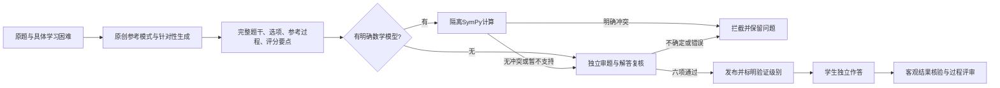

# 07｜数学能力升级：开源复用与题型边界

日期：2026-11-21。范围：开发副本中的数学工具、学生Agent和变式训练；保留现有页面设计、教师批量批改及双端联动。未推送GitHub，未更新公开Streamlit地址，未调用付费模型。本文件不宣称任意高中数学证明已经能够形式化验证。

## 1. 别人的真实实现与本次取舍

继续核对了独立研究目录中的DeepTutor固定提交 `341af371bf8143b2da3569084edf8e6cb46d7404`：

- `deeptutor/capabilities/solve/prompts/zh/system.md`：先规划，工具辅助求解，按步骤记录完成，图形题可用GeoGebra能力。不是一个只接受多项式的求解器。
- `deeptutor/services/practice/answers.py:check_answer`：客观选项匹配，包含多选集合；短答、论述和自由回答明确不由该匹配器判定。
- `deeptutor/learning/semantic_assessment.py:exact_verdict/judge_answers`：确定性匹配和语义评估分开，评估绑定具体题目与来源。其模型信心阈值没有移植，模型自报confidence不视为数学证明。
- `deeptutor/tools/exec_tool.py`：可执行工具与隔离环境契约。未移入允许任意Python/Shell的执行器，也没有复制整个Agent平台。

**直接复用SymPy 1.14.0的成熟计算算法；独立实现窄权限适配层；借鉴DeepTutor的“客观核验与语义评审分开”架构。** 这比翻译整个平台更能保留原有数据和双端业务。SymPy为BSD-3-Clause，许可证归档于 `licenses/sympy-LICENSE.txt`。本次未复制DeepTutor或无明确授权的批改仓库源码。

官方实现依据：[SymPy求解器](https://docs.sympy.org/latest/modules/solvers/solveset.html)、[不等式](https://docs.sympy.org/latest/modules/solvers/inequalities.html)、[几何](https://docs.sympy.org/latest/modules/geometry/index.html)、[DeepTutor仓库](https://github.com/HKUDS/DeepTutor)。本轮数学适配直接调用SymPy的符号/集合/矩阵API，没有声称已经接入GeoGebra。

## 2. 必须区分的三种“题型”

1. **作答形式**：单选、多选、填空、解答；决定比较选项、最终结果还是审查完整过程。
2. **知识模块**：集合、函数、三角、数列、不等式、向量、解析几何、立体几何、概率统计、综合证明；决定建模与教学重点。
3. **核验任务**：求导、方程、区间、不等式、求和、向量、坐标、计数等；一个综合题可能包含多个任务。完成一个计算不能宣布整道证明正确。

不能因为作答形式是“解答题”就不接收，也不能因为工具算出了某个数，就把所有解答题判正确。

## 3. 已接入的能力和明确边界

| 知识模块 | 符号工具支持 | 过程评审重点 | 当前不可冒称已验证的部分 |
| --- | --- | --- | --- |
| 集合与逻辑 | 有限集合交集、显式关系求解 | 取值域、量词、必要充分条件 | 任意逻辑证明和量词消去 |
| 函数与导数 | 初等函数表达式、复合函数求导、实数定义域 | 单调区间、极值与端点、参数范围 | 任意含参分类讨论全自动符号求解 |
| 三角函数 | 三角表达式、给定区间内三角方程 | 周期、两支角、角度范围与丢解 | 任意三角综合证明 |
| 数列 | 有限/符号求和，正整数n、k，几何与加权求和 | 递推转换、首项、下标、错位相减 | 任意递推闭式和归纳证明自动化 |
| 不等式 | 可求解的一元实不等式、区间与定义域 | 乘除符号、等号条件、参数分类 | 任意多元或含参不等式形式化证明 |
| 平面向量 | 数量积、模长、二维距离 | 非零条件、向量与数量关系对应 | 从任意图形自动可靠识别全部向量条件 |
| 解析几何 | 有界低次多项式方程组、代数交点、距离 | 坐标建模、两个交点、退化和边界 | 任意圆锥曲线参数全分类 |
| 立体几何 | 三维数量积、叉积、距离和坐标表达式 | 坐标设置、法向量、定理条件、推理覆盖 | 图片自动建模、任意空间证明形式化验证 |
| 概率统计 | 组合数、阶乘、精确分数、模型给定后的表达式计算 | 等可能、放回与否、事件独立性、分布假设 | 自动证明统计假设成立或任意数据结论可靠 |
| 综合应用与证明 | 可拆解的计算子任务 | 条件、循环论证、替代解法、关键推理和评分要点 | 通用形式化定理证明器 |

底层统一11类操作：`evaluate/derivative/equation/inequality/system/sum/dot/cross/norm/distance/set`。这不是新增11种用户必须手选的表单；Agent自行构造有来源的计算请求，学生直接作答。求解器不能决定的情况返回unsupported/unresolved，不把“不能算”改成“学生错了”。

### 客观题与多选题

- 新生成的选择题必须有完整选项；单选参考只能包含一个选项；参考选项必须存在于题面。
- 多选按集合比较：`AC`与`C、A`等价；漏选、多选与选对明确区分，不能因字母顺序不同判错。
- 新生成题先做独立审题复核，之后的集合匹配是“与该参考答案比较”；不能把AI参考答案包装成程序从题意独立推导的答案。
- 多选部分分值按题目/教师评分标准处理；本次不擅自增加通用部分得分规则。原教师端既有多选集合比较继续保留。

## 4. 从生成到发布的实际流程

六项审查：题目完整、模型对应、定义域与分类讨论、过程逻辑、答案一致、评分要点覆盖。任一fail/uncertain或存在未解决问题，均不能以correct发布。生成器声明的“已经验证”不算复核；审题是独立的一次模型调用，但可能仍使用同一提供商和同一模型，存在相关性错误，并不等于独立形式证明。

发布状态分别为“计算核验与审题复核通过”或“AI审题复核通过”，没有工具支持的证明题不再被无条件封禁。程序计算结果只对所提交模型负责，题意翻译与完整证明另行审核。学生Agent的数学观察明确保存 `model_binding=requires_reasoning_review`，不会直接把一次模型计算当作原作答正确的权威证据。

同结构巩固允许改变系数/条件；标注“结构迁移”的题仍禁止仅换数字；原样重发原题仍拦截。评分依据改变后，旧审题回执不能直接用于新作答判定。

## 5. 原创参考模式：不是伪造的已审定题库

`data/math_reference_patterns.json`包含覆盖全部10个知识模块的10个项目原创参考模式，每题有答案、评分要点、适用计算请求。包括对数含参导数、区间三角方程、加权指数数列求和、椭圆直线交点与弦长、空间点面距离、超几何抽样、均值不等式证明等。

有计算请求的子结论已纳入真实SymPy回归；例如椭圆题的方程组核验只证明交点计算，不冒称弦长和整个过程都已证明。原模式不会直接伪装成教师审定试题发给学生，而是提供给生成器作为建模与评分依据的参考，新题仍须经过本轮审核。

**目前没有取得带明确再分发授权的完整高考题库，也没有数学教师签署的整题审核记录。** 不能把这10个模式称为成熟真题库或全题型验证集。后续可接收教师自有试卷与评分标准，或经授权的题库，并记录来源、版本、审核人与范围。

## 6. 成本、恢复与边界

- 每道新变式通常一次生成、一次审题；这增加单题复核成本，收益是扩大可用题型并减少错误参考直接发布。不能未经测量宣称本轮必然省钱。
- 通过后复用同一道练习与审题回执；审题超时保留候选，继续审核时不重复生成。明确拒绝的候选再次请求时才重新生成。
- 纯计算按完整请求缓存256项（包括预期结果），不缓存临时超时和进程失败；不付模型费用。缓存为单进程，不是跨部署持久缓存。
- 一次计算默认6秒，最多4个并发；子进程只接收数学JSON，不继承API Key和课堂数据，不允许任意代码、文件或网络操作。AST白名单、表达式节点/深度/幂次/有理数位数/方程组次数均有限制。
- 这不是完整操作系统安全沙箱，也没有容器级内存配额；当前不引入任意代码执行。教师原有批改队列和参考答案共享未改造为每份作答再加一轮审核，避免本次放大班级批改费用。
- 本轮原始拍题/教师批改仍保留既有识别与批改调用；新增广泛结构化计算主要通过学生Agent和变式流程接入。不是所有教师批改请求都已经调用新版计算层。

## 7. 验证与复用落点

| 文件 | 职责 |
| --- | --- |
| `core/math_kernel.py` | 直接调用SymPy，受限解析、定义域保留、进程期限与缓存 |
| `core/exercise_review.py` | 六项审题回执、参考版本绑定、学生集合/区间/选项比较 |
| `core/education.py` | 针对性生成、参考模式、按审核结果发布、训练结果保存 |
| `core/agent.py` | 有来源的广泛数学工具请求、预算与权限、取消后停用工具 |
| `core/question_patterns.py` | 原创模式只读筛选与来源声明 |
| `ui/agent.py`、`ui/student.py` | 真实显示选项与审核级别，沿用当前布局 |
| `tests/test_math_kernel.py` | 50项新增验证：真实符号结果、安全、定义域、审核恢复、多选和来源绑定 |

新增专项测试：50项通过（41.23秒）。完整回归：352项通过（75.36秒），包含此前302项；一个既有Starlette测试客户端弃用警告。系统临时目录权限异常通过项目内独立测试目录隔离处理，未修改系统目录权限。离线模型回执是显式测试替身，只验证发布/拦截/恢复控制，不是实际AI准确率结果。没有实际付费模型、手写识别或教学效果评测，不能声称已达到DeepTutor完整能力或比赛获奖标准。

验收应优先实际走三条完整链：复杂三角/数列计算题；含过程与等号条件的证明题；多选漏选与不同正确解法。随后使用真实高中卷面、人工标准答案测量识别正确率、审题漏检率、误判率、整批耗时和单题费用。
